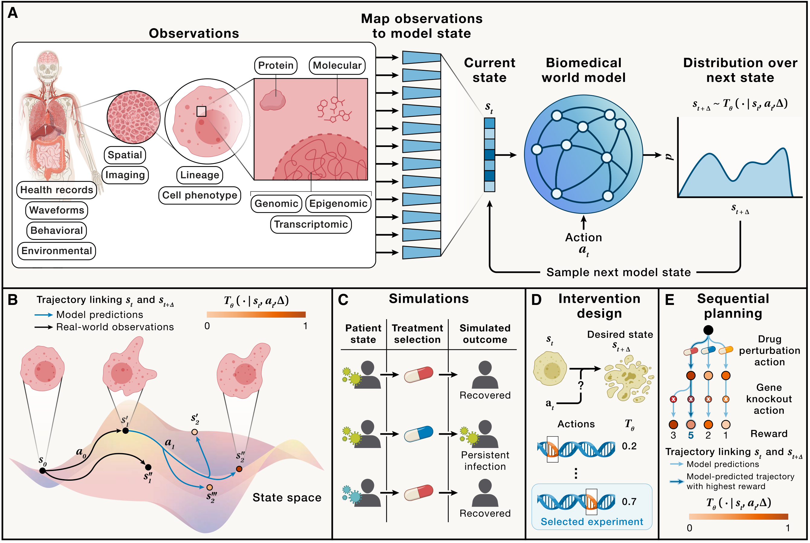
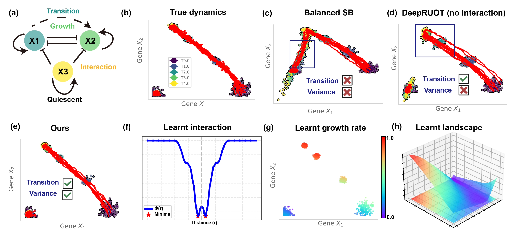
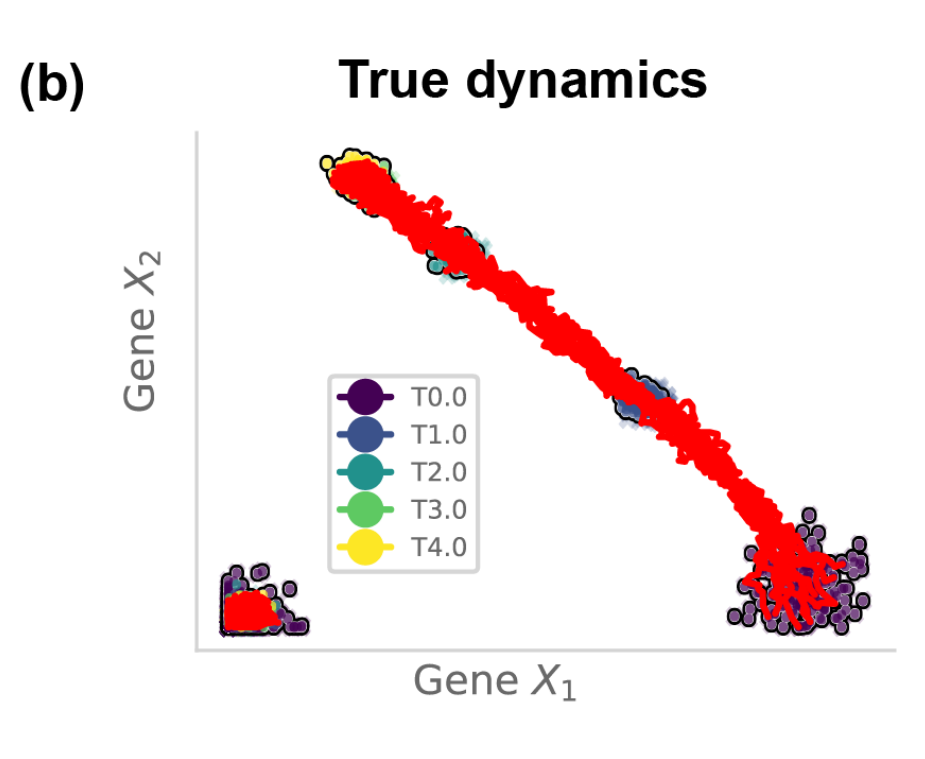
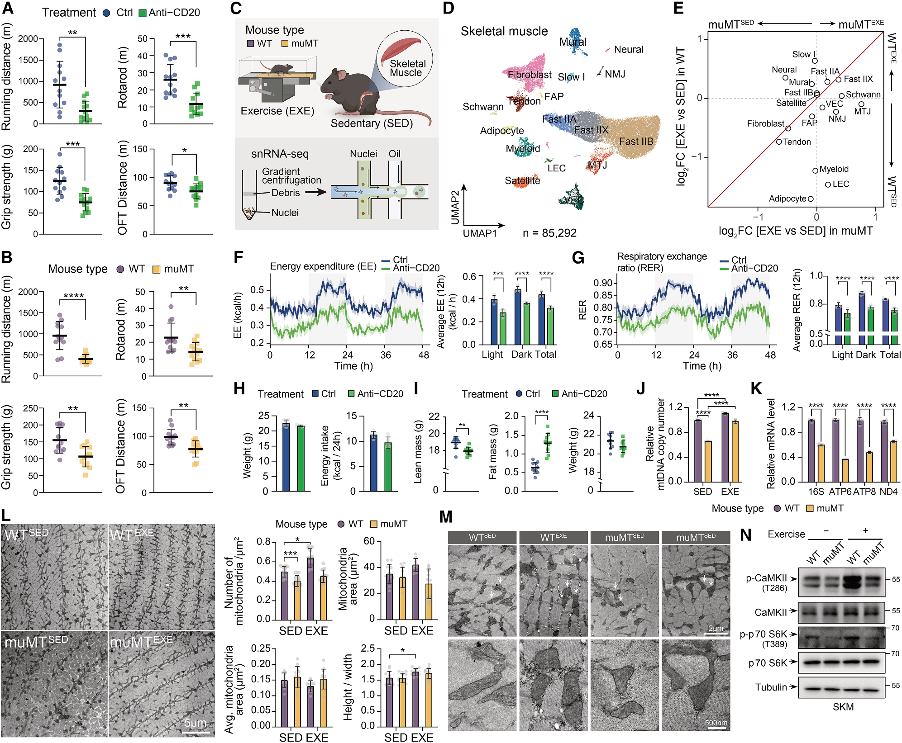
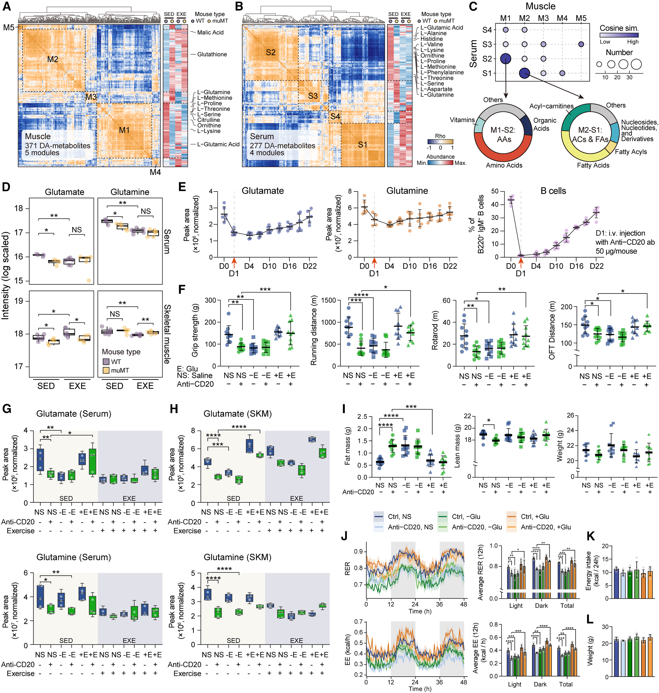
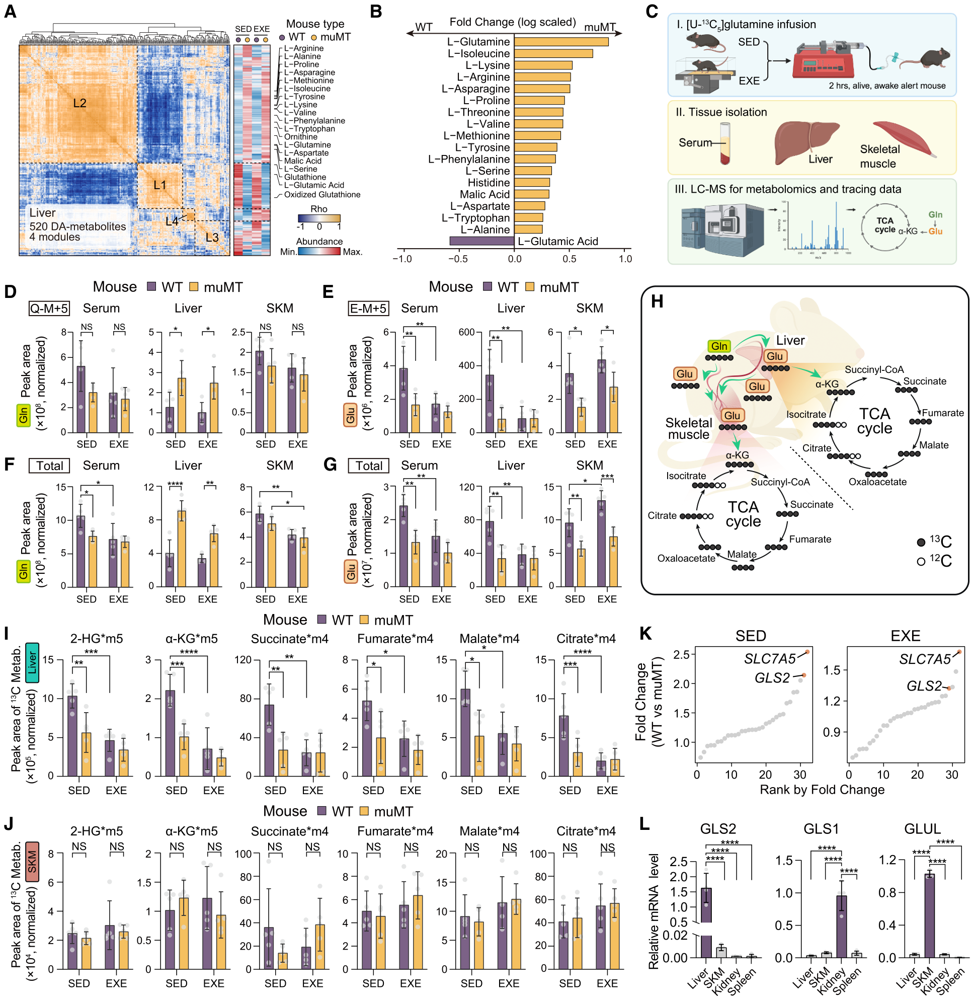
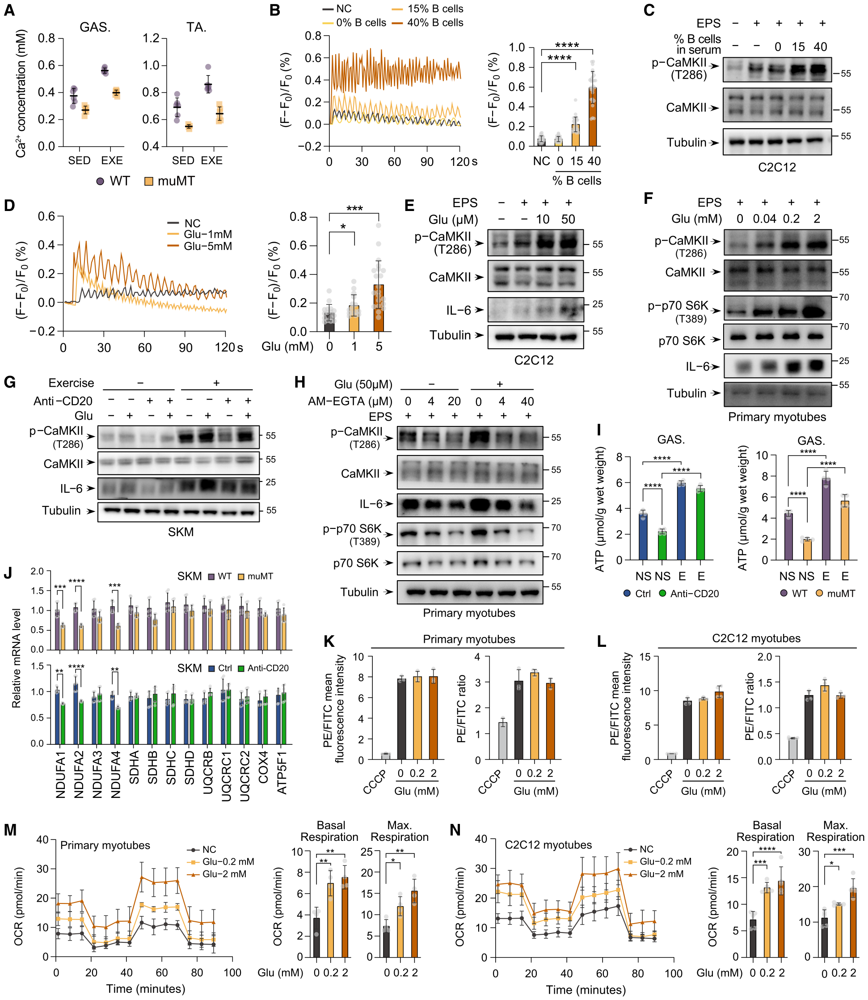
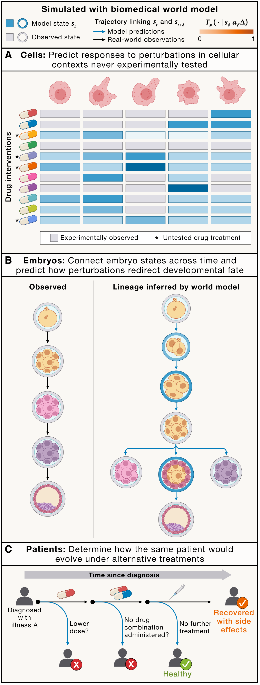
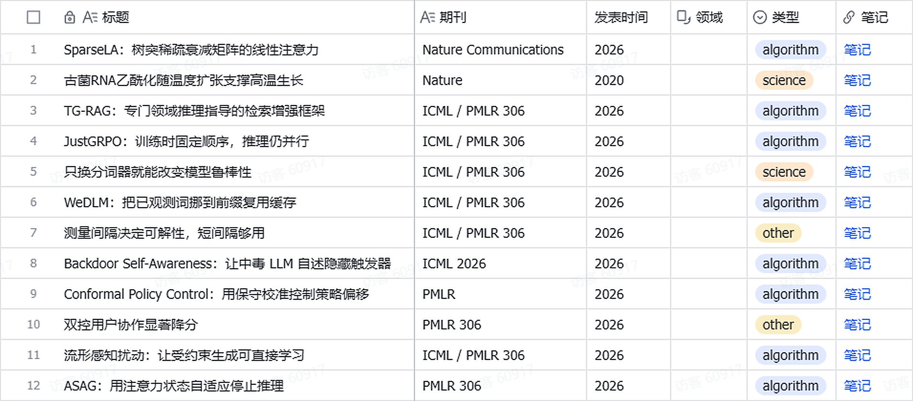

# 观潮 / SOUNDING


> **把论文读成可复述、可核对、可迁移的证据链。**
>
> Sounding 是一套交给 AI 执行的论文阅读与归档方法：先重建一篇论文的论证，再为多篇论文留下可比较的定位素材。它不把摘要写长，也不让模型凭一篇论文擅自判定“潮”、世代或学术地位。

[](#1-sounding-论文阅读法)
[](#3-如何使用)
[](#安装与配置)
[](#license)

## 为什么叫 Sounding

**Sounding 有「测深」之意。** 海洋测绘中，一次测深只告诉我们一个位置的深度；在不同位置反复测量，才能逐渐勾勒出海面之下的地形。我们把这种探索方式借来理解学术研究。

**测深，是向下读透一篇论文。** 从作者要解决的问题出发，追踪方法或发现、关键证据与论证边界，留下可复述、可核对的一个「测点」，而不是只停在摘要和结论。

**观潮，是横向理解一片领域。** 在大量独立而深入的单篇阅读之后，对照各个测点，观察研究问题、方法、证据与分歧如何连接和变化。我们不只看海面上此起彼伏的学术热点，更希望逐步摸清浪潮之下相对深层的研究脉络与问题本质。

封面上的每一条测线，都代表一次深入的单篇阅读；多个测点共同描出海床的轮廓。尚未测到的地方仍是未知：领域判断需要随着新证据修正，也由使用者确认，而不是由模型凭单篇论文自动定论。

## 先看这里

| 你要做什么 | Sounding 会交付什么 | 从哪里开始 |
| --- | --- | --- |
| **测深一篇论文** | 问题、方法／发现、证据、边界与原文定位 | [Sounding 论文阅读法](#1-sounding-论文阅读法) |
| **回顾一批论文** | 问题脉络、能力变化、证据分歧与待验证空白 | [观潮与多篇回顾](reference-wave.md) |
| **直接开始使用** | 文本模式或明确请求后的独立归档模式 | [如何使用](#3-如何使用) |

**阅读顺序：** 单篇先「测深」，多篇回顾再「观潮」；方向定位和待验证空白由使用者确认。

### 目录

- [为什么叫 Sounding](#为什么叫-sounding)
- [Sounding 论文阅读法](#1-sounding-论文阅读法)
- [效果展示](#2-效果展示)
- [如何使用](#3-如何使用)
- [安装与配置](#安装与配置)
- [文档导航](#文档导航)
- [License](#license)


## 1. Sounding 论文阅读法

Sounding 根据**论文的主要贡献和论证结构**，将文献分为四类；类型决定阅读骨架，不由期刊、会议或文章标题决定。

| 文献类型 | 主要看什么 | 阅读主线 | 读完要回答 |
| --- | --- | --- | --- |
| **方法／算法 `algorithm`** | 新方法如何工作，是否经得起比较 | 问题 → 灵感 → 方法与数据流 → 基线、消融与边界 | 它解决了什么，结果支持到哪里？ |
| **科学发现／机制 `science`** | 发现或机制由哪些实验共同支持 | 现象与问题 → 核心发现 → 子命题、对照和证据链 | 哪条证据支持哪一步，还剩什么替代解释？ |
| **综述／综合 `review`** | 作者如何组织既有研究、形成判断 | 范围 → 概念和文献组织 → 综合判断 → 评价主张与边界 | 作者提出了什么，依据和适用范围是什么？ |
| **其他 `other`** | Benchmark、数据集或立场主张采用什么口径 | 目标与惯例 → 覆盖范围 → 评价或数据质量 → 使用限制 | 这套资源或口径能回答什么，何时不适用？ |

### 先看结论靠什么立住

从摘要和引言里的贡献声明开始，按图序看原图与图注，再进入方法、实验和表格，最后回到相关工作核对缺口。我们按**论文实际的论证结构**选择读法，而不是按 Nature、NeurIPS 或文章章节标题套模板。

### 方法／算法论文：从为什么到怎么用

适用：论文的主要贡献是新模型、新算法或新架构，结论主要靠实验对比、消融与分析支撑。

1. **科学故事**：具体任务是什么，已有方法走到哪里，真正卡住的环节在哪里？
2. **灵感**：作者换了什么视角或假设，为什么可能有效，付出了什么代价？
3. **具体算法**：从输入、符号和模块到输出，把数据流、关键公式、训练目标及损失作用串起来。
4. **基线对比**：先说数据与划分，再解释指标、比较对象、结果和消融；检查公平性、失败情况及适用边界。

读完应能回答：**它解决的到底是什么，我能否复现、采用或改进？**

### 科学发现／机制论文：把证据链接起来

适用：论文提出一条新认识或机制，结论主要靠多条互补证据而不是单张算法榜单立住。

1. **现实痛点**：现象、已有解释和尚未解决的矛盾是什么？
2. **核心发现**：用一句能独立复述的话讲清新认识，它修正了哪条旧认识？
3. **证据链**：拆出关键子命题，逐项还原问题、设计、对照、结果、结论及排除／未排除的替代解释。

涉及生物实验时，核对 n 数的是什么、重复、检验、离散度、p 值对应的比较与多重比较校正；阴性结果和未报告事项不抹平。读完应能判断：**我能否引用这个结论，需要加什么限定？**

### 综述论文：重建作者的综合论证

适用：文章以组织和综合既有研究为主要贡献，包括叙述性综述、系统综述、Meta 分析和 Perspective；按原文实际目的读，不预设每篇都提出新范式。

1. **研究问题与范围**：作者要回答什么，涵盖哪些研究，采用什么类型的综合？
2. **概念界定与文献组织**：核心概念如何使用，作者按什么维度组织路线、案例与相邻概念？
3. **综合判断与依据**：作者归纳出哪些进展、争议和瓶颈，各由哪些研究及条件支撑？
4. **评价规约与研究议程**：若作者提出定义、指标或后续议程，分清建议、依据和适用范围；没有就如实说明。
5. **覆盖边界与使用**：哪些问题可以引用本文，哪些需要追溯原始研究或横向比较？

读完应能回答：**作者如何组织已有研究、形成什么判断、依据和边界是什么？** 综述转述、作者归纳与倡议、已独立核验的原始证据分开；单篇不自动判潮或把作者观点写成领域共识。

### Benchmark／数据集／立场论文：审视别人被要求遵守的口径

适用：主要贡献是评价基准、数据资源或一项应该被采用的主张，而不是提出算法或机制链。

1. **改变了什么惯例**：以前默认怎样做，现在要求谁改变什么？
2. **覆盖面与边界**：任务、样本、来源、纳排规则及潜在偏差是什么？
3. **评价方法本身**：指标定义及盲区、基线、划分和泄漏风险、标注质量与可复现性怎样？
4. **什么时候该用、不该用**：使用门槛、迁移风险、许可约束和引用限定是什么？

读完应能判断：**用这套口径比较或决策是否公平，它适不适合我的问题？**

### 每篇论文都会留下什么

- **十行速览**：正文定稿后最后写，放在正文前；沿正文相同结构，把每个关键部分浓缩成一句。
- **完整解读**：对应类型的主体不缩水；方法论文有符号、损失、数据与比较，科学论文有证据链和实验统计。
- **原文定位**：关键数字与判断附图表、公式、章节或 PDF 页码，未报告和不能确认的内容明确写出。
- **关系与待查**：依据实际可用材料说明与已读工作的关系，保留会改变理解或使用结论的具体问题。

始终区分“论文声称”“数据支持”和“读后的判断或待查”；不会把模型推断直接写成因果发现，也不会用速览代替正文。

## 2. 效果展示

### 单篇测深：三类论文案例

三种论证结构，各看**文本阅读**与**飞书归档**两种交付。先选择一篇，再展开需要的模式；每份文本都保留原图、出处和证据边界。

| 方法／算法 | 科学发现／机制 | 综述／Perspective |
| --- | --- | --- |
| <a href="examples/cytobridge/figures/figure-1.png"></a> | <a href="examples/b-cell-exercise/figures/graphical-abstract.png"></a> | <a href="examples/world-models/figures/fig1.png"></a> |
| **CytoBridge** · 细胞动力学与算法对照 | **B cell deficiency** · B 细胞—肝脏—肌肉证据链 | **World models** · 概念、评价与研究议程 |

<sub>点击缩略图查看原图。三篇论文的来源、图注及各自许可／版权说明分别见展开的文本案例；论文图片不因本仓库代码的 MIT License 而自动获得 MIT 授权。</sub>

<details>
<summary><strong>01｜方法／算法 · CytoBridge：从细胞快照重建动力学</strong></summary>

**论文：** [Modeling Cell Dynamics and Interactions with Unbalanced Mean Field Schrödinger Bridge](https://arxiv.org/abs/2505.11197v3) · NeurIPS 2025。

<details>
<summary><strong>📖 文本模式｜十行速览、方法与实验边界</strong></summary>

<!-- CYTOBRIDGE_TEXT_BEGIN -->

标题：CytoBridge：用带生长的群体力连接细胞快照<br>
发表：NeurIPS 2025<br>
类型：algorithm<br>
citekey：888cee66e7（按预印本 DOI 计算，仅用于演示）

### 十行速览

1. 多时刻单细胞快照可以用最优传输与随机桥连接，但增长、死亡和群体作用往往不能同时由既有轨迹模型显式表示（PDF 第 1–3 页）。
2. 本文瞄准的是非配对快照下同时拟合随机扩散、净增长／死亡和群体依赖运动，而不是直接证明细胞间的因果通信（PDF 第 2、4 页）。
3. 把细胞云转成带权互作粒子并以均场近似群体力，换来可计算的连续模型，也引入对状态距离、势函数及可辨识性的假设（PDF 第 4–6、10、17–18 页）。
4. CytoBridge 用速度、增长、标量对数密度和相互作用势四类网络，从不同时间的细胞矩阵生成带权轨迹与分布（PDF 第 5 页 Figure 1、§5）。
5. 模型以质量和分布匹配、密度一致性及能量近似联合训练，但能量上界和理论／实现的若干记号仍需核查（PDF 第 6–7、17–18 页）。
6. 主表是在所有可用时点参与训练后的拟合，另外仅对合成、鼠造血和胚状体做中间时间点留出，并以 $`W_1`$ 与总质量误差互补评估（PDF 第 20、22–23、28 页）。
7. 合成末时点 $`W_1`$ 为 $`0.038\pm0.003`$ 对 DeepRUOT $`0.057\pm0.003`$，鼠造血第一个时点的质量误差却为 0.208、高于 UOT-FM 的 0.100（PDF 第 8–9 页 Figure 2–3、Tables 1–2）。
8. 合成和鼠造血的留出结果支持时间插值，但不同基线的训练设置、实现方式及缺失的预算信息限制严格归因（PDF 第 20、22、28 页）。
9. 去增长和去质量项会损害合成实验，而无作用势、EMT、胰腺及速度／显存结果说明收益与成本依数据和假设而变，真实作用力尚无因果验证（PDF 第 21、23、25、27、29–30 页）。
10. 当前没有可核验的个人已读关系，代码中的记号与权重约定、数据预处理及独立生物验证仍待查。

---

## PDF 与来源

[打开公开论文原文（arXiv v3）](https://arxiv.org/pdf/2505.11197v3)；本示例未上传原始 PDF。

Zhenyi Zhang、Zihan Wang、Yuhao Sun、Tiejun Li、Peijie Zhou，**Modeling Cell Dynamics and Interactions with Unbalanced Mean Field Schrödinger Bridge**，NeurIPS 2025，arXiv:2505.11197v3。本文核对的是 34 页全文：正文 PDF 第 1–10 页，参考文献第 11–16 页，附录 A–F 第 17–34 页；Figure 1、2、3 分别位于 PDF 第 5、8、9 页，Table 1、2 分别位于第 8、9 页。首页直接写出论文标题、作者、版本号与会议；本示例不虚构 citekey 或个人文献库记录。

**原图与出处：** Figure 1–3 裁自 Zhang 等的 [arXiv v3 原文](https://arxiv.org/abs/2505.11197v3)，图注保持原文；裁剪与栅格化未改变图中文字。论文版本标注为 [CC BY-NC-SA 4.0](https://creativecommons.org/licenses/by-nc-sa/4.0/)，完整署名与修改说明见[图像来源](examples/cytobridge/figures/ATTRIBUTION.md)。

## 1 科学故事：分布能连起来，不等于增长与群体作用都被解释

单细胞测序常消耗细胞，因而跨时刻拿到的是不同细胞的样本云，而不是同一细胞的完整电影；单快照伪时间方法和依赖剪接／未剪接计数的 RNA velocity 解决的问题也不同。动态最优传输把不同时刻的细胞分布连接起来；Sha 等（2024）的 TIGON 等引入增长，Zhang 等（2025a）的 DeepRUOT 在无预设增长函数下处理随机性与非守恒质量；Tong 等（2024b）的 SF2M 则提供平衡随机桥，Atanackovic 等（2025）的 Meta FM 又使用初始群体的邻域信息。上述进展使从时间快照拟合生成性轨迹成为可能，但论文指出多数增长／随机轨迹模型没有把粒子之间显式、随群体分布变化的相互作用与非平衡增长同时建模；这些已有方法并不是都完全忽略邻域或群体信息（PDF 第 1–3、33–34 页，§1–3、§E）。

在作者比较的合成吸引实验中，较强的无相互作用 DeepRUOT 到第 4 个观测时点的 $`W_1=0.057\pm0.003`$，CytoBridge 为 $`0.038\pm0.003`$；这是特定模型和基准上的差距，不是所有真实数据均存在细胞通信的证明（PDF 第 8 页 Table 1）。本文补的是**从多时间快照拟合同时含随机扩散、净增长／死亡和群体依赖力的连续动力学**，不是直接测量配体—受体关系或证明某对细胞的因果通信。

**最笨的做法为什么不行。** 把各时刻细胞数都归一化后只连接概率分布，会把细胞净增长／死亡的信息排除出模型；将每个细胞当独立粒子又无法表达随邻居群体改变的漂移（后一句是根据模型比较作出的**推断**，PDF 第 2、4、7–8 页）。

## 2 灵感：让会增减的粒子共同塑造运动

把不同时间的细胞云看成会增减且彼此施力的粒子群。<br>
换来同时表述随机扩散、数量变化和群体影响的可解近似，代价是必须假设可由低维状态、所选距离与受限势函数概括相互作用，且单靠快照无法唯一确定真实机制。<br>
均场把邻居的总作用写成对当前群体密度的积分，再用带权粒子和随机分组近似这个积分，因此可以在不追踪每个真实细胞身份的情况下优化群体演化（PDF 第 4–6、10、17–18、31 页）。

## 3 具体算法：从非守恒均场桥到四个可训练函数

### 3.1 任务定义

输入是按真实采样时刻排序的未配对细胞状态矩阵 $`A_k\in\mathbb R^{n_k\times d}`$，每行是一细胞、每列是一基因或其降维坐标；正文把原始 $`d`$ 写成基因数，实际实验常先用 PCA，鼠造血和胚状体为 50 维，胰腺为 30 维。输入还包括各时刻相对细胞数量／质量，不要求同一细胞跨时刻的配对标签；训练约束来自已观测快照及其质量比。输出是速度、增长率、对数密度与相互作用势的参数化函数，可模拟状态、质量权重、分布和模型导出的向量场；中间真实轨迹通常不可得，不能把生成轨迹当作已观察到的细胞谱系（PDF 第 5–7、17–18、21–23 页）。

### 3.2 数据流骨架

多时刻细胞云 → 预处理降维 → 加权粒子 → 随机分组 → 速度与群体作用 → 状态及质量演化 → 匹配分布与总量 → 约束密度 → 联合训练。

### 3.3 图 1：四个函数如何协同

Figure 1 把多时间快照、细胞状态变化、增长／死亡和群体相互作用放在一个建模框架；这是一张方法总览图，不是证明真实细胞通信的实验图（PDF 第 5 页，§5）。

[](examples/cytobridge/figures/figure-1.png)

<sub>点击图片查看完整原图；来源与许可见[图像来源](examples/cytobridge/figures/ATTRIBUTION.md)。</sub>

Figure 1: Overview of CytoBridge.

中文：先看输入是多个时间点的细胞云，再看状态运动、权重增长和相互作用如何共同决定生成的下一时刻；图是方法关系概览，不能单独证明每个推断细胞作用是真实因果作用。

1. **状态与速度：** 每个样本 $`x_i(t)\in\mathbb R^d`$ 和时刻 $`t`$ 进入 $`v_\theta`$，得到 $`d`$ 维的概率流速度；它不是单独的总漂移，还要叠加群体力。
2. **增长与权重：** 同一 $`x_i,t`$ 进入 $`g_\theta`$ 得标量净增长率，数值积分 $`\dot w_i=g_\theta w_i`$ 得正权重；质量变化通过权重体现，并不要求训练模拟器把粒子字面复制或删除。
3. **相互作用：** 对批内 $`x_i-x_j\in\mathbb R^d`$ 求距离 $`d_{ij}`$，经 8 个径向基展开成 $`\mathbb R^8`$、再入网络得标量势，求关于 $`x_i`$ 的梯度得到 $`d`$ 维力；截断函数和其他粒子的权重共同确定力的聚合。
4. **密度与评分：** $`s_\theta(x,t)`$ 表示缩放后的**标量对数密度**，其空间梯度才对应缩放后的 score；密度及动力学一致性由物理约束训练。
5. **数据与目标：** 对所有粒子积分后得到 $`N\times d`$ 的预测状态和 $`N`$ 个正权重；将归一化的加权分布与实测细胞云匹配，同时拟合局部与总质量并约束动力学（PDF 第 5–7、17–18 页，§5、算法 1–2、§A.2–A.4）。

### 3.4 数学：理论对象、数值近似与训练目标

下表按下文首次使用顺序给出记号；归一化约定的差别单独说明，不把两套写法混为一谈。

| 符号 | 含义 | 类型／形状 |
| --- | --- | --- |
| $`t,T,x,y,d`$ | 时间、终点、两状态、状态维度 | 时间与维数为标量；$`x,y\in\mathbb R^d`$ |
| $`\rho(x,t),\nu_0,\nu_1`$ | 未必归一的细胞质量密度及起终密度 | 非负标量密度／测度 |
| $`b(x,t),g(x,t),\sigma(t)`$ | 随机漂移、净增长率、扩散系数 | $`b\in\mathbb R^d`$；$`g,\sigma\in\mathbb R`$ |
| $`k(x,y),\Phi(x-y)`$ | 相互作用权重与偶对称势 | 标量；$`\Phi(-z)=\Phi(z)`$ |
| $`I_\rho(x,t)`$ | 根据当前密度聚合的相互作用项 | $`\mathbb R^d`$ |
| $`\Psi,\alpha`$ | 增长代价及权重 | 标量函数、标量 |
| $`v,q`$ | 概率流速度、缩放后的密度 score | 均为 $`\mathbb R^d`$ |
| $`N,i,j,X_i,W_i,w_i`$ | 粒子数、粒子索引、状态、布朗运动、正质量权重 | $`X_i,W_i\in\mathbb R^d`$，$`w_i\gt 0`$ |
| $`\mu_t^N,\delta_{X_i}`$ | 理论加权经验测度及点质量 | 测度 |
| $`\theta,v_\theta,g_\theta,s_\theta,\Phi_\theta`$ | 网络参数及速度、增长、缩放对数密度、势网络 | 参数集合；输出依次为 $`\mathbb R^d,\mathbb R,\mathbb R,\mathbb R`$ |
| $`d_{ij},d_{\rm cutoff},K,\beta_\ell,\mu_\ell,e_\ell`$ | 配对距离、截断距离、径向基数、宽度、中心与特征 | 标量；$`\ell=1,\ldots,K`$ |
| $`p,\tau,C_p`$ | 随机组大小、积分步长和该组索引集 | 整数、正标量、集合 |
| $`\widetilde v_i`$ | 含群体作用的概率流速度 | $`\mathbb R^d`$ |
| $`A_k,\widehat A_k,n_k,h_k`$ | 第 $`k`$ 次观测、预测粒子、该时刻细胞数、最近粒子映射 | 矩阵／点集、整数、映射 |
| $`M_k,G_k,\widehat w^k,\bar w(t_k)`$ | 局部质量误差、全局质量误差、观测均匀权重、归一化预测权重 | 两标量、两个 $`N`$ 维向量 |
| $`\mathcal L_{\rm energy},\mathcal L_{\rm mass},\mathcal L_{\rm OT},\mathcal L_{\rm recons},\mathcal L_{\rm FP}`$ | 能量、质量、分布、重建、密度一致性目标 | 标量 |
| $`\lambda_m,\lambda_d,\lambda_r,\lambda_f,\lambda_w`$ | 各目标和初始密度约束权重 | 标量 |
| $`p_0,\lambda_s,\epsilon`$ | 初始密度、score 初始化权重、高斯噪声 | 密度、标量、$`\epsilon\sim\mathcal N(0,I_d)`$ |

**理论 UMFSB。** 令 $`I_\rho(x,t)=\int k(x,y)\nabla_x\Phi(x-y)\rho(y,t)\,dy`$，作者优化漂移与增长成本

$`\displaystyle \inf_{\rho,b,g,\Phi}\int_0^T\!\int\left[\tfrac12\|b\|_2^2+\alpha\Psi(g)\right]\rho\,dx\,dt,`$

受起终密度和下式约束：

$`\displaystyle \partial_t\rho=-\nabla_x\!\cdot[(b-I_\rho)\rho]+\tfrac{\sigma(t)^2}{2}\Delta\rho+g\rho.`$

这里 $`g\gt 0`$ 是净增长、$`g\lt 0`$ 是净死亡／质量减少；这是作者为细胞增长和死亡引入的**源汇反应**，不是把任意群体漂移都称为增长。$`k=0`$ 回到无相互作用的正则非平衡传输，强制 $`g=0`$ 则得到守恒均场桥。Definition 4.1 的目标未显式写 $`\alpha`$，Theorem 4.1 又加入该系数；以上写法沿用定理记号，复现需确认权重约定（PDF 第 4 页，Definition 4.1、Theorem 4.1；第 31 页 §D.1）。

令 $`q=\tfrac12\sigma(t)^2\nabla_x\log\rho`$、$`v=b-q`$，则连续性方程变为 $`\partial_t\rho=-\nabla\cdot[(v-I_\rho)\rho]+g\rho`$，而精确的重新参数化能量被写作

$`\displaystyle \int_0^T\!\int\left[\tfrac12\|v\|^2+\tfrac12\|q\|^2+\langle v,q\rangle+\alpha\Psi(g)\right]\rho\,dx\,dt.`$

它与原式的关系是 $`b=v+q`$；这把随机扩散方程转成需要 score 的确定性概率流方程，并没有消除原问题的随机性（PDF 第 4 页式 (3)–(4)、Remark 4.1）。

**粒子近似。** 理论命题给出

$`\displaystyle dX_i=\left[b(X_i,t)-\tfrac1{N-1}\sum_{j\ne i}k(X_i,X_j)w_j\nabla_{X_i}\Phi(X_i-X_j)\right]dt+\sigma(t)dW_i,\qquad \dot w_i=g(X_i,t)w_i.`$

对应概率流 ODE 用 $`v`$ 代替 $`b`$ 并去掉布朗项；理论测度写成 $`\mu_t^N=N^{-1}\sum_iw_i(t)\delta_{X_i(t)}`$，理论初始 $`w_i(0)=1`$。附录 D.1 **假设**经验测度收敛及类似 propagation-of-chaos 的极限，且要求 $`k`$、$`\nabla\Phi`$ 等有界／Lipschitz；这不是对所有神经网络和截断核的无条件收敛证明。实际训练叙述则采用 $`w_i(0)=1/N`$、以权重之和表示质量；正文重建段的群体速度公式还省略了命题中的 $`w_j`$，因此不能无条件把理论系数直接照搬为实现，需查代码确认尺度及归一化（PDF 第 5–6、31–33 页，Proposition 5.1、§D.2）。

**作用势和随机分组。** $`d_{ij}=\|x_i-x_j\|_2`$，$`e_\ell(d)=\exp[-\beta_\ell(e^{-d}-\mu_\ell)^2]`$，$`\Phi_\theta=\mathrm{NN}(e_1,\ldots,e_K)`$，$`K=8`$；$`k=\mathbf1[d_{ij}\lt d_{\rm cutoff}]`$。这让势受状态距离支配，而非直接建立分子或空间上的因果配体—受体边。每步将 $`N`$ 个粒子随机分组，每组 $`p`$ 个、只对组内求和并用 $`1/(p-1)`$ 缩放，运算由 $`O(N^2)`$ 降至 $`O((p-1)N)`$；作者引用在特定条件下随步长 $`\tau`$ 有 $`O(\sqrt\tau)`$ 的分布逼近。理论要求光滑核而实验的硬截断在阈值处不连续，因此其理论假设对实践设置并非自动成立（PDF 第 5–6、17–18、28–29、31 页，§5.1、算法 1、§A.3、§C.2、假设 D.1）。

**完整训练目标。** 实验使用常数 $`\sigma`$、$`\Psi(g)=g^2`$，联合训练

$`\displaystyle \mathcal L=\mathcal L_{\rm energy}+\lambda_r\mathcal L_{\rm recons}+\lambda_f\mathcal L_{\rm FP},\quad \mathcal L_{\rm recons}=\lambda_m\mathcal L_{\rm mass}+\lambda_d\mathcal L_{\rm OT}.`$

局部质量把每个目标时刻样本分配给最近的预测粒子，记映射为 $`h_k`$；原文的局部和全局误差为

$`\displaystyle M_k=\sum_{i=1}^{N}\left|w_i(t_k)-\tfrac{n_k}{Nn_0}\operatorname{card}h_k^{-1}(x_i(t_k))\right|^2,\quad G_k=\left|\sum_iw_i(t_k)-\tfrac{n_k}{n_0}\right|^2.`$

$`\mathcal L_{\rm mass}=\sum_k(M_k+G_k)`$；$`\mathcal L_{\rm OT}=\sum_kW_2(\widehat w^k,\bar w(t_k))`$，比较的实际对象是具有对应观测／预测坐标、分别带均匀／归一化权重的经验测度，论文借 Sinkhorn 实现。密度网络给 $`\rho_\theta=\exp(2s_\theta/\sigma^2)`$，则

$`\displaystyle \mathcal L_{\rm FP}=\|\partial_t\rho_\theta+\nabla\!\cdot(\rho_\theta\widetilde v_\theta)-g_\theta\rho_\theta\|+\lambda_w\|\rho_\theta(\cdot,0)-p_0\|.`$

这分别防止只匹配形状却丢失总量、只匹配总量却放错状态区域，以及四个网络相互不一致；若去掉质量项或 FP 项，合成数据消融见下节 Table 15，但原文**未单独消融** $`M_k`$、$`G_k`$、$`W_2`$ 或初始密度边界项。质量匹配把样本计数比作为质量目标，采样效率／测序捕获偏差是否可忽略需另外验证（PDF 第 6–7、17–18 页，§5.2、算法 2、§A.1、§A.4）。

作者没有直接优化上述精确能量，而将交叉项改成范数乘积并称为上界；附录 A.5、算法 2 印出的粒子期望形式是

$`\displaystyle \mathcal L_{\rm energy}=\mathbb E_{x_0\sim\rho_0}\int_0^T\!\left[\tfrac12\|v_\theta\|^2+\tfrac12\|\nabla_xs_\theta\|^2+\|v_\theta\|\,\|s_\theta\|+\alpha\Psi(g_\theta)\right]\exp\!\left(\int_0^t g_\theta(x(u),u)du\right)dt.`$

式中指数是沿轨迹累计的相对增长权重；论文在此处用 $`s_\theta`$ 而非 $`\nabla s_\theta`$，故此式是**原文转录，不是已核实的正确代码实现**。必须保留原文的一个记号歧义：$`s_\theta`$ 前面定义为标量缩放对数密度，理论式交叉项应涉及 $`\nabla s_\theta`$，但 PDF 第 6 页写 $`\langle v_\theta,s_\theta\rangle`$，第 18 页 §A.5 与算法 2 写 $`\|v_\theta\|\,\|s_\theta\|`$，同时二次项却写 $`\|\nabla s_\theta\|^2`$；仅凭论文无法断言代码究竟用哪一个，亦不能把这个上界等同于精确求解 UMFSB。算法 2 的总损失行也省略了正文中显式出现的 $`\lambda_f`$；这些都需代码核对，而不是在笔记中自行改写成“已证实实现”（PDF 第 4、6–7、17–18、30 页）。

**两阶段优化而非单次黑盒拟合。** ① 预训练 $`v_\theta,g_\theta`$：不加相互作用，用局部质量与分布匹配初始化；② 固定增长并更新速度与 $`\Phi_\theta`$，只用分布匹配细化；③ 由最优传输样本对构造布朗桥，按条件 score matching 初始化 $`s_\theta`$，目标写作 $`\|\lambda_s(t)\nabla s_\theta+\epsilon\|^2`$，其中 $`\lambda_s=2\sqrt{t(1-t)}/\sigma`$；④ 对初始样本拟合高斯混合密度 $`p_0`$，联合优化四个函数与以上全部目标，使用神经 ODE 求解及 Sinkhorn 传输。作者的算法 2 实际在第二步更新 $`v_\theta,\Phi_\theta`$，不是只训练势网络（PDF 第 6–7、17 页，算法 2、§A.1–A.2）。

**超参／复现坑。** 表 19 给预训练 $`\lambda_m,\lambda_d=(0.01,1)\to(0,1)`$，训练时 $`\lambda_m=\lambda_d=1`$、$`\lambda_r=10^3,\lambda_f=10^4,\lambda_w=10`$；合成／鼠造血／胚状体／胰腺／EMT／斑马鱼的 $`d_{\rm cutoff}`$ 分别为 0.5／300／100／100／2／0.3，主训练轮数分别为 200／1000／500／500／200／500，默认分组 $`p=16`$。原文称对真实 scRNA-seq 取足够大截断覆盖所有对，斑马鱼则用物理空间邻域；实际基因过滤、归一化、数据具体拆分、网络层数及随机种子仍需查实现（PDF 第 28–30 页，§C.2 与 Table 19）。

### 3.5 贡献边界

新意是把非守恒增长、随机桥和群体作用合成 UMFSB 理论框架，并设计学习未知增长／势及对应带权粒子训练的 CytoBridge；不是首次提出最优传输、均场、神经 ODE、径向基、随机分组、Sinkhorn 或条件 score matching。势函数限制、随机分组、预训练、损失权重与 GMM 都是使优化可运行的具体假设／工程选择，不应与框架本身混同（PDF 第 2–7、17–18 页）。

## 4 基线对比：先看预测对象，再看数字

### 4.1 数据、划分与任务

| 数据／任务 | 来源与规模 | 训练、评测与边界 |
| --- | --- | --- |
| 合成三基因调控 | 自激、互抑、外激、噪声和 $`X_2`$ 相关分裂；记录原始时间 0、8、16、24、32；另造吸引、Lennard–Jones 式及无相互作用三种情形 | Table 1 为全部时点参与训练后的 $`t=1`$–4 拟合；Table 4 分别留出中间 $`t=1,2,3`$ 重训并评测；原文未给全部初始细胞数与分组种子，不能外推更大规模（PDF 第 7–8、19–21、28 页） |
| 鼠造血 | Weinreb 等（2020），49,302 个细胞、3 时点、50 PC，体外祖细胞培养，含谱系追踪数据 | Table 2 是训练时点拟合；Table 7 留出唯一中间时点；Fig. 3 的 2D UMAP 为可视化而非 50D 输入；无法由分布指标推出单细胞真实谱系完全正确（PDF 第 8–9、21–22、28–30 页） |
| 人胚状体 | Moon 等（2019），16,819 个细胞、5 时点、50 PC，3D 培养、27 天 | Table 9 全时点训练；Table 10 实际列出 3 个中间留出时点，正文却说四个，存在原文数量不一致；100 PC 另作规模测试（PDF 第 22–23、30 页） |
| 人胰腺 β 样分化／A549 EMT | 胰腺 51,274 细胞、8 时点、30 PC；EMT 4 时点，TGFB1 诱导 | Table 11、12 为全时点训练拟合；胰腺具体划分及 EMT 细胞数原文未报告（PDF 第 23–25、28 页） |
| 斑马鱼空间转录组 | ZESTA 六时点中选择 5.25 与 10 hpf，表达 50 PC，空间配准后共同建模 | 比较空间和表达分布；该两时点任务不构成未见时间点外推证据，所用细胞数／切片间独立重复原文未报告（PDF 第 26–28 页） |

一般设置用全部可用时间点训练并在这些时点评估；只对合成吸引、鼠造血和胚状体另做逐一留出中间时间点实验。模型无法据此证明超出观测窗口的长期预测、跨供体泛化、OOD 最坏情况或经实验证实的逐细胞配对准确率（PDF 第 28 页 §C.1；原文未测）。

### 4.2 指标先于表

- $`W_1\downarrow`$：预测和观测**归一化经验分布**之间，以欧氏距离为搬运成本的最小平均搬运距离；评估时由初始点演化并使用预测权重，POT 实现。它衡量状态分布形状而非细胞总量，因此单独看可能掩盖错误的增殖。
- TMV $`\downarrow`$：$`\left|\sum_iw_i(t_k)-n_k/n_0\right|`$，衡量预测总权重与观测相对细胞数的绝对差；它反过来不保证细胞出现在正确状态，必须与 $`W_1`$ 联读。
- 以下主表每格为 **$`W_1`$ / TMV**，均为 5 次运行的均值 ± 1 个标准差，不是置信区间；部分基线显示 0.000 仅表示表中精度下四舍五入，不代表严格无波动（PDF 第 8–9、28 页）。

### 4.3 主表：全部拟合时点，不偷换留出测试

**合成吸引数据，$`\sigma=0.05`$，PDF 第 8 页 Table 1。**

| 模型 | $`t=1`$ | $`t=2`$ | $`t=3`$ | $`t=4`$ |
| --- | --- | --- | --- | --- |
| SF2M | 0.146±0.002 / 0.080±0.000 | 0.320±0.004 / 0.250±0.000 | 0.447±0.005 / 0.515±0.000 | 0.554±0.005 / 0.930±0.000 |
| Meta FM | 0.149±0.000 / 0.080±0.000 | 0.241±0.000 / 0.250±0.000 | 0.288±0.000 / 0.515±0.000 | 0.404±0.000 / 0.930±0.000 |
| MMFM | 0.101±0.000 / 0.080±0.000 | 0.223±0.000 / 0.250±0.000 | 0.438±0.000 / 0.515±0.000 | 0.366±0.000 / 0.930±0.000 |
| Metric FM | 0.319±0.000 / 0.080±0.000 | 0.751±0.000 / 0.250±0.000 | 0.690±0.000 / 0.515±0.000 | 0.614±0.000 / 0.930±0.000 |
| UOT-FM | 0.051±0.000 / **0.010±0.000** | 0.058±0.000 / 0.036±0.000 | 0.060±0.000 / 0.044±0.000 | 0.054±0.000 / 0.095±0.000 |
| MIOFlow | 0.315±0.000 / 0.080±0.000 | 0.387±0.000 / 0.250±0.000 | 0.483±0.000 / 0.515±0.000 | 0.518±0.000 / 0.930±0.000 |
| uAM | 0.489±0.000 / 0.081±0.000 | 0.995±0.000 / 0.033±0.000 | 1.402±0.000 / 0.459±0.000 | 1.655±0.000 / 1.516±0.000 |
| UDSB | 1.131±0.009 / 0.018±0.006 | 1.489±0.018 / 0.135±0.014 | 1.455±0.022 / 0.447±0.011 | 0.543±0.015 / 1.018±0.035 |
| TIGON | 0.169±0.000 / 0.097±0.000 | 0.184±0.000 / 0.165±0.000 | 0.167±0.000 / 0.210±0.000 | 0.179±0.000 / 0.384±0.000 |
| DeepRUOT | 0.044±0.002 / 0.014±0.007 | 0.045±0.002 / 0.026±0.018 | 0.053±0.002 / 0.059±0.032 | 0.057±0.003 / 0.075±0.044 |
| CytoBridge | **0.015±0.001** / 0.013±0.009 | **0.014±0.001 / 0.021±0.024** | **0.018±0.002 / 0.043±0.041** | **0.038±0.003 / 0.058±0.061** |

CytoBridge 四个时点的 $`W_1`$ 均为表中最低；但 $`t=1`$ 的最佳 TMV 是 UOT-FM 的 0.010 而非 CytoBridge 的 0.013，不能照搬正文“两个指标均最佳”。多数 TMV 的标准差很大，特别是 $`t=4`$ 的 $`0.058\pm0.061`$ 对 DeepRUOT $`0.075\pm0.044`$ 有明显重叠，不能仅凭均值称差异显著。

Figure 2 先给出已知的三基因机制与真实运动，再依次比较平衡桥、无显式相互作用的非平衡桥以及 CytoBridge；仅在这种有构造真值的模拟中，势函数／增长率恢复可以和真值进行直接比较（PDF 第 7–8 页）。

[](examples/cytobridge/figures/figure-2.png)

<sub>点击图片查看完整原图；来源与许可见[图像来源](examples/cytobridge/figures/ATTRIBUTION.md)。</sub>

**Figure 2 局部放大：** 依次为原文 (b) 的真实轨迹和 (e) 的模型轨迹；均为原图裁切，点击可查看完整尺寸。

<a href="examples/cytobridge/figures/figure-2b-detail.png"></a> <a href="examples/cytobridge/figures/figure-2e-detail.png"></a>

Figure 2: (a) Illustration of the synthetic gene regulatory dynamics. (b) The ground truth cellular dynamics project on (X1, X2). The red lines indicate the ground truth trajectories of cells in (b), or inferred trajectories of cells in (c) to (e). (c) The dynamics learned by balanced Schrödinger bridge SF2M (Tong et al., 2024b). (d) The dynamics learned by DeepRUOT. (e) The dynamics learned by CytoBridge. (f) The learned interaction potential. (g) The growth rates inferred by CytoBridge. (h) The constructed landscape at t = 4. The z-axis represents the density of cells.

中文：先对照 (b) 的模拟真值与 (c)–(e) 的预测轨迹，再看 (f)–(h) 的势、增长与景观；图显示给定合成机制下的可恢复性，不证明真实生物数据中的作用力已被独立验证。

**鼠造血，$`\sigma=0.1`$，PDF 第 9 页 Table 2。**

| 模型 | $`t=1`$：$`W_1`$ / TMV | $`t=2`$：$`W_1`$ / TMV |
| --- | --- | --- |
| SF2M | 8.217±0.001 / 2.231±0.000 | 11.086±0.002 / 5.399±0.000 |
| Meta FM | 8.545±0.000 / 2.231±0.000 | 10.313±0.000 / 5.399±0.000 |
| MMFM | 7.647±0.000 / 2.231±0.000 | 10.156±0.000 / 5.399±0.000 |
| Metric FM | 7.788±0.000 / 2.231±0.000 | 11.449±0.000 / 5.399±0.000 |
| UOT-FM | 8.114±0.000 / **0.100±0.000** | 9.170±0.000 / 0.118±0.000 |
| MIOFlow | 6.313±0.000 / 2.231±0.000 | 6.746±0.000 / 5.399±0.000 |
| uAM | 7.537±0.000 / 2.875±0.000 | 9.762±0.000 / 5.670±0.000 |
| UDSB | 10.687±0.058 / 0.282±0.146 | 13.477±0.053 / 3.010±0.225 |
| TIGON | 6.140±0.000 / 1.234±0.000 | 6.973±0.000 / 2.083±0.000 |
| DeepRUOT | 6.052±0.002 / 0.200±0.001 | 6.757±0.006 / 0.260±0.007 |
| CytoBridge | **6.013±0.002** / 0.208±0.001 | **6.644±0.011 / 0.078±0.013** |

$`t=1`$ 的 $`W_1`$ 比最佳无显式作用的 DeepRUOT 低 0.039，但 TMV 0.208 高于 DeepRUOT 0.200，更高于最佳 UOT-FM 0.100；$`t=2`$ 的 $`W_1`$ 比 DeepRUOT 低 0.113，TMV 也更低。数值上的差不等于实验独立重复的显著性或相互作用机制的因果验证。

Figure 3 将造血数据中的速度、增长、score 和速度—作用力相关性投影到 UMAP；可视化向量经过 scVelo 的投影，不是直接测得每个细胞的真实受力（PDF 第 9、30 页）。

[](examples/cytobridge/figures/figure-3.png)

<sub>点击图片查看完整原图；来源与许可见[图像来源](examples/cytobridge/figures/ATTRIBUTION.md)。</sub>

Figure 3: Application in mouse blood hematopoiesis data (σ = 0.1), visualized in UMAP space. (a) The overall velocity learned by CytoBridge. (b) The growth rates learned by CytoBridge. (c) The score function learned by CytoBridge at t = 2. (d) The correlation of velocity and interacting forces.

中文：先看预测的分化方向和增长强弱，再看不同状态附近的 score 与模型内力—速度相关性；这些图展示的是拟合模型的解释，不等于已识别或干预验证的细胞间通信。

**真正的留出。** 合成 $`t=1,2,3`$ 的 $`W_1`$：CytoBridge 依次为 $`0.182\pm0.001`$、$`0.064\pm0.004`$、$`0.043\pm0.002`$，DeepRUOT 为 $`0.184\pm0.001`$、$`0.086\pm0.004`$、$`0.079\pm0.003`$；鼠造血留出中间时点为 $`6.847\pm0.003`$ 对 $`6.868\pm0.003`$。这是更直接的插值证据，首个合成时点仅差 0.002，且留出表只报 $`W_1`$，不支持对未见时点质量预测同样优秀的结论（PDF 第 19–20、22 页 Tables 4、7）。胚状体 Table 9 在 $`t=1`$ 的 $`W_1`$ 与 DeepRUOT 同为 $`8.159\pm0.002`$；其 $`t=3`$ TMV 为 $`0.175\pm0.007`$，劣于 DeepRUOT 的 $`0.005\pm0.005`$，因此优势并非全指标普遍存在（PDF 第 23 页）。

### 4.4 对照与公平性三查

**同条件：** 作者说原论文已覆盖的数据集沿原默认设置，其他数据集调整网络规模使参数量相当并调轮数与学习率；SF2M 扩散系数匹配本文，DeepRUOT 同评估流程但无相互作用，TIGON 为避免不稳定重新实现，uAM 用默认参数。UDSB 的默认设置只支持三时点，在合成／胚状体使用 $`t=0,2,4`$，并未参加合成留出表；不同可用时间点、重新实现与未逐一列出的调参预算妨碍把全部差值唯一归因于作用项（PDF 第 19、28 页 §B.1、§C.1）。

**指标与基线：** 同表采用 $`W_1`$/TMV，平衡模型以均匀权重评估且不能恢复增长；Meta FM 已建模初始群体邻域，不应把所有基线说成没有任何群体信息。论文未完整报告每个模型的参数量、搜索空间、最佳超参、重复种子与逐运行配对结果，因此无法独立确认完全等预算或显著性（PDF 第 2、28 页）。

**消融与反例：** 合成吸引 $`t=4`$，完整方法 $`W_1=0.038\pm0.003`$、TMV $`0.058\pm0.061`$；去增长为 $`0.480\pm0.018`$、$`0.930\pm0.000`$，去质量项为 $`0.047\pm0.005`$、$`0.689\pm0.046`$，去预训练为 $`1.451\pm0.004`$、$`0.168\pm0.081`$；去 FP 为 $`0.039\pm0.004`$、$`0.063\pm0.058`$，但其 $`t=1`$ 的 $`W_1=0.014\pm0.000`$ 反而优于完整模型的 $`0.015\pm0.001`$，不能声称每个点都获益。去 score 初始化／仅预训练分别为 $`0.039\pm0.003`$／$`0.108\pm0.002`$（均为 $`t=4`$ 的 $`W_1`$）；无作用势的合成数据，$`t=4`$ CytoBridge $`0.052\pm0.003`$ 劣于 DeepRUOT $`0.046\pm0.002`$（PDF 第 21、27 页 Tables 6、15）。

### 4.5 扩展、成本与失效边界

- 胰腺 Table 11 按印出的均值，CytoBridge 七个时间点中有 **4 个更低、1 个相同、2 个更高**，而正文称 5/7 改善；例如 $`t=1`$ 为 $`8.0448\pm0.0005`$ 对 $`8.0447\pm0.0005`$，差异远小于所报标准差，故保留表格事实及文字冲突。EMT 的 $`t=1,2,3`$ 为 0.240／0.259／0.269，DeepRUOT 为 0.239／0.253／0.261；Table 12 未报告离散度，不能由此推断真实作用为零（PDF 第 23、25 页 Tables 11–12）。
- 斑马鱼空间／基因 $`W_1`$ 为 0.035／4.712；比较者中空间次优 uAM 为 0.177，基因次优 MIOFlow 为 4.720，Table 13 **未给标准差**；空间输入及配准和单纯表达状态任务不同（PDF 第 26 页）。
- 随机分组 $`p=16`$ 在模拟中的时间 0.115 s、显存 1.7 GB；不分组 0.568 s、22.1 GB，末时刻 $`W_1`$ 分别 0.038 和 0.029，说明加速伴有精度差异，不是免费提升。100 PC 胚状体实验中 CytoBridge 11 分 26 秒、6.3 GB，DeepRUOT 10 分 17 秒、3.7 GB；这是 A100、特定实验的比较，未测试无限维扩展（PDF 第 28–30 页 Tables 18、20）。
- 截断距离太小可使合成 $`t=4`$ 的 $`W_1`$ 从 $`d_{\rm cutoff}=0.5`$ 的 $`0.038\pm0.003`$ 升至 0.1 的 $`0.167\pm0.003`$；因此距离尺度／预处理变动会直接改变邻居与结论（PDF 第 29 页 Table 16）。
- 作者自己列出的限制包括只优化能量上界、径向基势的表达能力、复杂多阶段训练、没有配体—受体先验、尚无免模拟训练；另有计数能否代表实际生长、快照下可辨识性及硬截断理论假设问题。论文没有提供干预实验去验证被推断作用为因果细胞通信（PDF 第 10、17–18、28、31 页）。

### 4.6 收口

当问题确实是**多时刻未配对快照**，且希望同时拟合质量变化和由群体状态调制的运动时，CytoBridge 是值得与无相互作用基线并列检验的生成性建模选项；要用于生物机制，应先检验质量采样偏差、留出时间和无作用对照，再用独立空间、谱系或扰动实验验证，而不是把力场图直接当作机制发现。

## 与已读的关系

未提供可用的已读论文库或阅读记录；因此**无法判断与个人已读的关系**，这里对 DeepRUOT、SF2M 等仅是本文基线的文内对照，并非声称它们已被读者读过。

## 待查

- **实现与补充材料：** 查 CytoBridge 代码中的能量交叉项究竟使用 $`s_\theta`$ 还是 $`\nabla s_\theta`$、交互聚合中的 $`w_j`$ 与 $`1/N`$ 归一化；核实算法 2 缺失的 $`\lambda_f`$ 是否由实现补入。
- **实现与补充材料：** 查各数据集预处理、网络层数、随机种子、训练／留出脚本和胚状体留出时点数量；对照 Table 11 和正文 5/7 的不一致。
- **影响结论但未给出的量：** 每个真实数据集的绝对细胞捕获率、独立生物重复数及跨供体／跨批次留出误差；缺少这些不能断言估计的质量变化是体内真实增长或可跨实验泛化。
- **影响结论但未给出的量：** 多个同样拟合快照的势函数是否可区分、可用于验证的配体—受体或扰动效应量及其不确定度；缺少这些不能把统计上拟合的作用力定位为具体可干预的细胞通信。

**定位待补：** 尚无用户研究方向、已读清单或项目约束，暂不分配研究波次、项目角色或优先级。

<!-- CYTOBRIDGE_TEXT_END -->

</details>

<details>
<summary><strong>🗂️ 云端归档模式｜真实飞书单篇笔记</strong></summary>

<!-- CYTOBRIDGE_ARCHIVE_BEGIN -->

**飞书笔记：** [打开 CytoBridge 单篇笔记](https://rcntgteigkrr.feishu.cn/docx/URpEd790XomUL2xLiA2cVmnJnoc)。

> 这篇单篇笔记为持链接可读。

<!-- CYTOBRIDGE_ARCHIVE_END -->

</details>

</details>

<details>
<summary><strong>02｜科学发现／机制 · B 细胞、肝代谢与小鼠运动能力</strong></summary>

**论文：** [B cell deficiency limits exercise capacity by remodeling liver glutamate metabolism](https://doi.org/10.1016/j.cell.2026.03.039) · Cell 2026。

<details>
<summary><strong>📖 文本模式｜十行速览、逐图证据链与实验边界</strong></summary>

<!-- BCELL_TEXT_BEGIN -->

标题：B细胞缺失重塑肝脏谷氨酸代谢并限制小鼠运动能力

发表：Cell (2026)

类型：science

citekey：8660add44f

## 十行速览

1. 现实问题：去除 B 细胞可治疗某些疾病，但其对运动能力是否有非经典免疫作用及其跨器官机制尚未明确（引言，PDF 第 2 页）。
2. 此前背景包括运动后的肌肉钙信号和免疫变化，并不能直接回答 B 细胞如何改变运动表现（引言，PDF 第 2 页）。
3. 本文提出：在所测小鼠中，B 细胞经 TGF-β1 与肝脏谷氨酰胺／谷氨酸代谢，影响骨骼肌钙信号和运动表现（Fig. 1–7）。
4. 抗 CD20 耗竭和遗传性成熟 B 细胞缺失均伴随运动表现下降；这不是直接的人体临床结果（Fig. 1A–B）。
5. 血清与肌肉谷氨酸降低、补充谷氨酸后的恢复，以及谷氨酰胺示踪共同指向肝—肌代谢连接（Fig. 2–3）。
6. 血清 TGF-β1 补充与肝脏 GLS2／SLC7A5 双靶点干预把 B 细胞、肝脏代谢与运动表型连接起来（Fig. 4–5）。
7. 谷氨酸诱导肌管钙响应，钙螯合阻断相关磷酸化，肌肉 ATP 与细胞耗氧读出提供互补证据（Fig. 6）。
8. B 细胞 Tgfb1 杂合条件模型及野生型／条件模型 B 细胞回输支持该链，但未单独证明每个环节的唯一性（Fig. 7；Methods，PDF 第 21、26 页）。
9. 样本和统计需按面板辨认：细胞、图像、混样和小鼠不能互换，图注复用与正文／图注不一致均需保留（Fig. 1L、6B、7N；Methods，PDF 第 22、28 页）。
10. 本次未获可核验的已读对照；人体验证、原始数据及若干图注矛盾仍待查（Limitations，PDF 第 14 页；Data S1–S2）。

---

## PDF 与来源

- 原文：Youxiang Mao, Ziyan Xia, Xu Pan, Wenjun Xia, Peng Jiang. “B cell deficiency limits exercise capacity by remodeling liver glutamate metabolism.” *Cell* 189, 3254–3269 (2026). DOI：[10.1016/j.cell.2026.03.039](https://doi.org/10.1016/j.cell.2026.03.039)。原文于 2026-04-17 在线发表，期刊页标 2026-05-28（PDF 第 2、16 页）。
- 来源：用户提供的原始 PDF；为避免泄露本地用户路径，此展示稿不公开绝对路径。已读取 PDF 第 1–28 页的文字、资源和 Methods，以及第 29–47 页 S1–S10 的可提取文字与图例；主图裁切经独立回读；补充图的图内内容未逐张独立目视核验。原文引文只作为作者的背景线索，没有逐篇取得或核验。本次仅收到该 PDF，Data S1、Data S2 和 Table S1 未单独取得、未核验。
- 页码：PDF 第 2–16 页为主文与主图／图例，印刷页码 3254–3268；第 17 页为参考文献续页，第 18–28 页为 STAR Methods；第 29–47 页为补充图和图例。主图 Fig. 1–7 分别位于 PDF 第 4、5、7、9、11、13、15 页，部分图例续于紧接其后的页；封面 Graphical abstract 位于 PDF 第 1 页。
- **原图与版权**：以下图片取自用户提供的 PDF 的原始图像对象，或按所在页面原位裁切并栅格化；不重画、不覆盖、不增加图内标记。论文 PDF 标注“© 2026 Elsevier Inc. All rights are reserved, including those for text and data mining, AI training, and similar technologies.”（PDF 第 2 页）。本说明只标明来源和原文版权状态，**不表示作品采用 CC BY，也不表示已获得再分发或公开展示授权**；后续公开或云端再利用应由使用者核实适用许可。
- 本展示使用仓库中的原图文件；飞书归档的写入和回读结果见本案例的「云端归档模式」。
- 原图回读状态：已进行源对象哈希／裁切范围与像素一致性自动检查；主图裁切经独立回读，图框完整、无正文／图注混入，关键标签可读；补充图的图内内容未逐张独立目视核验。

## 第 1 段：痛点

抗 CD20 等 B 细胞清除治疗有明确的免疫学背景，但不能据此推出 B 细胞缺失对运动的后果，更不能解释免疫细胞如何跨肝脏、血液与肌肉发挥作用。已有研究将肌肉钙／CaMK 信号、线粒体适应以及运动引起的免疫变化联系起来；这些是论文引言引用的**背景知识**，不是本文新做的临床治疗试验（引言及引文 8–17，PDF 第 2 页）。实际难题是同时区分 B 细胞缺失、系统代谢变化、局部肌肉效应和其他免疫／心血管解释；如果只看一个血清代谢物的相关性，就不足以定位作用器官或恢复功能。

## 第 2 段：空白与核心新发现

**在本研究的实验条件下，小鼠 B 细胞缺失伴随循环 TGF-β1 和肝脏 GLS2／SLC7A5 改变、血清及骨骼肌谷氨酸降低，并伴随较差的运动表现；补充或回输等干预支持一条 B 细胞—肝脏—肌肉作用链。**

作者将其概括为 B 细胞的“免疫非依赖”功能；这里更窄的证据表述是：若干替代性免疫表型不一致或阴性，而 TGF-β1、肝脏代谢及谷氨酸干预可改变实验小鼠表型（Fig. 1–7，S2、S5、S10）。这补充了 B 细胞作为抗体／免疫细胞之外的跨器官代谢调节角色，并不证明该过程完全不涉及其他免疫作用。遗传／抗体消除、TGF-β1 与代谢物干预、肝脏双靶点抑制、同位素示踪、回输、肌管和生化测量构成互补证据；单细胞、代谢组及血液相关性本身不证明因果。作者明确说尚缺直接人体数据（Limitations，PDF 第 14 页）。

论文自己的机制总览连接 B 细胞、肝脏、骨骼肌与运动；它是作者提出的工作模型，不是单个实验的直接读出（Graphical abstract，PDF 第 1 页）。


原文标题：Graphical abstract。

中文：作者提出 B 细胞相关 TGF-β1 改变肝脏谷氨酰胺代谢，再通过谷氨酸影响肌肉钙信号与运动。这是综合模型；其不同环节的证据强度和对象需按下文各图分别判断。

## 第 3 段：论证链

### 3.1 论证地图

P1 **存在表型**：两种 B 细胞缺失方式下小鼠运动与肌肉读出改变（Fig. 1，S1–S2）。<br>
P2 **代谢物可参与表型**：Glu 随缺失下降；补充可恢复多项结果（Fig. 2，S3）。<br>
P3 **肝脏是有证据的上游节点**：Gln 示踪、组织差异及肝脏 SLC7A5 操作支持肝代谢参与，但并未直接测定完整器官间净通量（Fig. 3，S4）。<br>
P4 **TGF-β1—肝靶点可干预**：外源 TGF-β1、局部／系统对照、肝双靶点 CRISPR 和 SMAD2/3 富集连接信号与转录（Fig. 4–5，S5–S6）。<br>
P5 **肌肉有可操作的下游响应**：Glu、Ca²⁺ 螯合、ATP 与耗氧实验支持肌肉机制；B 细胞 Tgfb1 条件等位基因和回输进一步测试来源（Fig. 6–7，S7–S10）。

### 3.2 指标和读图前提

- 跑台耐力是到预定疲劳终点的表现；转棒反映协调与耐受，握力反映抓握力，开放场距离反映一般运动活动；这些读出互补，但没有一个单独等于人的最大摄氧量或自发运动动机（Fig. 1A–B；Methods，PDF 第 24 页）。
- RER 为呼出二氧化碳与摄入氧的比值 $VCO_2/VO_2$，用于间接判断底物氧化倾向；能量消耗由间接测热估算，食物摄入和体组成提供补充，但两者不能单独定位哪一个器官消耗了能量（Fig. 1F–I；Methods，PDF 第 23 页）。
- LC–MS 的代谢物峰面积／相对丰度描述测得的代谢物量；$M+5$ 表示含五个标记碳的同位素体信号，它能报告标记进入产物，但不能单靠这一数值定量器官间净通量（Fig. 3C–J；Methods，PDF 第 23–24 页）。
- $F$ 为电刺激时荧光强度，$F_0$ 为刺激前同一区域基线；$(F-F_0)/F_0$ 是标准化钙荧光变化，不直接等于肌肉组织钙离子绝对浓度；另一个组织匀浆比色法给出组织钙读出（Fig. 6A–B、D；Methods，PDF 第 22–23 页）。
- mtDNA／核 DNA 比值、TEM 线粒体数量／形态、肌肉 ATP 以及肌管氧消耗率（OCR）分别反映拷贝数、超微结构、组织 ATP 和细胞呼吸；它们互补，但都不是单独测得的线粒体新生速率，OCR 也不能单独决定运动中的 ATP 来源（Fig. 1J–M、6I–N；Methods，PDF 第 25、27 页）。
- 此文没有算法训练目标或损失函数，损失项不适用；上式中的 $VCO_2$、$VO_2$、$F$、$F_0$ 为各次测量的标量，$M+5$ 是同位素体类别而非独立样本（Methods，PDF 第 23–24 页）。

### 3.3 P1：B 细胞缺失与运动表型是否相连？

**问题与设计。** 若结果只来自单一遗传背景或单一运动测试，不能知道它是否伴随 B 细胞损失。作者以抗 CD20 与同型抗体对照比较，并以缺乏成熟 B 细胞的 muMT 小鼠与 WT 比较；运动后测肌肉单核转录组、呼吸代谢和线粒体结构（Fig. 1；Methods，PDF 第 21–22 页）。

**按图读。** A–B 从跑台、转棒、握力和开放场展示两套模型；作者报告抗 CD20 组跑台、转棒和握力下降约 40%–50%，开放场影响较小（Results，PDF 第 3 页）。C 为训练与取样，D 为肌肉细胞核 UMAP，E 将不同细胞类型的运动响应按 WT／muMT 分轴比较；论文称共识别 85,292 个细胞核及 17 种类型，但**核不是动物重复**（Fig. 1C–E；Methods，PDF 第 22 页）。F–I 给出能量消耗、RER、摄食、体重与 MRI 脂肪／瘦体重；J–N 依次为肌肉 mtDNA、线粒体相关转录、TEM 数量／嵴以及磷酸化免疫印迹。J–M 同时提供数量与结构而非只凭一张显微图判断功能。



> Figure 1. B cell deficiency impairs exercise capacity and skeletal muscle function (A and B) Exercise performance of isotype-matched Ctrl and anti-CD20 monoclonal antibody (mAb)-treated mice (A) and WT and muMT mice (B). Treadmill endurance, rotarod, grip strength, and open field tests (OFTs) were performed 30 days post B cell depletion (2-day rest between tests; n = 12). (C) Schematic of exercise protocol, tissue sampling, scRNA-seq, and liquid chromatography-mass spectrometry (LC-MS) analysis. (D) UMAP of skeletal muscle (SKM) nuclei, colored by cell type (UMAP, uniform manifold approximation and projection). (E) Exercise-induced cell-type abundance changes in muMT vs. WT mice. Scatterplot shows log₂ fold changes (EXE vs. SED) for each SKM cell population (muMT: x axis; WT: y axis). Each point = one cell type; red diagonal = equal genotype responses. (F–H) EE (F), RER (G), weight, and energy intake (H) quantification during 12-h light/dark cycle and their averages in Ctrl/anti-CD20 mAb-treated mice (30 days post-treatment; n = 5); data are shared with Figures 2J–2L (anti-CD20 or isotype control/fed normal saline [NS], same treatments). (I) Fat/lean mass and weight in Ctrl/anti-CD20 mAb-treated mice (30 days) by magnetic resonance imaging (MRI) (n = 10, data from Figure 2I). (J) mtDNA copy number in WT/muMT SKM (n = 4). (K) Relative mRNA levels of mitochondrial function-related genes in WT/muMT SKM (n = 4). (L) Representative transmission electron microscopy (TEM) images of SKM mitochondria in WT/muMT mice (SED/EXE, left; scale bars, 5 μm). Quantification (right; 11–12 images per mitochondrial population from three mice). (M) TEM images of mitochondrial cristae changes in WT/muMT SKM (SED/EXE; three mice). Scale bars: 2 μm (low magnification), 500 nm (high magnification). (N) Western blotting of homogenized gastrocnemius (GAS) muscle (SKM) from WT/muMT mice (SED/EXE). All data: mean ± SD. Experiments repeated ≥3 times (consistent results). p values: two-tailed unpaired t test (A, B, F–I, and K) and two-way ANOVA + Tukey’s test (J and L). \*p < 0.05, \*\*p < 0.01, \*\*\*p < 0.001, \*\*\*\*p < 0.0001. See also Figures S1 and S2.

中文：先比较抗 CD20／同型对照和 muMT／WT 的运动表现，再看运动后肌肉细胞组成及线粒体读出。图中细胞核和 TEM 图像都嵌套在动物样本之内，不能当成彼此独立的小鼠。

**结果与边界。** 两种缺失模型出现较差表现，并伴肌肉 mtDNA／线粒体结构和磷酸化差异（Fig. 1A–B、J–N）。常规心脏超声、肌纤维形态和毛细血管读出未见作者所报告的明显差异，缩小了这些测量范围内的替代解释，但不能排除所有心肺、神经、疾病或动机因素（Fig. S1L–T、S2A–C）。主要实验使用雄鼠；雌鼠有关键复现但伴体重差异，不能把“未见明显性别差异”等同完整性别分层验证（Fig. S1D、S10D–O；Methods，PDF 第 21 页）。

### 3.4 P2：Glu 是伴随变化，还是能改变运动表现？

**问题与设计。** 作者从肌肉与血清代谢组的相关模块中筛选代谢物，并比较 WT／muMT、静息／训练；再比较 B 细胞清除恢复时的血液读出，以及饮食或腹腔 Glu 条件（Fig. 2；Methods，PDF 第 23–24 页）。

**按图读。** A–C 是肌肉／血清代谢模块及相似性，不是干预；D 显示组织中 Glu／Gln，E 把外周血 B 细胞比例与血清代谢物联系起来。F 对照缺失、饮食及 Glu 给药的运动表现，G–H 测血清与腓肠肌代谢物，I–L 测体组成、RER、能量消耗和摄食／体重（Fig. 2A–L）。补充图 S3 展示其他氨基酸、乳酸、糖原和部分 TCA 中间物；图例明确 Fig. S3A 的部分数据与 Fig. 2D 复用，不是独立复现。



> Figure 2. B cell-maintained peripheral Glu ensures optimal exercise performance (A and B) Metabolite modules in SKM (A) and serum (B). Each panel: right, Spearman correlation similarity matrix between metabolites; left, mean metabolite abundances of WT/muMT groups at SED/EXE (n = 5). (C) Bubble plot (cosine similarity across muscle/serum metabolite modules, dots sized by metabolite number) and donut chart (metabolite category percentages) (n = 5). (D) Boxplot: Glu/Gln intensity in muscle/serum of WT/muMT mice at SED/EXE (n = 5). (E) Correlation between serum Glu/Gln and PBMC-derived B cell percentage. B cells depleted by day 1 intravenous (i.v.) 50 μg/mice anti-CD20 antibody; orbital blood collected for LC-MS and FACS analysis (n = 5–6). (F–L) 5-week-old mice: anti-CD20 or isotype control, fed NS, Glu-deficient (-E) or NS + Glu intraperitoneal (i.p.) every other day (+E). After 30 days, exercise performance (F), serum (G)/SKM (GAS) Glu/Gln (H), fat/lean mass and weight (I), RER/EE (J), energy intake (K), and weight (L) were measured. n = 10 (F and I); n = 5 (G, H, and J–L). All data: mean ± SD. Experiments repeated ≥3 times (similar results). p values: two-way ANOVA + Tukey’s test (D and F–L). \*p < 0.05, \*\*p < 0.01, \*\*\*p < 0.001, \*\*\*\*p < 0.0001. See also Figures S2 and S3.

中文：代谢组和血中 B 细胞比例先提示谷氨酸与表型有关，随后补充谷氨酸测试能否改变运动和代谢读出。相关性不能单独区分原因与结果，补充的效应也不能证明谷氨酸是唯一介质。

**结果与替代解释。** muMT 小鼠血清及肌肉 Glu 较低；外源 Glu 使多项缺失相关表型改善（Fig. 2D、F–L）。这支持 Glu 在所用模型中具有功能作用，不证明其生理浓度变化是所有运动缺陷的唯一原因，也不排除其他代谢物随干预同时变化。Fig. 2F–L 图注将对照写作“fed NS”，语义与饲料／注射并列不够清楚；此处保留“普通／缺 Glu 饲料及腹腔补充”而不凭空细化对照（Fig. 2 图注续页，PDF 第 6 页）。

### 3.5 P3：变化是否涉及肝脏 Gln 代谢？

**问题与设计。** 单独看肌肉 Glu 降低无法判定它来自肌肉自身，还是其他组织。作者比较肝、血清和肌肉代谢物，对清醒小鼠静脉给予 [U-¹³C₅]-Gln 并用 LC–MS 追踪，再改变肝脏转运相关蛋白（Fig. 3；Fig. S4；Methods，PDF 第 24–25 页）。

**按图读。** A–B 是肝代谢组模块与氨基酸变化；C 是示踪方案；D–G 分别给出标记 Gln、标记 Glu 和总 Gln／Glu 的跨组织读出；H 是作者提出的器官交换示意，I–J 是肝和肌肉的 TCA 标记读出；K–L 检查相关酶／转运体的肝内表达及组织分布。图例将部分标记读出称“flux”，但展示的标记和丰度不应被自动理解为已定量的净器官间通量（Fig. 3C–L）。



> Figure 3. B cell deficiency alters Glu metabolism in multiple tissues (A) Liver metabolite modules. Right: the Spearman correlation similarity matrix between metabolites; left: mean metabolite abundances of WT and muMT mice at SED and EXE states (n = 5). (B) Bar plot of amino acid fold changes in the liver of WT and muMT mice (n = 5). (C) Schematic of the [U-13C]-Gln infusion system. [U-13C]-Gln was infused into the tail vein of SED and EXE mice for 2 h (mice alive, awake, alert). Serum, liver, and SKM were collected immediately post-infusion for LC-MS analysis. (D–G) Circulatory [U-13C]-Gln (Q-M+5) (D), Glu (E-M+5) (E) flux, and total Gln (F) and Glu (G) abundance in serum, liver, and SKM of WT and muMT mice (SED/EXE) after 2 h [U-13C]-Gln infusion (n = 5). (H) Schematic of inter-organ Gln/Glu carbon exchange between SKM and liver via serum (black circles: 13C-labeled carbons; open circles: 12C carbons). (I and J) TCA cycle flux in liver (I) and SKM (J) of WT and muMT mice (SED/EXE) after 2 h [U-13C]-Gln infusion (n = 5). (K) Relative mRNA levels of Glu/Gln metabolism transporters and enzymes in the liver of WT and muMT mice (SED/EXE). (L) Relative mRNA levels of GLS2, GLS1, and GLUL in mouse liver, kidney, SKM, and spleen (n = 4). All data are mean ± SD. Experiments were performed ≥3 times with similar results. p values: one-way ANOVA+ Dunnett’s test (L) and two-way ANOVA + Tukey’s multiple comparison test (D–G, I, and J). \*p < 0.05, \*\*p < 0.01, \*\*\*p < 0.001, \*\*\*\*p < 0.0001. See also Figure S3.

中文：先看肝内谷氨酰胺积累与谷氨酸减少，再看标记碳进入各组织谷氨酸及 TCA 中间物的差异。跨组织示意是模型，示踪本身不能独立测出肝到肌肉的净转运速率。

**结果与替代解释。** 在作者条件下，muMT 小鼠肝脏标记 Gln 较高，各组织的 Gln 来源标记 Glu 较低，而肌肉 TCA 标记与部分局部代谢酶读出差异有限（Fig. 3D–J，S3J–M）。肝 SLC7A5 过表达改善运动并提高肌肉 Glu，但未提高血清／肝 Glu；作者提出多余 Gln 可能供应肌肉产生 Glu（Fig. S4H–Q）。因此，“肝脏直接输出的 Glu 是肌肉 Glu 的唯一来源”并未被证明，肌肉局部代谢仍是重要替代／补充路径。

### 3.6 P4：上游 TGF-β1 如何连接 B 细胞与肝脏？

**问题与设计。** 作者测 PBMC 转录、血清蛋白和 B 细胞清除恢复相关性，比较系统性 TGF-β1 与肌肉局部注射，再分别测试肝细胞培养、肝脏双靶点 CRISPR 和 SMAD2/3 启动子富集（Fig. 4–5；Methods，PDF 第 21、25–26 页）。

**Fig. 4 按图读。** A–D 为 PBMC 细胞分群与 Tgfb1 表达，E 为血清蛋白；F–J 测系统性 TGF-β1 对抗体耗竭或 muMT 小鼠运动、血清蛋白和肌肉磷酸化的影响；K–M 改用肌肉内给药，观察局部 Glu、蛋白和运动；N 为恢复过程中的血清 TGF-β1 与 B 细胞比例相关性。相关性与系统补充分别承担提示和干预作用，不是同一证据类型（Fig. 4A–N）。


> Figure 4. B cells sustain serum TGF-β1 levels to drive exercise performance (A) UMAP of serum cells, colored by cell type. (B) Dot plot of pseudobulk B cell-related chemokine expression in serum from WT/muMT mice (SED/EXE); pseudobulk profiles = sum of transcript counts per sample. (C and D) Violin plots of TGF-B1 expression: (C) overall PBMCs TGF-B1; (D) TGF-β1 in each PBMC cell type. (E) ELISA analysis of serum TGF-β1 protein in SED/EXE mice treated with isotype control or anti-CD20 mAb (n = 5). (F and G) 5-week-old mice treated with isotype control/anti-CD20 mAb + i.p. TGF-β1 every other day for 30 days. Exercise performance (F) (2-day rest between tests) (n = 10) and serum TGF-β1 (G) (n = 5) measured. (H and I) WT/muMT mice injected i.p. with TGF-β1 every other day for 30 days. Exercise performance (H) (2-day rest between tests) (n = 9–10) and serum TGF-β1 (I) (n = 5) measured. (J) Western blot analysis of homogenized GAS (SKM) from WT/muMT mice (±i.p. 250 ng TGF-β1). (K–M) WT/muMT mice injected intramuscular (i.m.) with TGF-β1 (10 ng/g per mouse) every other day for 20 days. GAS Glu levels (K) (n = 5), western blotting of exercise-related proteins (L), and exercise performance (M) (n = 10) assessed. (N) Correlation between serum TGF-β1 and B cell percentage: B cells depleted by i.v. 50 μg/mice anti-CD20 (day 1); serum TGF-β1 detected by ELISA (as Figure 2E); B cell percentage shown in Figure 2E (n = 4). All data: mean ± SD; experiments repeated ≥3 times. p values: Mann-Whitney U test (C) and two-way ANOVA + Tukey’s test (E–I, K, and M). \*p < 0.05, \*\*p < 0.01, \*\*\*p < 0.001, \*\*\*\*p < 0.0001. See also Figure S4.

中文：比较系统补充与肌肉局部注射，理解为什么作者将 TGF-β1 的主要作用位置指向肌肉之外。局部给药在所测剂量、时间和指标下未恢复，并不证明肌肉永远不能响应 TGF-β1。

**Fig. 5 按图读。** A、D–E 将系统补充后的肝／血清代谢物与肝 GLS2、SLC7A5 表达放在一起；B–C 是人源 THLE／HepG2 细胞经 TGF-β1 或人 B 细胞条件培养基处理，结果是细胞培养证据而非人体运动研究。F–H 验证肝脏双靶点 CRISPR 干预，I–L 检验代谢物、运动与肌肉蛋白，M 用抗 SMAD2+SMAD3 与 IgG 对照做肝组织 CUT&RUN-qPCR，N 为作者机制示意。原文将该干预称 double-knockdown／DKO，不能推断每个肝细胞或每个靶点都达到完全敲除（Fig. 5A–N，S6A–B）。


> Figure 5. TGF-β1 transcriptionally upregulates hepatic Gln catabolism (A, D, and E) WT and muMT mice were treated with/without TGF-β1 every other day for 30 days. Liver (left) and serum (right) Gln/Glu levels (A), liver SLC7A5/GLS2 mRNA (D), and protein (E) levels were measured (n = 5–6). (B and C) THLE or HepG2 cells were treated with TGF-β1 for 12 h, and subsequently detected cellular Gln and Glu levels (B) (n = 3). Human B cells culture medium was collected after 48 h and added to THLE or HepG2 cells for further 12 h. Intracellular Gln and Glu levels were quantified by LC-MS (C) (n = 3). (F–J) C57BL/6J mice received hydrodynamic tail vein injection of GFP-tagged CRISPR plasmid to knockdown liver SLC7A5/GLS2 (DKO), then i.p. TGF-β1 every other day for 30 days. SLC7A5/GLS2 knockout efficiency was verified by RT-qPCR (mRNA, F) (n = 4), western blot (protein, G), and immunofluorescence (H); (H) shows DAPI/GFP staining (sgRNA expression). Scale bars: 500 μm (low magnification) and 40 μm (high magnification). For immunofluorescence: five images/mouse, three mice/group. Serum/liver/SKM Gln (I) and Glu (J) (n = 6) levels were analyzed by LC-MS. (K) Exercise performance of untreated/TGF-β1-treated WT and liver DKO mice (2-day rest between assays) (n = 10). (L) Western blot analysis of GAS (SKM) of untreated/TGF-β1-treated WT and liver DKO mice. (M) CUT&RUN-qPCR (anti-Smad2+Smad3 antibody) demonstrated TGF-β transcriptional regulation of liver SLC7A5/GLS2 in untreated/TGF-β1-treated WT and muMT mice. Data: mean 2-ΔΔCT (normalized to IgG/β-actin) (n = 4). (N) Schematic of TGF-β regulation of SLC7A5/GLS2. All data: mean ± SD. Experiments repeated ≥3 times. p values: two-way ANOVA + Tukey’s test (A, D, F, I–K, and M); one-way ANOVA + Dunnett’s test (B); two-tailed unpaired Student’s t test (C). \*p < 0.05, \*\*p < 0.01, \*\*\*p < 0.001, \*\*\*\*p < 0.0001. See also Figures S4, S5, and S6.

中文：把 TGF-β1 引起的肝靶点表达、双靶点干预后的表型和启动子 SMAD2/3 富集连读。双靶点同时改变不能分别证明 GLS2 或 SLC7A5 各自对所有终点都是必需的。

**结果与替代解释。** 系统性 TGF-β1 在模型中改善运动表型并增加肝靶点表达；肝脏双靶点干预使许多 TGF-β1 效应减弱，CUT&RUN 提供启动子占据证据（Fig. 4F–J、5D–M）。肌内 TGF-β1 与 IL-6 补充在所测条件下未重现效果（Fig. 4K–M，S5I–K）；这限制了这些具体方案的解释，不等于排除所有局部免疫因子或剂量。Fig. S6I 的人源细胞 ChIP-seq 轨迹来自外部 GEO／ENCODE 数据，是本文对既有数据的再分析，不应称作本文新做的人体试验。

### 3.7 P5：肌肉钙与线粒体读出能否连接到 B 细胞来源？

**问题与设计。** 作者先以不同来源的小鼠血清或 Glu 刺激 C2C12／原代肌管，再用钙螯合剂、ATP／OCR 等实验检验下游；最后用 B 细胞 Tgfb1 条件等位基因与 B 细胞回输考察来源（Fig. 6–7，S6–S9）。

**Fig. 6 按图读。** A 是组织匀浆钙比色；B–D 是小鼠血清或 Glu 条件下肌管电刺激钙荧光与蛋白，B、D 图注各称约 30 个细胞但未交代它们来自多少个独立培养或动物。E–H 检查肌管、鼠肌肉及 AM-EGTA 螯合后的磷酸化；I–J 测肌肉 ATP 与呼吸链相关 mRNA；K–L 以 JC-1 测膜电位并设去极化阳性对照：图内标签为 CCCP，图注写为 FCCP，药物名称待原始资料核实（Fig. 6K–L，PDF 第 13–14 页）；M–N 测原代与 C2C12 肌管基础和最大 OCR（Fig. 6A–N）。



> Figure 6. Glu fosters Ca2+ signaling and mitochondrial function in SKM (A) Intracellular calcium concentration in GAS and TA muscles of WT and muMT mice (SED or EXE) (n = 6). (B) Contribution of serum from mice with different B cell numbers to C2C12 myotube Ca2+ responses. High B cell serum increased intracellular Ca2+ sparks upon EPS (left). Normalized average calcium transient amplitude ((F-F0)/F0) vs. basal (no EPS) (right). ∼30 cells quantified. (C) C2C12 myotubes were cultured in serum from mice with different B cell numbers for 12 h prior to EPS (in vivo exercise mimic) and analyzed by western blotting. (D) Contribution of Glu to C2C12 myotube Ca2+ responses. High Glu increased intracellular Ca2+ sparks upon EPS (left). Normalized average calcium transient amplitude ((F-F0)/F0) vs. basal (no EPS) (right). ∼30 cells quantified. (E) C2C12 myotubes were pretreated with increasing Glu doses for 12 h prior to EPS (in vivo exercise mimic) and analyzed by western blotting. (F) Western blot analysis of primary myotubes pretreated with increasing Glu doses for 12 h prior to EPS (in vivo exercise mimic). (G) GAS (SKM) from isotype control (Ctrl) and anti-CD20 antibody-treated mice (i.p. Glu) was analyzed by western blotting. (H) Primary myotubes were pretreated with/without 50 μM Glu and increasing AM-EGTA doses for 12 h prior to EPS (in vivo exercise mimic) and analyzed by western blotting. (I) GAS ATP concentration in Ctrl/anti-CD20 antibody-treated mice (left) and WT/muMT mice (normal chow or + Glu i.p. every other day for 30 days, E group) (n = 4). (J) Relative mRNA expression of mitochondrial electron transport chain (ETC) components in SKM (GAS) from WT/muMT mice or Ctrl/anti-CD20-treated mice (n = 6). (K and L) Mitochondrial membrane potential JC-1 (mitochondrial membrane potential dye) staining: red = aggregates, green = monomers. Fluorescence changes in primary myotubes (K) and C2C12 myotubes (L) after L-Glu treatment were quantified by FACS; FCCP (carbonyl cyanide-4-(trifluoromethoxy) phenylhydrazone) as positive control (mitochondrial depolarization) (n = 3). (M and N) OCR in primary myotubes (M) (n = 4) and C2C12 myotubes (N) (n = 5) pretreated with L-Glu for 12 h; basal and maximal respiration quantified. All data: mean ± SD. Experiments repeated ≥3 times. p values: two-way ANOVA + Tukey’s test (A and I); one-way ANOVA+ Dunnett’s test (B, D, and K–N); two-tailed unpaired Student’s t test (J). \*p < 0.05, \*\*p < 0.01, \*\*\*p < 0.001, \*\*\*\*p < 0.0001. See also Figures S6 and S7.

中文：区分组织匀浆的钙含量、单个肌管的电刺激钙荧光和肌肉 ATP／细胞耗氧，它们分别测量不同层面。螯合剂支持钙参与谷氨酸诱导的磷酸化，但并未识别谷氨酸最初作用的受体或直接测出体内信号通量。

**Fig. 7 按图读。** A–H 比较 WT 与 Tgfb1 条件杂合模型的 B 细胞表达、血清 TGF-β1、运动、组织 Glu／Gln、肝靶点和肌肉蛋白，并检查 Glu 补充；I–J 测条件模型来源 B 细胞回输；K–R 测 WT B 细胞回输后的细胞比例、运动、血清、组织代谢和肌肉蛋白；S 是作者整体模型（Fig. 7A–S）。Methods 写明受基因位置限制只获得 Tgfb1^flox/+; Cd79a^Cre，而不是 Tgfb1 双等位基因纯合条件敲除；每只受体按方案接受活化 B 细胞回输，不能把回输的细胞数当作受体数（Methods，PDF 第 21、26 页）。


> Figure 7. B cell-specific TGF-β1 deficiency yields a phenotype resembling B cell deficiency (A) Reverse-transcription quantitative PCR (RT-qPCR)-determined TGFB1/TGFB2 expression in naive (left) and activated (right) splenic B cells from WT and TGFB1fl/+CD79Acre mice (n = 6). (B–H) WT and TGFB1fl/+CD79Acre mice maintained on a normal diet received i.p. L-Glu every other day for 30 days. Serum TGF-β1 (B) (n = 6) was measured by ELISA. Exercise performance was assessed (C) (n = 10). Serum (D), GAS (SKM, E), and liver (F) Glu/Gln levels were quantified by LC-MS. mRNA (G) (n = 6) and protein (H) levels were analyzed. (I and J) Exercise performance (I) (n = 10) and western blot analysis of GAS muscle (SKM) (J) in muMT mice with/without adoptive transfer of TGFB1 cKO splenic B cells (from TGFB1fl/+CD79Acre mice). (K) Flow cytometry of splenic (top) and PBMC-derived (bottom) B cells in WT, muMT, and muMT mice with WT splenic B cell transfer (n = 11). Representative B220+IgM+ gating and quantification are shown. (L) Exercise performance in muMT mice with/without WT B cell transfer (n = 11). (M and N) Serum TGF-β1 (M) and GAS GLS2/SLC7A5 mRNA levels (N) in muMT mice with/without B cell transfer (n = 6). (O–Q) Serum (O), GAS SKM (P), and liver (Q) Glu/Gln levels (LC-MS) in muMT mice with/without B cell transfer (n = 6). (R) Western blot analysis of exercise-related signaling in muMT mice with/without WT B cell transfer (GAS SKM). (S) Working model: B cells regulate exercise capacity via spatial and metabolic modulation of liver metabolism. All data: mean ± SD. Experiments were repeated ≥3 times with consistent results. p values: two-tailed unpaired Student’s t test (A, I, and L–Q); one-way ANOVA + Dunnett’s test (K); two-way ANOVA + Tukey’s test (B–G). \*p < 0.05, \*\*p < 0.01, \*\*\*p < 0.001, \*\*\*\*p < 0.0001. See also Figures S8 and S9.

中文：条件杂合模型和不同供体的 B 细胞回输把 TGF-β1 来源与运动表型联系起来，工作模型则汇总此前各环节。原文 Fig. 7N 的组织名称以及 7O–Q 的部分文字方向存在待核对问题，不能在未查原图和原始数据前擅自消除矛盾。

**结果与边界。** 作者报告条件杂合模型产生与 B 细胞缺失相近的表型；野生型、而非条件模型来源的 B 细胞回输改善运动（Fig. 7A–L）。Glu 补充可绕过若干上游缺失效应，Gln 也可改善肝双靶点模型部分读出，后者与可能存在肝外／肌肉局部代谢的解释相容（Fig. S8N–R、S9）。这些实验支持参与关系，不证明体内所有 TGF-β1 均来自 B 细胞，也不证明完整链条在人体成立。

### 3.8 湿实验六项：n、重复、检验、离散度、p 和多重比较

总原则：下表的“图注 n”在动物实验中按所述动物／组织样本解释；若图注明显未指定单位或是否每组相同，原样标明“表述不清”，不从点数臆造。主图图注均称实验至少重复三次且数据 mean ± SD；Methods 汇总却写“standard error of the mean ± SD”，两种术语相互矛盾，以具体图注所写 SD 为记录并保留待核；代表性条带是否来自多少独立动物、同一次实验是否计入“重复”，原文对各面板并不总是清楚（Fig. 1–7 图注；Methods，PDF 第 28 页）。

| 图／实验 | n 数的是什么与重复 | 检验、离散度、p 与多重比较 |
| --- | --- | --- |
| Fig. 1A–B 运动 | 图注 n=12；对象为接受测试的小鼠；每项测试间休息两天；实验重复 ≥3 次，但分批方式未逐项说明 | 双侧非配对 t 检验；图注 mean ± SD；星号给阈值而非精确 p；此面板未报告多重终点校正。 |
| Fig. 1D–E 单核 | 85,292 个细胞核不是 85,292 只鼠；Methods 称每组三个生物样本混合、每组两份混样重复；生物来源如何在统计模型中独立处理未逐图说明 | 图中 UMAP／组成用于描述；图例未逐面板给离散度、检验和多重比较；原文未报告。 |
| Fig. 1J–M 肌肉 | J、K 图注 n=4，单位未逐项解释；L 每组 3 只小鼠的每类线粒体 11–12 张图像，图像不能按 11–12 只鼠解读；M 为 3 只鼠代表图 | K 为双侧非配对 t；J、L 为双因素 ANOVA + Tukey；图注 mean ± SD、星号阈值；未给各比较精确 p。 |
| Fig. 2 代谢组／补充 | A–D 组别 n=5，E n=5–6；F、I n=10，G、H、J–L n=5；图注未逐项说明所有 n 的层级；≥3 次重复 | D、F–L：双因素 ANOVA + Tukey；图注 mean ± SD，但 D 标为箱线图，须查箱线定义；星号阈值而非精确 p；模块筛选多重检验校正未说明。Fig. 1F–I 与 Fig. 2I–L 部分对照复用。 |
| Fig. 3 示踪 | D–G、I–J 图注 n=5，L n=4；设计为小鼠血清／组织，具体是否每组相同需核原始数据；≥3 次重复 | D–G、I–J：双因素 ANOVA + Tukey；L：单因素 ANOVA + Dunnett；mean ± SD、星号阈值；K 的 n／检验未在图注单独说明。 |
| Fig. 4 TGF-β1 | E、G、I n=5；F n=10、H n=9–10、K n=5、M n=10、N n=4；对象按图注为小鼠或其血清／组织，独立实验如何分批表述不清 | C 用 Mann–Whitney U；E–I、K、M 用双因素 ANOVA + Tukey；mean ± SD；星号为 p 阈值。B、D、J、L、N 未给完整面板级统计。 |
| Fig. 5 肝与细胞 | A、D–E n=5–6；B–C n=3（是孔、培养还是独立供体未说明）；F n=4，I–J n=6，K n=10，M n=4；H 为每组 3 只鼠、每鼠 5 张图像；≥3 次重复 | A、D、F、I–K、M 双因素 ANOVA + Tukey；B 单因素 ANOVA + Dunnett；C 双侧非配对 t；mean ± SD；星号阈值，未给所有精确 p。 |
| Fig. 6 肌肉／细胞 | A n=6，I n=4，J n=6；B、D 约 30 个肌管细胞，培养／供体层级不清；K–L n=3，M n=4，N n=5，图注未说明细胞实验 n 为独立培养还是技术孔 | A、I 双因素 ANOVA + Tukey；B、D、K–N 单因素 ANOVA + Dunnett；J 双侧非配对 t；mean ± SD、星号阈值；单细胞嵌套未说明。 |
| Fig. 7 条件模型／回输 | A n=6，B n=6，C n=10，G n=6；I n=10，K–L n=11，M–Q n=6；图注 D–F 未逐项写 n；回输对象为受体鼠，供体池与独立次数未逐项写 | A、I、L–Q 双侧非配对 t；K 单因素 ANOVA + Dunnett；B–G 双因素 ANOVA + Tukey；mean ± SD、星号阈值；没有全图／多终点统一校正声明。 |

所有主图的星号定义均为 `*` p<0.05、`**` p<0.01、`***` p<0.001、`****` p<0.0001；星号必须对应原图实际画出的组间比较，不能把阈值当成精确 p 或在未读到标记时指定特定两组（Fig. 1–7 图注）。Tukey／Dunnett 仅表示所列面板内相应多重比较；Fig. S4M、Q 与 S6A、B 明确使用 FDR 校正，不能推广为全文所有代谢物或所有终点均已校正（Fig. S4、S6 图注）。图例未明确 t 检验的方差齐性假设、精确 p 或置信区间时，记为原文未报告；“无显著差异”不等于统计等效。

### 3.9 实验清单：阳性与阴性分开

| 实验／对照 | 目的与结果 | 支持／边界 |
| --- | --- | --- |
| 抗 CD20 vs 同型；muMT vs WT | 运动、肌肉和代谢表型下降（Fig. 1A–B） | P1；两种模型并非同一个特异扰动。 |
| Glu 缺乏／补充 | 多项缺失相关运动及代谢读出恢复（Fig. 2F–L） | P2；补充充分性不是唯一性。 |
| ¹³C-Gln 与多组织 LC–MS | 比较标记进入肝、血清、肌肉（Fig. 3C–J） | P3；未直接给器官净交换通量。 |
| 肝 SLC7A5 过表达 | 肌肉 Glu 与运动改善，血清／肝 Glu 未明显增加（Fig. S4H–Q） | P3；兼容经 Gln 供肌肉转化的路径。 |
| 系统 TGF-β1 与肝双靶点干预 | 补充可改善；双靶点干预下效应减弱（Fig. 4F–J、5F–L） | P4；不能拆分两个靶点各自的贡献。 |
| SMAD2/3 CUT&RUN 与 IgG | 肝靶点启动子富集（Fig. 5M） | P4；占据配合表达／干预，不独自测转录因果。 |
| Glu、AM-EGTA、OCR | 肌管钙响应和磷酸化／呼吸读出变化（Fig. 6B–N） | P5；体外细胞数不等于独立动物数。 |
| Tgfb1 条件杂合与供体回输 | 条件模型表型和 WT／条件 B 细胞回输比较（Fig. 7A–R） | P5；不是双等位基因完全敲除。 |

**阴性／未见显著差异单列：** 在论文给定条件下，肌肉内 TGF-β1 未改善所测运动（Fig. 4K–M）；IL-6 补充未明显改善所测运动（Fig. S5I–K）；心脏超声、部分毛细血管／肌纤维及肌肉 TCA 读出未见作者所述明显变化（Fig. S1L–T、S2A–C、3J）；CD4⁺ 或 CD8⁺ T 细胞清除未改变所测运动（Fig. S10A–C）；Glu 未改变所测肌管 JC-1 膜电位（Fig. 6K–L）。它们均只限定所选模型、剂量、时间和读出，并非所有替代解释的普遍否定。

### 3.10 收口：可以怎样引用

可以写：**“在抗 CD20 耗竭、muMT 及 B 细胞 Tgfb1 条件杂合小鼠与配套细胞实验中，作者观察并干预了 B 细胞相关 TGF-β1—肝脏 Gln/Glu 代谢—骨骼肌功能之间的联系”**（Fig. 1–7）。不可写成：已证实抗 CD20 治疗会使患者运动能力下降、人体补充 Glu 可治疗疲劳、血清 Glu 全部来自肝脏、或该通路完全免疫非依赖；这些均超出论文直接证据（Limitations，PDF 第 14 页）。

## 与已读的关系

| 论文／来源 | 关系 | 差在哪 |
| --- | --- | --- |
| 无可核验的已读相关记录 | 未作跨论文定位 | 本任务只给当前 PDF 与项目模板；未检索私人阅读库或云端，故不声称已有并行、冲突或前后继关系。 |

引言所引 Hawley 等运动整合生物学及 T 细胞研究是作者的背景线索，并非本次已读对照，也不是本文新实验（引文 9、16–17，PDF 第 16 页）。

## 待查

**补充材料／原始数据：**
1. 取得 Data S1 原始图像／定量数据，核对 Fig. 7N 的组织：Results（PDF 第 12 页）称肝脏 GLS2／SLC7A5，Fig. 7 续图注（PDF 第 16 页）却写 GAS；保留不一致，勿自动更正。
2. 对照 Fig. 7O–Q 原图及原始数据，核查 Results（PDF 第 12 页）关于 WT B 细胞回输后肝 Gln 上升、血清／肌肉 Gln 下降的文字方向，与前文缺失／恢复模型叙述的关系；目前不替作者判断方向。
3. 取得 Data S2 和 Table S1，核对 FACS 门控、引物／构建体与分组；核实单细胞混样及细胞实验的独立重复层级（Methods，PDF 第 22、26 页）。另核对 Fig. 6K–L 阳性对照的原始实验记录：图内标 CCCP、图注写 FCCP，药物名称待原始资料核实（PDF 第 13–14 页）。

**缺少但可能改变解释的量：**
1. 真实人体 B 细胞缺失／抗 CD20 治疗人群的肝—血—肌代谢、运动终点、对照和效应量；作者明确尚无直接数据（Limitations，PDF 第 14 页）。
2. 肝—血—肌 Glu 和 Gln 的器官间净交换速率及其对全身供给的贡献；现有示踪／丰度读出不足以确定唯一来源（Fig. 3，S4）。
3. 关键多组比较的精确 p、置信区间、所有培养／动物的独立 n 和预先指定多重终点校正；目前图注通常只有阈值、部分 n 和分面板检验（Fig. 1–7；Methods，PDF 第 28 页）。

## 定位素材

状态：待回顾<br>
原文：B cell deficiency limits exercise capacity by remodeling liver glutamate metabolism · Cell 2026 · DOI 10.1016/j.cell.2026.03.039<br>
图注：Fig. 1 —— 抗 CD20／muMT 小鼠运动表现、肌肉细胞组成及线粒体读出。<br>
图注：Fig. 2 —— 血清／肌肉谷氨酸模块、B 细胞相关性及谷氨酸干预。<br>
图注：Fig. 3 —— 肝脏代谢组、¹³C 谷氨酰胺示踪和多组织代谢。<br>
图注：Fig. 4 —— B 细胞相关 TGF-β1 与系统／肌内干预。<br>
图注：Fig. 5 —— TGF-β1、肝脏 GLS2/SLC7A5 双靶点和 SMAD2/3 富集。<br>
图注：Fig. 6 —— 肌肉钙信号、ATP、膜电位及肌管耗氧。<br>
图注：Fig. 7 —— Tgfb1 条件杂合 B 细胞、回输及作者工作模型。<br>
能力变化：作者提出 B 细胞可经肝脏代谢影响运动；数据直接支持所用小鼠和细胞实验中的相关性、干预及部分机制，不含直接人体运动结局。<br>
比较口径：同型抗体／抗 CD20、WT／muMT、静息／训练、外源 TGF-β1／Glu／Gln、肝双靶点 CRISPR 与不同供体 B 细胞回输；运动、LC–MS、蛋白、肌管与显微指标各有不同样本层级。<br>
课题组事实：通讯作者 Peng Jiang；论文署名单位包括清华大学生命科学学院与清华—北大生命科学联合中心；论文称未报告原创代码，scRNA-seq 与代谢组数据分别存于 OMIX007512、OMIX015015（PDF 第 2、14 页）。<br>
前作／跟进线索：引言引用运动生物学和 CaMK 文献（引文 9–12）；未独立核验这些文献，也未检索跟进。<br>
待横向确认：与其他 B 细胞、肝—肌代谢和运动免疫研究的对象、扰动、定量通量及人体证据是否可比。

<!-- BCELL_TEXT_END -->

</details>

<details>
<summary><strong>🗂️ 云端归档模式｜飞书笔记与回读结果</strong></summary>

<!-- BCELL_ARCHIVE_BEGIN -->

**真实飞书笔记：** [打开 B 细胞与运动能力的单篇解读](https://rcntgteigkrr.feishu.cn/docx/MsQ1dXPR2orJsHxXOO0c0BDXnoc)。

- **归档与回读：** 正文、7 张主图及 3 张表已写入并回读；文献记录通过 DOI 和 citekey 对应同一篇笔记。
- **访问范围：** 仅此单篇文档持链接可读；不公开私人论文库入口。
- **原文 PDF：** 未上传（pending）；可由论文 DOI 访问来源。原图版权和公开再利用注意事项见上方文本模式。

<!-- BCELL_ARCHIVE_END -->

</details>

</details>

<details>
<summary><strong>03｜综述／Perspective · 生物医学世界模型的定义与评价</strong></summary>

**论文：** [World models for biomedicine](https://doi.org/10.1016/j.cell.2026.08.032) · Cell 2026。

<details>
<summary><strong>📖 文本模式｜概念边界、综合判断与评价议程</strong></summary>

<!-- WORLD_MODELS_TEXT_BEGIN -->

标题：生物医学世界模型的干预模拟与评估

发表：Cell (2026)

类型：review

citekey：4245851aa3

## 十行速览

1. 这篇 Perspective 综合文献并提出研究议程，讨论如何在可实验覆盖有限的干预空间中预测生物系统的响应（PDF 第 1–2、5 页）。
2. 作者将世界模型界定为能够生成动作条件下的未来状态分布并继续模拟的系统，模型动作不自动等于现实干预的因果效应（Fig. 1，PDF 第 3–4 页）。
3. 基础模型、机制模型、数字孪生和代理可与世界模型相交，但名称或生成能力不等于满足其定义（PDF 第 4–5 页）。
4. 细胞、胚胎和患者案例分别面对扰动背景稀疏、单细胞时间对应缺失和医疗记录混杂的问题（Fig. 2，PDF 第 5–7 页）。
5. 作者认为干预、观察及纵向数据互补，提出非破坏测量、类器官、自动实验室和学习型医疗系统等数据路径（Fig. 3，PDF 第 7–9 页）。
6. 预训练、多模态与结构化动作可帮助表示和泛化，但不能单凭模型架构识别因果效应或单细胞轨迹（PDF 第 10–11 页）。
7. 作者转述若干扰动预测研究称复杂模型在相关比较条件下常未超过简单基线，且长程模拟存在误差累积（PDF 第 5、12、14 页，引文 [89–93]）。
8. 作者建议以严格留出、简单基线、校准与分布指标、时间一致性和长程退化共同评价预测（Fig. 4A–C，PDF 第 12–15 页）。
9. 前瞻验证和匹配预算的闭环实验用于检验决策效用，模拟、干预设计和多步规划仍以因果有效性为条件（Fig. 4D，PDF 第 15–16 页）。
10. 已读 scDFM 笔记聚焦非配对细胞群体的扰动预测，不能据此认定多步世界模型能力；相关原研究未重新核验，基线范围与闭环收益仍待查（与已读的关系、待查）。

---

## PDF 与来源

- Ayush Noori, Nic Fishman, Ada Fang, Lukas Fesser, and Marinka Zitnik, “World models for biomedicine,” *Cell* 189, 5845–5869 (2026), https://doi.org/10.1016/j.cell.2026.08.032。
- 阅读依据：用户提供的出版版全文 PDF，共 25 页；正文、Box、声明至 PDF 第 16 页，参考文献从第 16 页延续至第 25 页。本文为 Perspective，没有独立的 Methods／实验结果主表。
- 主图：Fig. 1、2、3、4 分别位于 PDF 第 2、6、8、13 页（刊物页 5846、5850、5852、5857）。图片从对应页面直接裁出，未重画、重排或添加标记；版权与许可见文末。
- 核验范围：逐页读过本 Perspective 的全部正文和四张图，并检查文内引用编号和部分参考文献条目；**未取得或独立核验所引原始研究**。下文文献结论除非另有说明，均是这篇 Perspective 的转述；示意图不是新实验。

## 第 1 段 研究问题与范围

**问题与目标。** 可行的基因扰动、剂量、给药时序、组合和生物背景远多于能够逐一实验的情况；作者想讨论能否利用模型在实验前比较干预结果，并为后续实验选择提供依据（PDF 第 1–2 页）。引言援引研究估计人类二元蛋白互作图谱的已知覆盖约为 2%–11%，以及最大组合扰动筛选对名义上两两蛋白编码基因空间的覆盖约为 2%；这是文章引述的不同原研究口径，不是此文测得的总体覆盖率，也不代表被引原文已核验（PDF 第 1 页，引文 [3, 5]）。

**文章实际做了什么。** 作者将文献和方法按定义与相邻概念、数据与尺度案例、训练与动态建模、评测，以及可能的应用顺序组织；细胞、胚胎和患者是有意选择的代表性案例，而非穷尽所有尺度（PDF 第 2、5、9–16 页）。本文兼有叙述性综述和作者提出的概念、评价、研究议程，不是新模型论文，也不提供该 Perspective 自己的前瞻性基准结果。原文未报告系统检索数据库、检索式、截止日期、纳排筛选、偏倚评估或 Meta 分析；因此不能声称其完整代表领域文献。

## 第 2 段 概念界定与文献组织

### 作者的定义：状态、动作和可继续的分支

作者按功能而非某种架构定义 biomedical world model：它要能对**生物系统在不同动作下如何演化给出状态分布**，并能把生成的状态作为后续模拟的起点，由此生成动作条件下可延展、可分支的轨迹（PDF 第 3–4 页，Fig. 1）。这是本文工作定义，不是这里已经核实的全领域共识。作者同时规定：**action** 是模型中可指定的输入；**intervention** 是现实中施加到生物系统的操作。把动作作为条件并不自动使预测等于真实干预的因果效应（PDF 第 3–4 页）。

Fig. 1 从上到下先看 A 再看 B–E：A 把病历、成像和组学等部分观测映射为当前模型状态，再结合给定动作采样下一状态，并将其送回模型；B 将这种更新串成分支轨迹；C 比较同一初始状态下的不同动作或不同初始状态下的同一动作；D 给定目标状态反向搜索动作；E 搜索多步动作序列。图中药物结果、概率和奖励是功能示意，不是新实验或已验证的临床决策（Fig. 1A–E，PDF 第 2 页）。


Figure 1. Biomedical world models simulate action-conditioned biological trajectories<br>
(A) A biomedical world model integrates observations across modalities to construct a representation of the current biological state, $s_t$. Given this state and an action $a_t$, the model predicts a distribution over possible next states, $s_{t+Δ} ∼ T_θ(·|s_t; a_t; Δ)$. (B) Repeated application of action-conditioned transitions generates trajectories through the state space of a cellular world model. (C) In simulation, alternative actions can be applied to the same initial state, and the same action can be evaluated across different initial states to compare predicted outcomes. (D) In intervention design, the model can be searched in reverse: given a current state and a desired future state, candidate actions are evaluated according to their predicted ability to induce that state. (E) In sequential planning, predicted states are used as starting points for future simulation, allowing estimation of long-horizon evolution.

中文：A 先把部分观测变成可继续使用的模型状态，再在动作条件下产生下一状态的分布。B–E 依次说明滚动、反事实比较、目标导向设计及多步规划的设想，而非新实验结果。能画出预测分支不等于分支已经通过现实干预检验。

出处：Noori et al., *Cell* 189 (2026), Fig. 1；© 2026 The Author(s)，Published by Elsevier Inc.，CC BY 4.0；由原 PDF 裁切，未改动图像内容。

**原文符号与读法。** Fig. 1A 的转移可写成 $s_{t+Δ} \sim T_θ(\cdot\mid s_t,a_t,Δ)$；这是条件分布，不是说下一状态唯一确定（PDF 第 2–4 页）。

| 符号 | 原文含义 | 类型／形状 |
| --- | --- | --- |
| $t, Δ$ | 当前时间、经过的时间 | 时间标量；单位由任务确定 |
| $x_t$ | 系统实际生物状态，通常仅部分可观测 | 生物状态；维度未规定 |
| $o_t, o_{≤t}$ | 当前观测、截至当前的观测历史 | 观测或序列；维度未规定 |
| $p(\cdot\mid x_t)$ | 给定真实状态时观测的随机机制 | 条件分布 |
| $a_t, a_{≤t}$ | 当前可指定动作、动作历史 | 动作表示或序列；维度未规定 |
| $c$ | 可用于构造状态的上下文 | 上下文；维度未规定 |
| $s_t, s_{t+Δ}$ | 模型携带的当前状态及经过时间后的状态 | 状态表示；可含历史、token、显式变量或潜变量，维度未规定 |
| $E, D$ | 可选的状态编码器和观测解码器 | 映射；作者明确说二者并非定义所必需 |
| $T_θ$ | 动作条件的状态转移 | 参数化条件分布；形状依实现而定 |
| $θ$ | 转移模型的参数 | 参数集合；维度未规定 |
| $t_k, k$ | 离散轨迹中的时间与步骤索引 | 时间标量、整数索引 |

作者要求状态具备**预测充分性**：保留已有历史中对未来动作条件结果有用的信息，而不是必须重建未观测的每个生物学细节；该要求不意味着隐藏状态已被唯一识别（PDF 第 4、10、14 页，Box 2）。这篇 Perspective 没有提出一个训练损失或消融表；具体损失项及其移除效果**原文未报告**。

### 边界：相邻模型何时才属于作者口径

| 类型 | 与本文定义的关系 | 不能自动推出什么 |
| --- | --- | --- |
| 监督／生成模型 | 预测标签或生成条件样本不必表示动作条件的状态转移；若输入、输出都是可续推的宽状态且由动作控制，才可能满足作者口径（PDF 第 4 页） | 生成逼真结果不等于可做连续干预模拟 |
| 基础模型 | 大规模预训练得到的表征可以充当状态或动作编码器；只有满足可指定动作与可继续状态转移等功能，才可按本文口径称世界模型（PDF 第 4–5 页） | 多模态、参数规模或生成能力本身不够 |
| 机制模型 | 可从指定状态受干预并向前传播的方程或仿真也可符合功能定义；本文重点讨论学习式与可结合机制的混合模型（PDF 第 5 页） | 世界模型不必全是神经网络，也不保证只凭观测数据识别因果机制 |
| 数字孪生 | 数字孪生强调特定实体的虚拟副本；世界模型可表达人群或一般动态。只镜像现状、不能预测干预后状态的孪生不满足本文口径（PDF 第 5 页） | 两类名称不等价，也不是互斥 |
| 代理及虚拟实验室 | 代理可提议行动、调用工具；实验室环境表示操作与实验状态，可与世界模型结合（PDF 第 5 页） | 会自动执行流程不等于能准确预测生物干预 |

### 三类案例如何组织

Fig. 2 从 A 的细胞背景×干预矩阵，转到 B 的胚胎发育状态及可能谱系，再到 C 的同一患者不同治疗分支。灰色表示已观察、蓝色表示模型状态或预测，星号标示图示中的未测试处理；它是一种拟议能力的示意，而非该文在这些系统中完成反事实验证（Fig. 2，PDF 第 5–7 页）。



Figure 2. World models enable action-conditioned reasoning across cells, embryos, and patients<br>
(A) Cellular world models can predict responses for perturbation-context combinations that have not been experimentally measured. (B) Embryonic world models can connect developmental states across time and infer how perturbations redirect lineage and fate trajectories. (C) Patient world models can simulate alternative treatment trajectories for the same patient and compare their predicted outcomes.

中文：图按细胞、胚胎、患者展示作者设想中的不同查询方式。蓝色分支及缺失矩阵格代表模型预测，不是已经观察到的个体反事实或谱系真值。

出处：Noori et al., *Cell* 189 (2026), Fig. 2；© 2026 The Author(s)，Published by Elsevier Inc.，CC BY 4.0；由原 PDF 裁切，未改动图像内容。

| 案例／文献线索 | 文章组织的可用信息 | 仍缺的识别条件 |
| --- | --- | --- |
| 细胞：GEARS [82]、CellFlow [83]、STATE [84]；Perturb-seq [72] 与 Tahoe-100M [73] | 在实验分配扰动覆盖到的背景中，细胞群体的转录反应可提供群体层面的因果信息 | 测量通常破坏细胞，缺同一细胞的前后对应；单步输出必须还能作为后续输入，才符合文中可迭代定义；新背景泛化是待检验问题（PDF 第 5–6 页） |
| 胚胎：Monocle／Palantir、RNA velocity、Waddington-OT [103–110] | 发育图谱、空间组学、谱系记录与成像各自约束自然发育过程 | 不同时间的破坏性快照不能唯一确定单细胞转移；谱系重建依赖假设，正常发育拟合不等于能预测干预（PDF 第 6–7 页，引文 [77, 111]） |
| 患者：Foresight [125]、Delphi-2M [78] 等 | 电子病历可链接同一患者的长期就诊、诊断和治疗序列 | 治疗分配非随机，缺失严重程度、就诊可及性与编码过程可能混杂；预测病历序列可能学到医疗服务行为而非干预后的真实病程（PDF 第 7 页） |

## 第 3 段 综合判断与依据

### 结论一：现有数据各有信息，不能互相冒充

作者把动作分配和时间链接作为互补维度。Fig. 3A 对比重复非破坏测量与终点破坏性测量；B 将代表性技术按**观察／干预**和**无链接快照／同一系统重复测量**排列，并注明谱系追踪、分子记录可以连续积累历史但只在破坏性终点读出；C 从现有数据限制指向非破坏测量、类器官、自动实验室、学习型医疗系统和 AI-native／合成数据等可能路径（Fig. 3，PDF 第 8–9 页）。技术在示意坐标中的位置不等于量化排名，也不证明它们目前已同时满足全部要求。


Figure 3. Data for biomedical world models<br>
(A) Repeated non-destructive measurements can track biological systems over time, whereas destructive assays provide richer endpoint measurements but terminate trajectories. (B) Representative biomedical data sources and measurement technologies vary in intervention assignment and temporal linkage. (C) Emerging technologies and experimental systems could address limitations in longitudinal measurement, human relevance, intervention coverage, causal patient trajectories, and biological state coverage.

中文：A 对照破坏性深度终点与同一系统的连续观测，B 把数据按干预分配和时间链接摆到同一坐标，C 再把缺口对应到可能的数据生成路径。图不是技术实测排行榜，图中的位置也不能替代具体实验条件。

出处：Noori et al., *Cell* 189 (2026), Fig. 3；© 2026 The Author(s)，Published by Elsevier Inc.，CC BY 4.0；由原 PDF 裁切，未改动图像内容。

- **文章转述的实验／观测材料：** 扰动筛选能在所覆盖状态和动作内提供实验分配信息，但覆盖有限；发育快照可描绘自然变化，却常缺跨时间对应与干预；患者病历可链接长期过程，但治疗选择与观测过程受混杂影响（PDF 第 5–7 页，引文 [72, 73, 75–80]）。
- **作者综合：** 宽覆盖观察数据、受控干预和纵向链接提供不同信息，应结合而非将其中一种视为全部。观察动态能否迁移到干预动态本身仍难验证；未被数据识别的干预效应仍是外推（PDF 第 7、11 页）。
- **作者提出的数据议程：** 原文讨论 Live-seq、分子记录、类器官、自动化闭环与嵌入常规医疗的随机试验等；非破坏技术目前仍需面对吞吐量与分子深度限制，类器官不等同于人体，目标试验模拟也可能受到未测混杂和 positivity 违背影响。合成轨迹继承生成器的假设和偏差，不能当作独立实验证据（PDF 第 7–9 页）。

### 结论二：表示能力、因果可识别性和多步可靠性是不同问题

- **表示与动作。** 作者转述 scGPT [54] 和 Chreode [197] 等先从更广观察数据预训练表征、再用于扰动或转移任务的路线；多模态共同观测、桥接或生物知识可帮助连接表征，但无任何链接信息时，跨模态对应不能凭生成模型自动确定。动作应尽可能编码靶点、结构、剂量、时长与顺序；结构有助于信息共享，不独自识别未测动作的因果效应（PDF 第 10–11 页）。
- **识别与轨迹单位。** 观察性临床数据可能有未测混杂；破坏性细胞快照可能兼容多种单细胞路径。可测量或用谱系／动力学假设约束对应；如果个体对应未识别，也可以把群体分布作为状态，但不能将群体转移改写成已知的单细胞轨迹（PDF 第 11 页）。
- **长时程和跨尺度。** 作者比较序列模型与显式潜状态转移、概率预测与点预测，并讨论相互作用的细胞、增殖死亡以及空间组织。单步误差会在自回归 rollout 中累积；直接多时距预测和连续时间模型是候选路线，不是已解决证明。细胞与组织之间的聚合／反馈和多个时间尺度的协调仍是开放问题（PDF 第 11–12 页，Box 2）。

### 结论三：预测有用不等于因果正确或决策有用

作者转述细胞扰动预测中的比较研究称，一些深度模型在相关测试条件下未超过简单线性、平均或对照基线（PDF 第 5、14 页，引文 [89–93]）。这是来自多项被引研究的综合表述，不是对所有世界模型、所有任务的统一实测排序。另一条转述指出，平均表达差可能由不同扰动共有的系统偏差解释，故看似准确的均值预测未必识别了特定扰动效应（PDF 第 13–14 页，引文 [92]）。这些原研究的数据划分、基线预算、实现与反例均**未独立核验**。

## 第 4 段 评价规约与研究议程

作者提出的评估层次是建议，而非该文已经运行过的统一基准。Fig. 4A 比较已见条件的记忆与留出状态／动作泛化；B 比较直接一次跨越与较短转移的组合；C 将自由滚动随时长增长的分布漂移与纵向观测对照；D 在相同目标和实验预算下比较科学家／启发式与世界模型选实验的闭环。D 的命中数量和评分只是示意，不能引为世界模型已获得更高命中率的证据（Fig. 4，PDF 第 13–15 页）。


Figure 4. Evaluation of biomedical world models<br>
(A) Generalization. Performance on observed states and actions can reflect memorization; evaluation should test held-out states, actions, and state-action combinations. (B) Temporal compositionality. Predictions over an interval "Δ" should agree with predictions obtained by composing transitions over shorter intervals. (C) Long-horizon degradation. Errors can compound when predicted states are reused for subsequent simulation, causing increasing distributional drift from longitudinal observations. (D) Closed-loop evaluation and decision utility. World-model-guided experiment selection can be compared with scientist-guided or heuristic selection under the same objective and experimental budget.

中文：A 测未见状态与动作，B 测不同时间粒度下的转移组合是否一致，C 测反复使用预测状态后的退化，D 比较同预算闭环中的决策结果。这些是评价设计示意，不能证明模型已经通过各项评价。

出处：Noori et al., *Cell* 189 (2026), Fig. 4；© 2026 The Author(s)，Published by Elsevier Inc.，CC BY 4.0；由原 PDF 裁切，未改动图像内容。

### 评价对象与对照

1. **泛化和泄漏：** 分别留出新状态、新动作、见过状态与动作的新组合、时间跨度或干预序列；按供者、谱系、患者、机构、地域或时间等关联结构划分，避免把同一轨迹的近邻同时放入训练与测试。基因家族／通路或化合物骨架划分能提出更严格的问题，但具体划分仍需与使用场景一致（PDF 第 12–13 页，引文 [93, 249–251]）。
2. **基线与组件：** 对照原状态保持、忽略干预的自然动态、忽略初始状态的平均反应、加性／线性、近邻或插值；分别消融动作和初始状态，检验模型到底利用什么。原文对 stability 和 natural dynamics 的文字表述存在重叠，未给出可直接复现的统一实现（PDF 第 14 页）。
3. **生物知识和表示：** 用已知敲除、救援、谱系不可能事件、亚群治疗反应等进行挑战测试；这些测试本身不证明完整反事实轨迹。冻结状态编码器，对比仅给 $s_t$ 与同时给 $s_t$ 和观测历史 $o_{≤t}$ 的匹配预测器；若加入历史后留出预测改善，状态遗漏了可用的预测信息（PDF 第 14 页）。
4. **长时程与一致性：** 自由滚动时比较端点误差、分布漂移、多样性损失和约束违背；也比较直接预测和分段预测的状态分布，例如作者举出的直接 48 小时预测与两段 24 小时组合，这是测试设计示例而非实测结果（PDF 第 14–15 页）。跨模态／跨尺度的状态分布或聚合结果也应一致，同时允许信息少的输入具有更大不确定性（PDF 第 15 页）。
5. **前瞻与决策：** 在实验前预先指定状态、干预、预测分布与评价；文章建议将模型冻结后与正在进行的随机临床试验并行比较，并依据入组时可得信息产生各处理的预测。评价规划时，与单步、贪心、贝叶斯优化、专家启发式等在同目标及实验预算下比较，并记录收益和安全／可行性违背（PDF 第 15 页）。

### 指标说明：互补而非单一排名

下表是对原文所列评价方向的计算口径解释；论文未为本 Perspective 规定统一数据集、核函数、距离、阈值或实施公式，实际复现须先明确这些选择（PDF 第 13–15 页）。

| 指标／检验 | 衡量和一般计算 | 会遮蔽什么；由什么补充 |
| --- | --- | --- |
| 基因逐项均值、扰动前后均值差、倍数变化、方差／协方差 | 在预测与实测群体上分别求相应统计量并比较 | 均值可被共同的平均扰动效应解释、忽略多峰及异质性；以分布距离和扰动身份排序补充 |
| 最大均值差异（MMD） | 在选定核的特征空间比较预测与实测样本的均值嵌入 | 依赖核与样本；总体分布接近不保证单细胞对应或干预因果有效；配合谱系／干预实验 |
| Wasserstein 距离 | 在选定状态间代价下比较两组分布的最小运输代价 | 依赖状态距离和抽样，分布匹配也不能单独验证单元对应或规划收益；配合真实轨迹与闭环决策 |
| 扰动身份排序 | 将预测反应与候选扰动反应比较，检查其自身扰动的排序 | 排名依赖候选集合与相似度，只测相对区分不保证绝对幅度和概率校准；配合幅度与不确定性 |
| 校准与区间覆盖 | 将预测概率与经验频率对照，或统计预测区间包含实测值的比例 | 总体覆盖不保证各亚群或各干预均校准，宽区间也可能获得覆盖；按背景分层并同时报告准确度与区间宽度 |
| 决策效用 | 在相同目标和预算下评估命中率、富集、信息增益、遗憾以及安全或可行性违规 | 某项命中率不揭示代价、长时程风险或校准；配合约束、预算与多轮实验结果 |

作者指出，上述转录组指标不能直接覆盖胚胎空间组织、谱系、形态和临床事件时间；这些对象需要各自适配的评价（PDF 第 14 页）。论文没有为本 Perspective 自身报告新湿实验的样本量、独立重复、检验、离散度、p 值或多重比较；不能把被引研究的这些信息猜填到本文。

## 第 5 段 覆盖边界与使用

- **可带走的框架：** 用“当前状态是否足以续推—动作是否可指定—下一状态是否为分布—能否滚动—数据是否支持干预识别—是否有前瞻与决策评价”逐项定位模型能力。细胞／胚胎／患者的比较是组织工具，不是完整的尺度清单（PDF 第 3–7、12–15 页）。
- **作者的应用设想：** 在因果有效性被建立的条件下，可模拟未施加的干预、根据目标设计动作、规划多步序列；但优化可能利用模型误差，长程模拟可能漂移，作者建议结合不确定性、安全约束和观测后重新规划（PDF 第 15–16 页）。这些是条件化议程，不是已证实通用能力。
- **来源限制：** 没有系统检索流程、定量综合、统一实测基准或对所有现有模型的穷尽评估；这里不能推断整个领域缺乏某类研究。本文作者提出的功能定义与建议，不等于已获领域共识，也不能据单篇判定开创性。
- **版面勘误线索：** PDF 第 7 页正文提到 Fig. 3D，但实际 Fig. 3 与图注只有 A–C；PDF 第 15 页的前瞻验证引用 Fig. 4A、决策效用引用 Fig. 4B，与图注中 A=泛化、B=时间组合、D=闭环／决策的分图说明不一致。本文按实际图形及其图注解释，不替原文改号。

## 与已读的关系

`e1e2b1aea2`（scDFM）｜可对照的细胞扰动预测｜已读笔记 `scDFM 本地笔记` 描述基于非配对数据预测和对齐扰动后细胞群体分布；本文 Perspective 讨论动作条件状态的续推与多步评价，不能据该笔记认定 scDFM 具备多步世界模型能力。本次只核对这一条已读笔记，scDFM 原论文未重新核验，亦未检索云端或全网。

## 待查

**追溯原始材料：**

1. 对照 [89] Ahlmann-Eltze et al., “Deep-learning-based gene perturbation effect prediction does not yet outperform simple linear baselines,” *Nature Methods* (2025), https://doi.org/10.1038/s41592-025-02772-6，检查任务划分、数据覆盖及各基线实现，确认线性基线结论的适用范围。
2. 对照 [92] Viñas Torné et al., “Systema: a framework for evaluating genetic perturbation response prediction beyond systematic variation,” *Nature Biotechnology* (2026), https://doi.org/10.1038/s41587-025-02777-8，核对共同扰动效应与扰动特异性指标的具体计算、对照和数据范围。
3. 对照 [77] Weinreb et al., “Fundamental limits on dynamic inference from single-cell snapshots,” *PNAS* (2018), https://doi.org/10.1073/pnas.1714723115 及 [109] Schiebinger et al., “Optimal-Transport Analysis of Single-Cell Gene Expression Identifies Developmental Trajectories in Reprogramming,” *Cell* (2019), https://doi.org/10.1016/j.cell.2019.01.006，区分可识别性结论与最优传输耦合所需假设。

**缺失且会改变结论的量：**

1. 原文未汇总各案例在严格留出新背景、动作及其组合下的可比效应量、置信区间与统一基线预算；因此不能据本文量化当前方法的跨场景优劣。
2. 原文未给出对同一模型在多步预测、前瞻实验与匹配预算闭环中的联合实测成绩或安全失败率；因此不能据本文量化多步规划的真实收益或风险。

## 定位素材

状态：待回顾<br>
原文：World models for biomedicine · Cell 2026 · DOI 10.1016/j.cell.2026.08.032<br>
图注：Fig. 1 —— 多模态观测、可指定动作与状态分布共同构成可滚动的干预模拟框架。<br>
图注：Fig. 2 —— 细胞、胚胎和患者案例分别展示未测反应、发育分支及替代治疗轨迹的拟议查询。<br>
图注：Fig. 3 —— 用干预分配与时间链接比较数据来源，并列出现有缺口及可能的数据生成方法。<br>
图注：Fig. 4 —— 从留出泛化、时间组合、长期退化和同预算闭环四方面检验世界模型。<br>
能力变化：作者设想从单点预测走向可干预、可迭代模拟与规划；本文提供定义、文献综合及评价建议，未提供验证整套能力的新实验。<br>
比较口径：跨状态、动作、组合和时程留出；配对简单基线、概率／分布指标、前瞻实验及同目标同预算决策比较（PDF 第 12–15 页）。<br>
课题组事实：通讯作者 Marinka Zitnik，隶属 Harvard Medical School Department of Biomedical Informatics 等机构；论文正文未给出本 Perspective 的专属模型代码仓库（PDF 第 1 页）。<br>
前作／跟进线索：作者引用 Ha 与 Schmidhuber [10]、LeCun [37]、GEARS [82]、CellFlow [83]、扰动预测对照 [89–93]；均未在本次独立核验。<br>
待横向确认：定义及评测建议与其他综述或原研究的重合、分歧、实际采用情况和可泛化范围。

## 图片署名与许可

图像来自 Ayush Noori, Nic Fishman, Ada Fang, Lukas Fesser, and Marinka Zitnik, “World models for biomedicine,” *Cell* 189, 5845–5869 (2026), https://doi.org/10.1016/j.cell.2026.08.032，Fig. 1–4。论文 PDF 首页明确写明 “© 2026 The Author(s). Published by Elsevier Inc.” 及 “This is an open access article under the CC BY license (http://creativecommons.org/licenses/by/4.0/).” 许可链接：[Creative Commons Attribution 4.0 International](https://creativecommons.org/licenses/by/4.0/)。本稿仅从原 PDF 裁切图框并渲染为 PNG，未重画、改变内容或叠加标记；每张图旁保留作者、原文、图号、许可及裁切说明。此核验依据所给 PDF 的声明，不替其他可能受单独权利限制的材料作额外授权保证。

<!-- WORLD_MODELS_TEXT_END -->

</details>

<details>
<summary><strong>🗂️ 云端归档模式｜飞书笔记与回读结果</strong></summary>

<!-- WORLD_MODELS_ARCHIVE_BEGIN -->

**真实飞书笔记：** [打开生物医学世界模型的单篇解读](https://rcntgteigkrr.feishu.cn/docx/VXl2dje4GoZ3IPx4PgycFn3gnYb)。

- **归档与回读：** 正文、4 张主图及 4 张表已写入并回读；文献记录通过 DOI 和 citekey 对应同一篇笔记。
- **访问范围：** 仅此单篇文档持链接可读；不公开私人论文库入口。
- **原文 PDF：** 未上传（pending）；可由论文 DOI 访问来源。原图署名和 CC BY 4.0 许可见上方文本模式。

<!-- WORLD_MODELS_ARCHIVE_END -->

</details>

</details>

### 多篇观潮：论文库

单篇测深留下的阅读和定位信息可以汇聚到同一个多维表格：不同类型的论文在这里按标题、DOI、类型和笔记入口等信息统一组织，便于回顾、比较和继续梳理研究脉络。

[](examples/cytobridge/feishu-library.png)

<!-- PRIVATE_CLOUD_PREVIEW -->

<sub>用户提供的论文库示例快照，反映截图时的表格状态。上图为原图局部裁切、放大与适度锐化；点击查看未经修改的完整原图。私人论文库入口不放入公开 README。</sub>

## 3. 如何使用

### 先读，还是同时保存？

| | 文本模式（默认） | 云端归档模式（明确提出） |
| --- | --- | --- |
| **交付** | 在当前对话返回完整分析 | 复用已有分析，整理成可回顾的云端笔记 |
| **阅读深度** | 完整阅读、看图、核对证据 | 与文本模式相同，不重读一遍 |
| **准备工作** | 有可用全文即可；不要求云端凭据 | 需要已配置、可访问的归档后端 |
| **图片** | 阅读原图并按图号／页码解释，不强制生成裁图文件 | 保存原图裁切和图文排版，并回读核对 |

两种模式的**区别是交付方式，不是认真读和简略读**。完整阅读仍需要时间；损坏的 PDF 或关键材料不足时会说明并暂停，不自动耗时找源或伪造完整分析。

### 直接这样说

```text
用 sounding 完整阅读这篇：<PDF 路径或附件>
```

需要计时或读完后归档：

```text
用 sounding 读这篇，并计时。
把刚才的解读归档到飞书，复用已有内容。
```

已经读完一批同主题论文，想进行批量回顾：

```text
对这些已读论文做一次观潮回顾：对齐研究问题、能力、证据和边界，
列出候选划分与未知项，再由我确认定位。
```

### 安装与配置

这是以 [SKILL.md](SKILL.md) 为入口的 Agent Skill。克隆后，将目录放入所用客户端支持的 skills 目录，或按客户端说明建立链接：

```bash
git clone https://github.com/MakWaiGong/sounding.git
```

客户端能直接读取 PDF 时可先使用文本模式；需要仓库提供的 PDF／归档辅助脚本时，在仓库目录用 Python 3.10+ 安装依赖：

```bash
python -m pip install -e .
```

文本阅读不需要先初始化云端。明确归档时，按 [飞书归档](reference-feishu.md) 或 [Notion 兼容归档](reference-notion.md) 配置自己的目标；飞书为默认后端，Zotero 是可选书目索引或兼容路线。飞书归档前，须在本机私有配置的 `feishu.editor_open_ids` 中指定本人账号，以便给本人管理权限；缺失时不会创建笔记。源 PDF 上传独立后置，不阻塞正文和内嵌图片完成，上传并回读成功前保留本地副本。 新建飞书笔记默认持链接可读；复用已有笔记时保留原来的分享范围。

私有配置仅保存在本机；不要把密钥、个人笔记或论文上传到公开仓库。用户手写的领域和读法由用户维护，自动发布不会覆盖。

### 文档导航

README 面向准备使用的人；Agent 的执行细则和验收条件以以下文件为准。

| 想了解什么 | 去哪里 |
| --- | --- |
| 默认模式、阅读流程与交付边界 | [SKILL.md](SKILL.md) |
| 各类型论文的具体骨架 | [方法／算法](reference-algorithm.md) · [科学发现](reference-science.md) · [综述／其他](reference-other.md) |
| 符号、损失、指标和实验统计 | [证据规则](reference-evidence.md) · [指标术语](reference-metrics.md) |
| PDF 提取、图文归档与中断恢复 | [工程参考](reference-engineering.md) · [库与回写](reference-library.md) |
| 多篇回顾与研究问题组织 | [观潮](reference-wave.md) · [课题](reference-topic.md) |

## License

代码与一般文档采用 [MIT License](LICENSE)；原论文图像不因此获得 MIT 授权。CytoBridge 原图为 CC BY-NC-SA 4.0，详见[图像来源](examples/cytobridge/figures/ATTRIBUTION.md)；World models 原图为 CC BY 4.0，见综述文本中的署名与许可；B cell deficiency 原文标注 All rights reserved，公开展示或再分发是否获得授权尚未核实。
