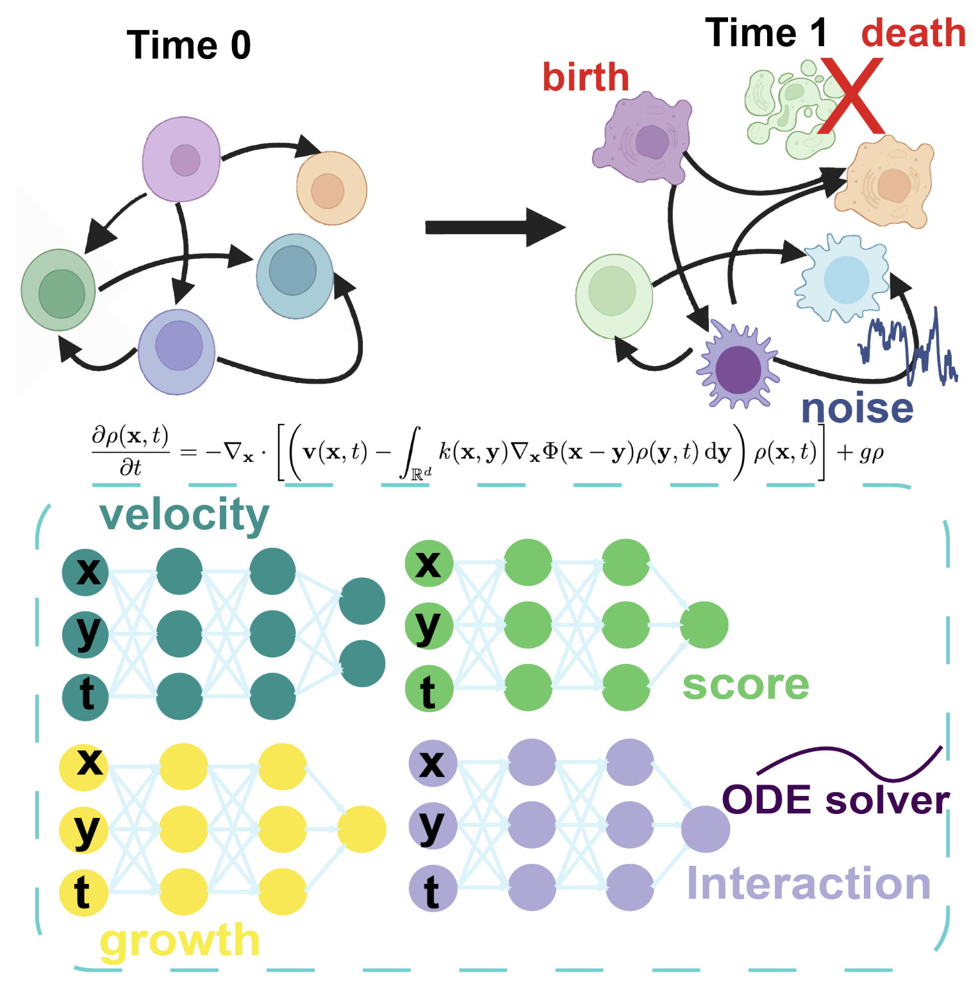
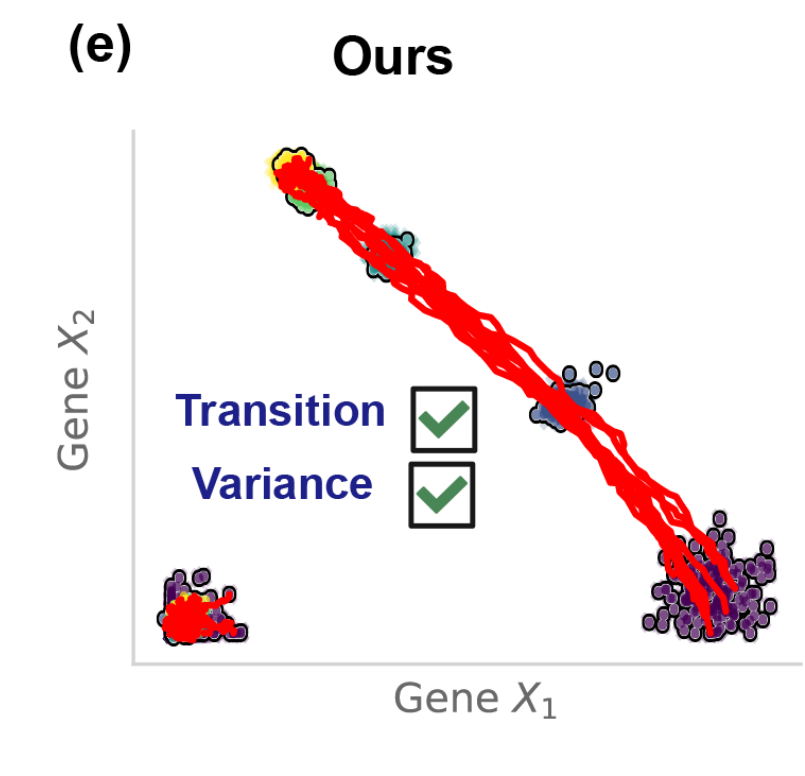
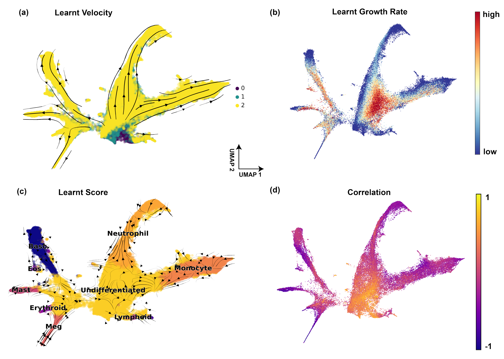
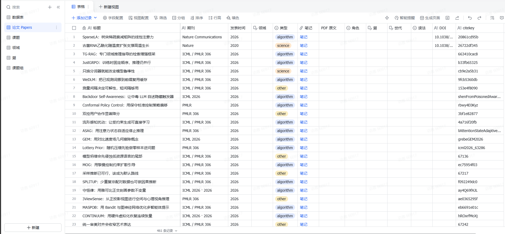

# 观潮 / Sounding


> **把论文读成可复述、可核对、可迁移的证据链。**
>
> Sounding 是一套交给 AI 执行的论文阅读与归档方法：先重建一篇论文的论证，再为多篇论文留下可比较的定位素材。它不把摘要写长，也不让模型凭一篇论文擅自判定“潮”、世代或学术地位。

[](#1-sounding-论文阅读法)
[](#3-如何使用)
[](#安装与配置)
[](#license)

## 为什么叫 Sounding

**Sounding 有「测深」之意。** 海洋测绘中，一次测深只告诉我们一个位置的深度；在不同位置反复测量，才能逐渐勾勒出海面之下的地形。我们把这种探索方式借来理解学术研究。

**测深，是向下读透一篇论文。** 从作者要解决的问题出发，追踪方法或发现、关键证据与论证边界，留下可复述、可核对的一个「测点」，而不是只停在摘要和结论。

**观潮，是横向理解一片领域。** 在大量独立而深入的单篇阅读之后，对照各个测点，观察研究问题、方法、证据与分歧如何连接和变化。我们不只看海面上此起彼伏的学术热点，更希望逐步摸清浪潮之下相对深层的研究脉络与问题本质。

封面上的每一条测线，都代表一次深入的单篇阅读；多个测点共同描出海床的轮廓。尚未测到的地方仍是未知：领域判断需要随着新证据修正，也由使用者确认，而不是由模型凭单篇论文自动定论。

## 先看这里

| 你要做什么 | Sounding 会交付什么 | 从哪里开始 |
| --- | --- | --- |
| **测深一篇论文** | 问题、方法／发现、证据、边界与原文定位 | [Sounding 论文阅读法](#1-sounding-论文阅读法) |
| **回顾一批论文** | 问题脉络、能力变化、证据分歧与待验证空白 | [观潮与多篇回顾](reference-wave.md) |
| **直接开始使用** | 文本模式或明确请求后的独立归档模式 | [如何使用](#3-如何使用) |

**阅读顺序：** 单篇先「测深」，多篇回顾再「观潮」；方向定位和待验证空白由使用者确认。

### 目录

- [为什么叫 Sounding](#为什么叫-sounding)
- [Sounding 论文阅读法](#1-sounding-论文阅读法)
- [效果展示](#2-效果展示)
- [如何使用](#3-如何使用)
- [安装与配置](#安装与配置)
- [文档导航](#文档导航)
- [License](#license)


## 1. Sounding 论文阅读法

### 先看结论靠什么立住

从摘要和引言里的贡献声明开始，按图序看原图与图注，再进入方法、实验和表格，最后回到相关工作核对缺口。我们按**论文实际的论证结构**选择读法，而不是按 Nature、NeurIPS 或文章章节标题套模板。

### 方法／算法论文：从为什么到怎么用

适用：论文的主要贡献是新模型、新算法或新架构，结论主要靠实验对比、消融与分析支撑。

1. **科学故事**：具体任务是什么，已有方法走到哪里，真正卡住的环节在哪里？
2. **灵感**：作者换了什么视角或假设，为什么可能有效，付出了什么代价？
3. **具体算法**：从输入、符号和模块到输出，把数据流、关键公式、训练目标及损失作用串起来。
4. **基线对比**：先说数据与划分，再解释指标、比较对象、结果和消融；检查公平性、失败情况及适用边界。

读完应能回答：**它解决的到底是什么，我能否复现、采用或改进？**

### 科学发现／机制论文：把证据链接起来

适用：论文提出一条新认识或机制，结论主要靠多条互补证据而不是单张算法榜单立住。

1. **现实痛点**：现象、已有解释和尚未解决的矛盾是什么？
2. **核心发现**：用一句能独立复述的话讲清新认识，它修正了哪条旧认识？
3. **证据链**：拆出关键子命题，逐项还原问题、设计、对照、结果、结论及排除／未排除的替代解释。

涉及生物实验时，核对 n 数的是什么、重复、检验、离散度、p 值对应的比较与多重比较校正；阴性结果和未报告事项不抹平。读完应能判断：**我能否引用这个结论，需要加什么限定？**

### 综述论文：检查这张领域地图有没有盲区

适用：文章重新组织一个方向的研究路线、证据与评价口径。

1. **它改变什么理解方式**：原来如何分类或开展研究，作者提出了什么新的组织方式？
2. **覆盖与遗漏**：研究范围、纳入排除标准、时间窗口和潜在漏项是什么？
3. **评价是否可靠**：指标、证据层级和代表工作的选择是否公允，有没有把反例筛掉？
4. **如何使用**：哪些分类、表格或未解问题可迁移，引用时需要哪些限定？

读完应能回答：**这张地图涵盖了什么、没资格回答什么，我能从哪里继续往下找？**

### Benchmark／数据集／立场论文：审视别人被要求遵守的口径

适用：主要贡献是评价基准、数据资源或一项应该被采用的主张，而不是提出算法或机制链。

1. **改变了什么惯例**：以前默认怎样做，现在要求谁改变什么？
2. **覆盖面与边界**：任务、样本、来源、纳排规则及潜在偏差是什么？
3. **评价方法本身**：指标定义及盲区、基线、划分和泄漏风险、标注质量与可复现性怎样？
4. **什么时候该用、不该用**：使用门槛、迁移风险、许可约束和引用限定是什么？

读完应能判断：**用这套口径比较或决策是否公平，它适不适合我的问题？**

### 每篇论文都会留下什么

- **十行速览**：正文定稿后最后写，放在正文前；沿正文相同结构，把每个关键部分浓缩成一句。
- **完整解读**：对应类型的主体不缩水；方法论文有符号、损失、数据与比较，科学论文有证据链和实验统计。
- **原文定位**：关键数字与判断附图表、公式、章节或 PDF 页码，未报告和不能确认的内容明确写出。
- **关系与待查**：依据实际可用材料说明与已读工作的关系，保留会改变理解或使用结论的具体问题。

始终区分“论文声称”“数据支持”和“读后的判断或待查”；不会把模型推断直接写成因果发现，也不会用速览代替正文。

## 2. 效果展示

### 同一篇论文，两种交付方式

下面以 **CytoBridge：Modeling Cell Dynamics and Interactions with Unbalanced Mean Field Schrödinger Bridge**（NeurIPS 2025）为例，展示方法论文从问题到实验边界的完整拆解。论文：[arXiv v3 原文](https://arxiv.org/abs/2505.11197v3)。

> **先看图，再看论证。** 文本模式展示完整阅读结果；云端模式展示飞书单篇笔记链接与多维表格截图。

[](examples/cytobridge/figures/figure-1.png)

<sub>原论文 Fig. 1，PDF 第 5 页；点击查看原图裁切的大图。作者、来源、许可和裁切说明见 [图像来源](examples/cytobridge/figures/ATTRIBUTION.md)。</sub>

<details>
<summary><strong>📖 文本模式｜展开完整十行速览与方法解读</strong></summary>

> 为便于展示，这里复用已准备的原论文图片；实际文本模式不以生成裁图文件或 citekey 为完成前提。

<!-- CYTOBRIDGE_TEXT_BEGIN -->

标题：CytoBridge：用带生长的群体力连接细胞快照<br>
发表：NeurIPS 2025<br>
类型：algorithm<br>
citekey：888cee66e7（按预印本 DOI 计算，仅用于演示）

### 十行速览

1. 多时刻单细胞快照可以用最优传输与随机桥连接，但增长、死亡和群体作用往往不能同时由既有轨迹模型显式表示（PDF 第 1–3 页）。
2. 本文瞄准的是非配对快照下同时拟合随机扩散、净增长／死亡和群体依赖运动，而不是直接证明细胞间的因果通信（PDF 第 2、4 页）。
3. 把细胞云转成带权互作粒子并以均场近似群体力，换来可计算的连续模型，也引入对状态距离、势函数及可辨识性的假设（PDF 第 4–6、10、17–18 页）。
4. CytoBridge 用速度、增长、标量对数密度和相互作用势四类网络，从不同时间的细胞矩阵生成带权轨迹与分布（PDF 第 5 页 Figure 1、§5）。
5. 模型以质量和分布匹配、密度一致性及能量近似联合训练，但能量上界和理论／实现的若干记号仍需核查（PDF 第 6–7、17–18 页）。
6. 主表是在所有可用时点参与训练后的拟合，另外仅对合成、鼠造血和胚状体做中间时间点留出，并以 $`W_1`$ 与总质量误差互补评估（PDF 第 20、22–23、28 页）。
7. 合成末时点 $`W_1`$ 为 $`0.038\pm0.003`$ 对 DeepRUOT $`0.057\pm0.003`$，鼠造血第一个时点的质量误差却为 0.208、高于 UOT-FM 的 0.100（PDF 第 8–9 页 Figure 2–3、Tables 1–2）。
8. 合成和鼠造血的留出结果支持时间插值，但不同基线的训练设置、实现方式及缺失的预算信息限制严格归因（PDF 第 20、22、28 页）。
9. 去增长和去质量项会损害合成实验，而无作用势、EMT、胰腺及速度／显存结果说明收益与成本依数据和假设而变，真实作用力尚无因果验证（PDF 第 21、23、25、27、29–30 页）。
10. 当前没有可核验的个人已读关系，代码中的记号与权重约定、数据预处理及独立生物验证仍待查。

---

## PDF 与来源

[打开公开论文原文（arXiv v3）](https://arxiv.org/pdf/2505.11197v3)；本示例未上传原始 PDF。

Zhenyi Zhang、Zihan Wang、Yuhao Sun、Tiejun Li、Peijie Zhou，**Modeling Cell Dynamics and Interactions with Unbalanced Mean Field Schrödinger Bridge**，NeurIPS 2025，arXiv:2505.11197v3。本文核对的是 34 页全文：正文 PDF 第 1–10 页，参考文献第 11–16 页，附录 A–F 第 17–34 页；Figure 1、2、3 分别位于 PDF 第 5、8、9 页，Table 1、2 分别位于第 8、9 页。首页直接写出论文标题、作者、版本号与会议；本示例不虚构 citekey 或个人文献库记录。

**原图与出处：** Figure 1–3 裁自 Zhang 等的 [arXiv v3 原文](https://arxiv.org/abs/2505.11197v3)，图注保持原文；裁剪与栅格化未改变图中文字。论文版本标注为 [CC BY-NC-SA 4.0](https://creativecommons.org/licenses/by-nc-sa/4.0/)，完整署名与修改说明见[图像来源](examples/cytobridge/figures/ATTRIBUTION.md)。

## 1 科学故事：分布能连起来，不等于增长与群体作用都被解释

单细胞测序常消耗细胞，因而跨时刻拿到的是不同细胞的样本云，而不是同一细胞的完整电影；单快照伪时间方法和依赖剪接／未剪接计数的 RNA velocity 解决的问题也不同。动态最优传输把不同时刻的细胞分布连接起来；Sha 等（2024）的 TIGON 等引入增长，Zhang 等（2025a）的 DeepRUOT 在无预设增长函数下处理随机性与非守恒质量；Tong 等（2024b）的 SF2M 则提供平衡随机桥，Atanackovic 等（2025）的 Meta FM 又使用初始群体的邻域信息。上述进展使从时间快照拟合生成性轨迹成为可能，但论文指出多数增长／随机轨迹模型没有把粒子之间显式、随群体分布变化的相互作用与非平衡增长同时建模；这些已有方法并不是都完全忽略邻域或群体信息（PDF 第 1–3、33–34 页，§1–3、§E）。

在作者比较的合成吸引实验中，较强的无相互作用 DeepRUOT 到第 4 个观测时点的 $`W_1=0.057\pm0.003`$，CytoBridge 为 $`0.038\pm0.003`$；这是特定模型和基准上的差距，不是所有真实数据均存在细胞通信的证明（PDF 第 8 页 Table 1）。本文补的是**从多时间快照拟合同时含随机扩散、净增长／死亡和群体依赖力的连续动力学**，不是直接测量配体—受体关系或证明某对细胞的因果通信。

**最笨的做法为什么不行。** 把各时刻细胞数都归一化后只连接概率分布，会把细胞净增长／死亡的信息排除出模型；将每个细胞当独立粒子又无法表达随邻居群体改变的漂移（后一句是根据模型比较作出的**推断**，PDF 第 2、4、7–8 页）。

## 2 灵感：让会增减的粒子共同塑造运动

把不同时间的细胞云看成会增减且彼此施力的粒子群。<br>
换来同时表述随机扩散、数量变化和群体影响的可解近似，代价是必须假设可由低维状态、所选距离与受限势函数概括相互作用，且单靠快照无法唯一确定真实机制。<br>
均场把邻居的总作用写成对当前群体密度的积分，再用带权粒子和随机分组近似这个积分，因此可以在不追踪每个真实细胞身份的情况下优化群体演化（PDF 第 4–6、10、17–18、31 页）。

## 3 具体算法：从非守恒均场桥到四个可训练函数

### 3.1 任务定义

输入是按真实采样时刻排序的未配对细胞状态矩阵 $`A_k\in\mathbb R^{n_k\times d}`$，每行是一细胞、每列是一基因或其降维坐标；正文把原始 $`d`$ 写成基因数，实际实验常先用 PCA，鼠造血和胚状体为 50 维，胰腺为 30 维。输入还包括各时刻相对细胞数量／质量，不要求同一细胞跨时刻的配对标签；训练约束来自已观测快照及其质量比。输出是速度、增长率、对数密度与相互作用势的参数化函数，可模拟状态、质量权重、分布和模型导出的向量场；中间真实轨迹通常不可得，不能把生成轨迹当作已观察到的细胞谱系（PDF 第 5–7、17–18、21–23 页）。

### 3.2 数据流骨架

多时刻细胞云 → 预处理降维 → 加权粒子 → 随机分组 → 速度与群体作用 → 状态及质量演化 → 匹配分布与总量 → 约束密度 → 联合训练。

### 3.3 图 1：四个函数如何协同

Figure 1 把多时间快照、细胞状态变化、增长／死亡和群体相互作用放在一个建模框架；这是一张方法总览图，不是证明真实细胞通信的实验图（PDF 第 5 页，§5）。

[](examples/cytobridge/figures/figure-1.png)

<sub>点击图片查看完整原图；来源与许可见[图像来源](examples/cytobridge/figures/ATTRIBUTION.md)。</sub>

Figure 1: Overview of CytoBridge.

中文：先看输入是多个时间点的细胞云，再看状态运动、权重增长和相互作用如何共同决定生成的下一时刻；图是方法关系概览，不能单独证明每个推断细胞作用是真实因果作用。

1. **状态与速度：** 每个样本 $`x_i(t)\in\mathbb R^d`$ 和时刻 $`t`$ 进入 $`v_\theta`$，得到 $`d`$ 维的概率流速度；它不是单独的总漂移，还要叠加群体力。
2. **增长与权重：** 同一 $`x_i,t`$ 进入 $`g_\theta`$ 得标量净增长率，数值积分 $`\dot w_i=g_\theta w_i`$ 得正权重；质量变化通过权重体现，并不要求训练模拟器把粒子字面复制或删除。
3. **相互作用：** 对批内 $`x_i-x_j\in\mathbb R^d`$ 求距离 $`d_{ij}`$，经 8 个径向基展开成 $`\mathbb R^8`$、再入网络得标量势，求关于 $`x_i`$ 的梯度得到 $`d`$ 维力；截断函数和其他粒子的权重共同确定力的聚合。
4. **密度与评分：** $`s_\theta(x,t)`$ 表示缩放后的**标量对数密度**，其空间梯度才对应缩放后的 score；密度及动力学一致性由物理约束训练。
5. **数据与目标：** 对所有粒子积分后得到 $`N\times d`$ 的预测状态和 $`N`$ 个正权重；将归一化的加权分布与实测细胞云匹配，同时拟合局部与总质量并约束动力学（PDF 第 5–7、17–18 页，§5、算法 1–2、§A.2–A.4）。

### 3.4 数学：理论对象、数值近似与训练目标

下表按下文首次使用顺序给出记号；归一化约定的差别单独说明，不把两套写法混为一谈。

| 符号 | 含义 | 类型／形状 |
| --- | --- | --- |
| $`t,T,x,y,d`$ | 时间、终点、两状态、状态维度 | 时间与维数为标量；$`x,y\in\mathbb R^d`$ |
| $`\rho(x,t),\nu_0,\nu_1`$ | 未必归一的细胞质量密度及起终密度 | 非负标量密度／测度 |
| $`b(x,t),g(x,t),\sigma(t)`$ | 随机漂移、净增长率、扩散系数 | $`b\in\mathbb R^d`$；$`g,\sigma\in\mathbb R`$ |
| $`k(x,y),\Phi(x-y)`$ | 相互作用权重与偶对称势 | 标量；$`\Phi(-z)=\Phi(z)`$ |
| $`I_\rho(x,t)`$ | 根据当前密度聚合的相互作用项 | $`\mathbb R^d`$ |
| $`\Psi,\alpha`$ | 增长代价及权重 | 标量函数、标量 |
| $`v,q`$ | 概率流速度、缩放后的密度 score | 均为 $`\mathbb R^d`$ |
| $`N,i,j,X_i,W_i,w_i`$ | 粒子数、粒子索引、状态、布朗运动、正质量权重 | $`X_i,W_i\in\mathbb R^d`$，$`w_i\gt 0`$ |
| $`\mu_t^N,\delta_{X_i}`$ | 理论加权经验测度及点质量 | 测度 |
| $`\theta,v_\theta,g_\theta,s_\theta,\Phi_\theta`$ | 网络参数及速度、增长、缩放对数密度、势网络 | 参数集合；输出依次为 $`\mathbb R^d,\mathbb R,\mathbb R,\mathbb R`$ |
| $`d_{ij},d_{\rm cutoff},K,\beta_\ell,\mu_\ell,e_\ell`$ | 配对距离、截断距离、径向基数、宽度、中心与特征 | 标量；$`\ell=1,\ldots,K`$ |
| $`p,\tau,C_p`$ | 随机组大小、积分步长和该组索引集 | 整数、正标量、集合 |
| $`\widetilde v_i`$ | 含群体作用的概率流速度 | $`\mathbb R^d`$ |
| $`A_k,\widehat A_k,n_k,h_k`$ | 第 $`k`$ 次观测、预测粒子、该时刻细胞数、最近粒子映射 | 矩阵／点集、整数、映射 |
| $`M_k,G_k,\widehat w^k,\bar w(t_k)`$ | 局部质量误差、全局质量误差、观测均匀权重、归一化预测权重 | 两标量、两个 $`N`$ 维向量 |
| $`\mathcal L_{\rm energy},\mathcal L_{\rm mass},\mathcal L_{\rm OT},\mathcal L_{\rm recons},\mathcal L_{\rm FP}`$ | 能量、质量、分布、重建、密度一致性目标 | 标量 |
| $`\lambda_m,\lambda_d,\lambda_r,\lambda_f,\lambda_w`$ | 各目标和初始密度约束权重 | 标量 |
| $`p_0,\lambda_s,\epsilon`$ | 初始密度、score 初始化权重、高斯噪声 | 密度、标量、$`\epsilon\sim\mathcal N(0,I_d)`$ |

**理论 UMFSB。** 令 $`I_\rho(x,t)=\int k(x,y)\nabla_x\Phi(x-y)\rho(y,t)\,dy`$，作者优化漂移与增长成本

$`\displaystyle \inf_{\rho,b,g,\Phi}\int_0^T\!\int\left[\tfrac12\|b\|_2^2+\alpha\Psi(g)\right]\rho\,dx\,dt,`$

受起终密度和下式约束：

$`\displaystyle \partial_t\rho=-\nabla_x\!\cdot[(b-I_\rho)\rho]+\tfrac{\sigma(t)^2}{2}\Delta\rho+g\rho.`$

这里 $`g\gt 0`$ 是净增长、$`g\lt 0`$ 是净死亡／质量减少；这是作者为细胞增长和死亡引入的**源汇反应**，不是把任意群体漂移都称为增长。$`k=0`$ 回到无相互作用的正则非平衡传输，强制 $`g=0`$ 则得到守恒均场桥。Definition 4.1 的目标未显式写 $`\alpha`$，Theorem 4.1 又加入该系数；以上写法沿用定理记号，复现需确认权重约定（PDF 第 4 页，Definition 4.1、Theorem 4.1；第 31 页 §D.1）。

令 $`q=\tfrac12\sigma(t)^2\nabla_x\log\rho`$、$`v=b-q`$，则连续性方程变为 $`\partial_t\rho=-\nabla\cdot[(v-I_\rho)\rho]+g\rho`$，而精确的重新参数化能量被写作

$`\displaystyle \int_0^T\!\int\left[\tfrac12\|v\|^2+\tfrac12\|q\|^2+\langle v,q\rangle+\alpha\Psi(g)\right]\rho\,dx\,dt.`$

它与原式的关系是 $`b=v+q`$；这把随机扩散方程转成需要 score 的确定性概率流方程，并没有消除原问题的随机性（PDF 第 4 页式 (3)–(4)、Remark 4.1）。

**粒子近似。** 理论命题给出

$`\displaystyle dX_i=\left[b(X_i,t)-\tfrac1{N-1}\sum_{j\ne i}k(X_i,X_j)w_j\nabla_{X_i}\Phi(X_i-X_j)\right]dt+\sigma(t)dW_i,\qquad \dot w_i=g(X_i,t)w_i.`$

对应概率流 ODE 用 $`v`$ 代替 $`b`$ 并去掉布朗项；理论测度写成 $`\mu_t^N=N^{-1}\sum_iw_i(t)\delta_{X_i(t)}`$，理论初始 $`w_i(0)=1`$。附录 D.1 **假设**经验测度收敛及类似 propagation-of-chaos 的极限，且要求 $`k`$、$`\nabla\Phi`$ 等有界／Lipschitz；这不是对所有神经网络和截断核的无条件收敛证明。实际训练叙述则采用 $`w_i(0)=1/N`$、以权重之和表示质量；正文重建段的群体速度公式还省略了命题中的 $`w_j`$，因此不能无条件把理论系数直接照搬为实现，需查代码确认尺度及归一化（PDF 第 5–6、31–33 页，Proposition 5.1、§D.2）。

**作用势和随机分组。** $`d_{ij}=\|x_i-x_j\|_2`$，$`e_\ell(d)=\exp[-\beta_\ell(e^{-d}-\mu_\ell)^2]`$，$`\Phi_\theta=\mathrm{NN}(e_1,\ldots,e_K)`$，$`K=8`$；$`k=\mathbf1[d_{ij}\lt d_{\rm cutoff}]`$。这让势受状态距离支配，而非直接建立分子或空间上的因果配体—受体边。每步将 $`N`$ 个粒子随机分组，每组 $`p`$ 个、只对组内求和并用 $`1/(p-1)`$ 缩放，运算由 $`O(N^2)`$ 降至 $`O((p-1)N)`$；作者引用在特定条件下随步长 $`\tau`$ 有 $`O(\sqrt\tau)`$ 的分布逼近。理论要求光滑核而实验的硬截断在阈值处不连续，因此其理论假设对实践设置并非自动成立（PDF 第 5–6、17–18、28–29、31 页，§5.1、算法 1、§A.3、§C.2、假设 D.1）。

**完整训练目标。** 实验使用常数 $`\sigma`$、$`\Psi(g)=g^2`$，联合训练

$`\displaystyle \mathcal L=\mathcal L_{\rm energy}+\lambda_r\mathcal L_{\rm recons}+\lambda_f\mathcal L_{\rm FP},\quad \mathcal L_{\rm recons}=\lambda_m\mathcal L_{\rm mass}+\lambda_d\mathcal L_{\rm OT}.`$

局部质量把每个目标时刻样本分配给最近的预测粒子，记映射为 $`h_k`$；原文的局部和全局误差为

$`\displaystyle M_k=\sum_{i=1}^{N}\left|w_i(t_k)-\tfrac{n_k}{Nn_0}\operatorname{card}h_k^{-1}(x_i(t_k))\right|^2,\quad G_k=\left|\sum_iw_i(t_k)-\tfrac{n_k}{n_0}\right|^2.`$

$`\mathcal L_{\rm mass}=\sum_k(M_k+G_k)`$；$`\mathcal L_{\rm OT}=\sum_kW_2(\widehat w^k,\bar w(t_k))`$，比较的实际对象是具有对应观测／预测坐标、分别带均匀／归一化权重的经验测度，论文借 Sinkhorn 实现。密度网络给 $`\rho_\theta=\exp(2s_\theta/\sigma^2)`$，则

$`\displaystyle \mathcal L_{\rm FP}=\|\partial_t\rho_\theta+\nabla\!\cdot(\rho_\theta\widetilde v_\theta)-g_\theta\rho_\theta\|+\lambda_w\|\rho_\theta(\cdot,0)-p_0\|.`$

这分别防止只匹配形状却丢失总量、只匹配总量却放错状态区域，以及四个网络相互不一致；若去掉质量项或 FP 项，合成数据消融见下节 Table 15，但原文**未单独消融** $`M_k`$、$`G_k`$、$`W_2`$ 或初始密度边界项。质量匹配把样本计数比作为质量目标，采样效率／测序捕获偏差是否可忽略需另外验证（PDF 第 6–7、17–18 页，§5.2、算法 2、§A.1、§A.4）。

作者没有直接优化上述精确能量，而将交叉项改成范数乘积并称为上界；附录 A.5、算法 2 印出的粒子期望形式是

$`\displaystyle \mathcal L_{\rm energy}=\mathbb E_{x_0\sim\rho_0}\int_0^T\!\left[\tfrac12\|v_\theta\|^2+\tfrac12\|\nabla_xs_\theta\|^2+\|v_\theta\|\,\|s_\theta\|+\alpha\Psi(g_\theta)\right]\exp\!\left(\int_0^t g_\theta(x(u),u)du\right)dt.`$

式中指数是沿轨迹累计的相对增长权重；论文在此处用 $`s_\theta`$ 而非 $`\nabla s_\theta`$，故此式是**原文转录，不是已核实的正确代码实现**。必须保留原文的一个记号歧义：$`s_\theta`$ 前面定义为标量缩放对数密度，理论式交叉项应涉及 $`\nabla s_\theta`$，但 PDF 第 6 页写 $`\langle v_\theta,s_\theta\rangle`$，第 18 页 §A.5 与算法 2 写 $`\|v_\theta\|\,\|s_\theta\|`$，同时二次项却写 $`\|\nabla s_\theta\|^2`$；仅凭论文无法断言代码究竟用哪一个，亦不能把这个上界等同于精确求解 UMFSB。算法 2 的总损失行也省略了正文中显式出现的 $`\lambda_f`$；这些都需代码核对，而不是在笔记中自行改写成“已证实实现”（PDF 第 4、6–7、17–18、30 页）。

**两阶段优化而非单次黑盒拟合。** ① 预训练 $`v_\theta,g_\theta`$：不加相互作用，用局部质量与分布匹配初始化；② 固定增长并更新速度与 $`\Phi_\theta`$，只用分布匹配细化；③ 由最优传输样本对构造布朗桥，按条件 score matching 初始化 $`s_\theta`$，目标写作 $`\|\lambda_s(t)\nabla s_\theta+\epsilon\|^2`$，其中 $`\lambda_s=2\sqrt{t(1-t)}/\sigma`$；④ 对初始样本拟合高斯混合密度 $`p_0`$，联合优化四个函数与以上全部目标，使用神经 ODE 求解及 Sinkhorn 传输。作者的算法 2 实际在第二步更新 $`v_\theta,\Phi_\theta`$，不是只训练势网络（PDF 第 6–7、17 页，算法 2、§A.1–A.2）。

**超参／复现坑。** 表 19 给预训练 $`\lambda_m,\lambda_d=(0.01,1)\to(0,1)`$，训练时 $`\lambda_m=\lambda_d=1`$、$`\lambda_r=10^3,\lambda_f=10^4,\lambda_w=10`$；合成／鼠造血／胚状体／胰腺／EMT／斑马鱼的 $`d_{\rm cutoff}`$ 分别为 0.5／300／100／100／2／0.3，主训练轮数分别为 200／1000／500／500／200／500，默认分组 $`p=16`$。原文称对真实 scRNA-seq 取足够大截断覆盖所有对，斑马鱼则用物理空间邻域；实际基因过滤、归一化、数据具体拆分、网络层数及随机种子仍需查实现（PDF 第 28–30 页，§C.2 与 Table 19）。

### 3.5 贡献边界

新意是把非守恒增长、随机桥和群体作用合成 UMFSB 理论框架，并设计学习未知增长／势及对应带权粒子训练的 CytoBridge；不是首次提出最优传输、均场、神经 ODE、径向基、随机分组、Sinkhorn 或条件 score matching。势函数限制、随机分组、预训练、损失权重与 GMM 都是使优化可运行的具体假设／工程选择，不应与框架本身混同（PDF 第 2–7、17–18 页）。

## 4 基线对比：先看预测对象，再看数字

### 4.1 数据、划分与任务

| 数据／任务 | 来源与规模 | 训练、评测与边界 |
| --- | --- | --- |
| 合成三基因调控 | 自激、互抑、外激、噪声和 $`X_2`$ 相关分裂；记录原始时间 0、8、16、24、32；另造吸引、Lennard–Jones 式及无相互作用三种情形 | Table 1 为全部时点参与训练后的 $`t=1`$–4 拟合；Table 4 分别留出中间 $`t=1,2,3`$ 重训并评测；原文未给全部初始细胞数与分组种子，不能外推更大规模（PDF 第 7–8、19–21、28 页） |
| 鼠造血 | Weinreb 等（2020），49,302 个细胞、3 时点、50 PC，体外祖细胞培养，含谱系追踪数据 | Table 2 是训练时点拟合；Table 7 留出唯一中间时点；Fig. 3 的 2D UMAP 为可视化而非 50D 输入；无法由分布指标推出单细胞真实谱系完全正确（PDF 第 8–9、21–22、28–30 页） |
| 人胚状体 | Moon 等（2019），16,819 个细胞、5 时点、50 PC，3D 培养、27 天 | Table 9 全时点训练；Table 10 实际列出 3 个中间留出时点，正文却说四个，存在原文数量不一致；100 PC 另作规模测试（PDF 第 22–23、30 页） |
| 人胰腺 β 样分化／A549 EMT | 胰腺 51,274 细胞、8 时点、30 PC；EMT 4 时点，TGFB1 诱导 | Table 11、12 为全时点训练拟合；胰腺具体划分及 EMT 细胞数原文未报告（PDF 第 23–25、28 页） |
| 斑马鱼空间转录组 | ZESTA 六时点中选择 5.25 与 10 hpf，表达 50 PC，空间配准后共同建模 | 比较空间和表达分布；该两时点任务不构成未见时间点外推证据，所用细胞数／切片间独立重复原文未报告（PDF 第 26–28 页） |

一般设置用全部可用时间点训练并在这些时点评估；只对合成吸引、鼠造血和胚状体另做逐一留出中间时间点实验。模型无法据此证明超出观测窗口的长期预测、跨供体泛化、OOD 最坏情况或经实验证实的逐细胞配对准确率（PDF 第 28 页 §C.1；原文未测）。

### 4.2 指标先于表

- $`W_1\downarrow`$：预测和观测**归一化经验分布**之间，以欧氏距离为搬运成本的最小平均搬运距离；评估时由初始点演化并使用预测权重，POT 实现。它衡量状态分布形状而非细胞总量，因此单独看可能掩盖错误的增殖。
- TMV $`\downarrow`$：$`\left|\sum_iw_i(t_k)-n_k/n_0\right|`$，衡量预测总权重与观测相对细胞数的绝对差；它反过来不保证细胞出现在正确状态，必须与 $`W_1`$ 联读。
- 以下主表每格为 **$`W_1`$ / TMV**，均为 5 次运行的均值 ± 1 个标准差，不是置信区间；部分基线显示 0.000 仅表示表中精度下四舍五入，不代表严格无波动（PDF 第 8–9、28 页）。

### 4.3 主表：全部拟合时点，不偷换留出测试

**合成吸引数据，$`\sigma=0.05`$，PDF 第 8 页 Table 1。**

| 模型 | $`t=1`$ | $`t=2`$ | $`t=3`$ | $`t=4`$ |
| --- | --- | --- | --- | --- |
| SF2M | 0.146±0.002 / 0.080±0.000 | 0.320±0.004 / 0.250±0.000 | 0.447±0.005 / 0.515±0.000 | 0.554±0.005 / 0.930±0.000 |
| Meta FM | 0.149±0.000 / 0.080±0.000 | 0.241±0.000 / 0.250±0.000 | 0.288±0.000 / 0.515±0.000 | 0.404±0.000 / 0.930±0.000 |
| MMFM | 0.101±0.000 / 0.080±0.000 | 0.223±0.000 / 0.250±0.000 | 0.438±0.000 / 0.515±0.000 | 0.366±0.000 / 0.930±0.000 |
| Metric FM | 0.319±0.000 / 0.080±0.000 | 0.751±0.000 / 0.250±0.000 | 0.690±0.000 / 0.515±0.000 | 0.614±0.000 / 0.930±0.000 |
| UOT-FM | 0.051±0.000 / **0.010±0.000** | 0.058±0.000 / 0.036±0.000 | 0.060±0.000 / 0.044±0.000 | 0.054±0.000 / 0.095±0.000 |
| MIOFlow | 0.315±0.000 / 0.080±0.000 | 0.387±0.000 / 0.250±0.000 | 0.483±0.000 / 0.515±0.000 | 0.518±0.000 / 0.930±0.000 |
| uAM | 0.489±0.000 / 0.081±0.000 | 0.995±0.000 / 0.033±0.000 | 1.402±0.000 / 0.459±0.000 | 1.655±0.000 / 1.516±0.000 |
| UDSB | 1.131±0.009 / 0.018±0.006 | 1.489±0.018 / 0.135±0.014 | 1.455±0.022 / 0.447±0.011 | 0.543±0.015 / 1.018±0.035 |
| TIGON | 0.169±0.000 / 0.097±0.000 | 0.184±0.000 / 0.165±0.000 | 0.167±0.000 / 0.210±0.000 | 0.179±0.000 / 0.384±0.000 |
| DeepRUOT | 0.044±0.002 / 0.014±0.007 | 0.045±0.002 / 0.026±0.018 | 0.053±0.002 / 0.059±0.032 | 0.057±0.003 / 0.075±0.044 |
| CytoBridge | **0.015±0.001** / 0.013±0.009 | **0.014±0.001 / 0.021±0.024** | **0.018±0.002 / 0.043±0.041** | **0.038±0.003 / 0.058±0.061** |

CytoBridge 四个时点的 $`W_1`$ 均为表中最低；但 $`t=1`$ 的最佳 TMV 是 UOT-FM 的 0.010 而非 CytoBridge 的 0.013，不能照搬正文“两个指标均最佳”。多数 TMV 的标准差很大，特别是 $`t=4`$ 的 $`0.058\pm0.061`$ 对 DeepRUOT $`0.075\pm0.044`$ 有明显重叠，不能仅凭均值称差异显著。

Figure 2 先给出已知的三基因机制与真实运动，再依次比较平衡桥、无显式相互作用的非平衡桥以及 CytoBridge；仅在这种有构造真值的模拟中，势函数／增长率恢复可以和真值进行直接比较（PDF 第 7–8 页）。

[](examples/cytobridge/figures/figure-2.png)

<sub>点击图片查看完整原图；来源与许可见[图像来源](examples/cytobridge/figures/ATTRIBUTION.md)。</sub>

**Figure 2 局部放大：** 依次为原文 (b) 的真实轨迹和 (e) 的模型轨迹；均为原图裁切，点击可查看完整尺寸。

<a href="examples/cytobridge/figures/figure-2b-detail.png"></a> <a href="examples/cytobridge/figures/figure-2e-detail.png"></a>

Figure 2: (a) Illustration of the synthetic gene regulatory dynamics. (b) The ground truth cellular dynamics project on (X1, X2). The red lines indicate the ground truth trajectories of cells in (b), or inferred trajectories of cells in (c) to (e). (c) The dynamics learned by balanced Schrödinger bridge SF2M (Tong et al., 2024b). (d) The dynamics learned by DeepRUOT. (e) The dynamics learned by CytoBridge. (f) The learned interaction potential. (g) The growth rates inferred by CytoBridge. (h) The constructed landscape at t = 4. The z-axis represents the density of cells.

中文：先对照 (b) 的模拟真值与 (c)–(e) 的预测轨迹，再看 (f)–(h) 的势、增长与景观；图显示给定合成机制下的可恢复性，不证明真实生物数据中的作用力已被独立验证。

**鼠造血，$`\sigma=0.1`$，PDF 第 9 页 Table 2。**

| 模型 | $`t=1`$：$`W_1`$ / TMV | $`t=2`$：$`W_1`$ / TMV |
| --- | --- | --- |
| SF2M | 8.217±0.001 / 2.231±0.000 | 11.086±0.002 / 5.399±0.000 |
| Meta FM | 8.545±0.000 / 2.231±0.000 | 10.313±0.000 / 5.399±0.000 |
| MMFM | 7.647±0.000 / 2.231±0.000 | 10.156±0.000 / 5.399±0.000 |
| Metric FM | 7.788±0.000 / 2.231±0.000 | 11.449±0.000 / 5.399±0.000 |
| UOT-FM | 8.114±0.000 / **0.100±0.000** | 9.170±0.000 / 0.118±0.000 |
| MIOFlow | 6.313±0.000 / 2.231±0.000 | 6.746±0.000 / 5.399±0.000 |
| uAM | 7.537±0.000 / 2.875±0.000 | 9.762±0.000 / 5.670±0.000 |
| UDSB | 10.687±0.058 / 0.282±0.146 | 13.477±0.053 / 3.010±0.225 |
| TIGON | 6.140±0.000 / 1.234±0.000 | 6.973±0.000 / 2.083±0.000 |
| DeepRUOT | 6.052±0.002 / 0.200±0.001 | 6.757±0.006 / 0.260±0.007 |
| CytoBridge | **6.013±0.002** / 0.208±0.001 | **6.644±0.011 / 0.078±0.013** |

$`t=1`$ 的 $`W_1`$ 比最佳无显式作用的 DeepRUOT 低 0.039，但 TMV 0.208 高于 DeepRUOT 0.200，更高于最佳 UOT-FM 0.100；$`t=2`$ 的 $`W_1`$ 比 DeepRUOT 低 0.113，TMV 也更低。数值上的差不等于实验独立重复的显著性或相互作用机制的因果验证。

Figure 3 将造血数据中的速度、增长、score 和速度—作用力相关性投影到 UMAP；可视化向量经过 scVelo 的投影，不是直接测得每个细胞的真实受力（PDF 第 9、30 页）。

[](examples/cytobridge/figures/figure-3.png)

<sub>点击图片查看完整原图；来源与许可见[图像来源](examples/cytobridge/figures/ATTRIBUTION.md)。</sub>

Figure 3: Application in mouse blood hematopoiesis data (σ = 0.1), visualized in UMAP space. (a) The overall velocity learned by CytoBridge. (b) The growth rates learned by CytoBridge. (c) The score function learned by CytoBridge at t = 2. (d) The correlation of velocity and interacting forces.

中文：先看预测的分化方向和增长强弱，再看不同状态附近的 score 与模型内力—速度相关性；这些图展示的是拟合模型的解释，不等于已识别或干预验证的细胞间通信。

**真正的留出。** 合成 $`t=1,2,3`$ 的 $`W_1`$：CytoBridge 依次为 $`0.182\pm0.001`$、$`0.064\pm0.004`$、$`0.043\pm0.002`$，DeepRUOT 为 $`0.184\pm0.001`$、$`0.086\pm0.004`$、$`0.079\pm0.003`$；鼠造血留出中间时点为 $`6.847\pm0.003`$ 对 $`6.868\pm0.003`$。这是更直接的插值证据，首个合成时点仅差 0.002，且留出表只报 $`W_1`$，不支持对未见时点质量预测同样优秀的结论（PDF 第 19–20、22 页 Tables 4、7）。胚状体 Table 9 在 $`t=1`$ 的 $`W_1`$ 与 DeepRUOT 同为 $`8.159\pm0.002`$；其 $`t=3`$ TMV 为 $`0.175\pm0.007`$，劣于 DeepRUOT 的 $`0.005\pm0.005`$，因此优势并非全指标普遍存在（PDF 第 23 页）。

### 4.4 对照与公平性三查

**同条件：** 作者说原论文已覆盖的数据集沿原默认设置，其他数据集调整网络规模使参数量相当并调轮数与学习率；SF2M 扩散系数匹配本文，DeepRUOT 同评估流程但无相互作用，TIGON 为避免不稳定重新实现，uAM 用默认参数。UDSB 的默认设置只支持三时点，在合成／胚状体使用 $`t=0,2,4`$，并未参加合成留出表；不同可用时间点、重新实现与未逐一列出的调参预算妨碍把全部差值唯一归因于作用项（PDF 第 19、28 页 §B.1、§C.1）。

**指标与基线：** 同表采用 $`W_1`$/TMV，平衡模型以均匀权重评估且不能恢复增长；Meta FM 已建模初始群体邻域，不应把所有基线说成没有任何群体信息。论文未完整报告每个模型的参数量、搜索空间、最佳超参、重复种子与逐运行配对结果，因此无法独立确认完全等预算或显著性（PDF 第 2、28 页）。

**消融与反例：** 合成吸引 $`t=4`$，完整方法 $`W_1=0.038\pm0.003`$、TMV $`0.058\pm0.061`$；去增长为 $`0.480\pm0.018`$、$`0.930\pm0.000`$，去质量项为 $`0.047\pm0.005`$、$`0.689\pm0.046`$，去预训练为 $`1.451\pm0.004`$、$`0.168\pm0.081`$；去 FP 为 $`0.039\pm0.004`$、$`0.063\pm0.058`$，但其 $`t=1`$ 的 $`W_1=0.014\pm0.000`$ 反而优于完整模型的 $`0.015\pm0.001`$，不能声称每个点都获益。去 score 初始化／仅预训练分别为 $`0.039\pm0.003`$／$`0.108\pm0.002`$（均为 $`t=4`$ 的 $`W_1`$）；无作用势的合成数据，$`t=4`$ CytoBridge $`0.052\pm0.003`$ 劣于 DeepRUOT $`0.046\pm0.002`$（PDF 第 21、27 页 Tables 6、15）。

### 4.5 扩展、成本与失效边界

- 胰腺 Table 11 按印出的均值，CytoBridge 七个时间点中有 **4 个更低、1 个相同、2 个更高**，而正文称 5/7 改善；例如 $`t=1`$ 为 $`8.0448\pm0.0005`$ 对 $`8.0447\pm0.0005`$，差异远小于所报标准差，故保留表格事实及文字冲突。EMT 的 $`t=1,2,3`$ 为 0.240／0.259／0.269，DeepRUOT 为 0.239／0.253／0.261；Table 12 未报告离散度，不能由此推断真实作用为零（PDF 第 23、25 页 Tables 11–12）。
- 斑马鱼空间／基因 $`W_1`$ 为 0.035／4.712；比较者中空间次优 uAM 为 0.177，基因次优 MIOFlow 为 4.720，Table 13 **未给标准差**；空间输入及配准和单纯表达状态任务不同（PDF 第 26 页）。
- 随机分组 $`p=16`$ 在模拟中的时间 0.115 s、显存 1.7 GB；不分组 0.568 s、22.1 GB，末时刻 $`W_1`$ 分别 0.038 和 0.029，说明加速伴有精度差异，不是免费提升。100 PC 胚状体实验中 CytoBridge 11 分 26 秒、6.3 GB，DeepRUOT 10 分 17 秒、3.7 GB；这是 A100、特定实验的比较，未测试无限维扩展（PDF 第 28–30 页 Tables 18、20）。
- 截断距离太小可使合成 $`t=4`$ 的 $`W_1`$ 从 $`d_{\rm cutoff}=0.5`$ 的 $`0.038\pm0.003`$ 升至 0.1 的 $`0.167\pm0.003`$；因此距离尺度／预处理变动会直接改变邻居与结论（PDF 第 29 页 Table 16）。
- 作者自己列出的限制包括只优化能量上界、径向基势的表达能力、复杂多阶段训练、没有配体—受体先验、尚无免模拟训练；另有计数能否代表实际生长、快照下可辨识性及硬截断理论假设问题。论文没有提供干预实验去验证被推断作用为因果细胞通信（PDF 第 10、17–18、28、31 页）。

### 4.6 收口

当问题确实是**多时刻未配对快照**，且希望同时拟合质量变化和由群体状态调制的运动时，CytoBridge 是值得与无相互作用基线并列检验的生成性建模选项；要用于生物机制，应先检验质量采样偏差、留出时间和无作用对照，再用独立空间、谱系或扰动实验验证，而不是把力场图直接当作机制发现。

## 与已读的关系

未提供可用的已读论文库或阅读记录；因此**无法判断与个人已读的关系**，这里对 DeepRUOT、SF2M 等仅是本文基线的文内对照，并非声称它们已被读者读过。

## 待查

- **实现与补充材料：** 查 CytoBridge 代码中的能量交叉项究竟使用 $`s_\theta`$ 还是 $`\nabla s_\theta`$、交互聚合中的 $`w_j`$ 与 $`1/N`$ 归一化；核实算法 2 缺失的 $`\lambda_f`$ 是否由实现补入。
- **实现与补充材料：** 查各数据集预处理、网络层数、随机种子、训练／留出脚本和胚状体留出时点数量；对照 Table 11 和正文 5/7 的不一致。
- **影响结论但未给出的量：** 每个真实数据集的绝对细胞捕获率、独立生物重复数及跨供体／跨批次留出误差；缺少这些不能断言估计的质量变化是体内真实增长或可跨实验泛化。
- **影响结论但未给出的量：** 多个同样拟合快照的势函数是否可区分、可用于验证的配体—受体或扰动效应量及其不确定度；缺少这些不能把统计上拟合的作用力定位为具体可干预的细胞通信。

**定位待补：** 尚无用户研究方向、已读清单或项目约束，暂不分配研究波次、项目角色或优先级。

<!-- CYTOBRIDGE_TEXT_END -->

</details>

<details>
<summary><strong>🗂️ 云端归档模式｜查看飞书论文库与多维表格</strong></summary>

<!-- CYTOBRIDGE_ARCHIVE_BEGIN -->

**飞书笔记：** [打开 CytoBridge 单篇笔记](https://rcntgteigkrr.feishu.cn/docx/URpEd790XomUL2xLiA2cVmnJnoc)。

**多维表格：**

[](examples/cytobridge/feishu-library.png)

<sub>用户提供的论文库截图；点击查看原图。截图反映截取时的表格状态。</sub>

<!-- PRIVATE_CLOUD_PREVIEW -->

> 这篇单篇笔记为持链接可读；上图经用户确认用于展示，私人论文库入口不放入公开 README。

<!-- CYTOBRIDGE_ARCHIVE_END -->

</details>

<sub>论文原图及其引用／改编遵循 [CC BY-NC-SA 4.0](https://creativecommons.org/licenses/by-nc-sa/4.0/)；飞书截图由用户提供，仓库代码仍按 MIT 许可。</sub>

## 3. 如何使用

### 先读，还是同时保存？

| | 文本模式（默认） | 云端归档模式（明确提出） |
| --- | --- | --- |
| **交付** | 在当前对话返回完整分析 | 复用已有分析，整理成可回顾的云端笔记 |
| **阅读深度** | 完整阅读、看图、核对证据 | 与文本模式相同，不重读一遍 |
| **准备工作** | 有可用全文即可；不要求云端凭据 | 需要已配置、可访问的归档后端 |
| **图片** | 阅读原图并按图号／页码解释，不强制生成裁图文件 | 保存原图裁切和图文排版，并回读核对 |

两种模式的**区别是交付方式，不是认真读和简略读**。完整阅读仍需要时间；损坏的 PDF 或关键材料不足时会说明并暂停，不自动耗时找源或伪造完整分析。

### 直接这样说

```text
用 sounding 完整阅读这篇：<PDF 路径或附件>
```

需要计时或读完后归档：

```text
用 sounding 读这篇，并计时。
把刚才的解读归档到飞书，复用已有内容。
```

已经读完一批同主题论文，想进行批量回顾：

```text
对这些已读论文做一次观潮回顾：对齐研究问题、能力、证据和边界，
列出候选划分与未知项，再由我确认定位。
```

### 安装与配置

这是以 [SKILL.md](SKILL.md) 为入口的 Agent Skill。克隆后，将目录放入所用客户端支持的 skills 目录，或按客户端说明建立链接：

```bash
git clone https://github.com/MakWaiGong/sounding.git
```

客户端能直接读取 PDF 时可先使用文本模式；需要仓库提供的 PDF／归档辅助脚本时，在仓库目录用 Python 3.10+ 安装依赖：

```bash
python -m pip install -e .
```

文本阅读不需要先初始化云端。明确归档时，按 [飞书归档](reference-feishu.md) 或 [Notion 兼容归档](reference-notion.md) 配置自己的目标；飞书为默认后端，Zotero 是可选书目索引或兼容路线。飞书归档前，须在本机私有配置的 `feishu.editor_open_ids` 中指定本人账号，以便给本人管理权限；缺失时不会创建笔记。源 PDF 上传独立后置，不阻塞正文和内嵌图片完成，上传并回读成功前保留本地副本。 新建飞书笔记默认持链接可读；复用已有笔记时保留原来的分享范围。

私有配置仅保存在本机；不要把密钥、个人笔记或论文上传到公开仓库。用户手写的领域和读法由用户维护，自动发布不会覆盖。

### 文档导航

README 面向准备使用的人；Agent 的执行细则和验收条件以以下文件为准。

| 想了解什么 | 去哪里 |
| --- | --- |
| 默认模式、阅读流程与交付边界 | [SKILL.md](SKILL.md) |
| 各类型论文的具体骨架 | [方法／算法](reference-algorithm.md) · [科学发现](reference-science.md) · [综述与其他](reference-other.md) |
| 符号、损失、指标和实验统计 | [证据规则](reference-evidence.md) · [指标术语](reference-metrics.md) |
| PDF 提取、图文归档与中断恢复 | [工程参考](reference-engineering.md) · [库与回写](reference-library.md) |
| 多篇回顾与研究问题组织 | [观潮](reference-wave.md) · [课题](reference-topic.md) |

## License

代码与一般文档采用 [MIT License](LICENSE)；效果展示中的原论文图像及相应材料另依其署名、非商业和相同方式共享许可，详见 [图像来源](examples/cytobridge/figures/ATTRIBUTION.md)。
