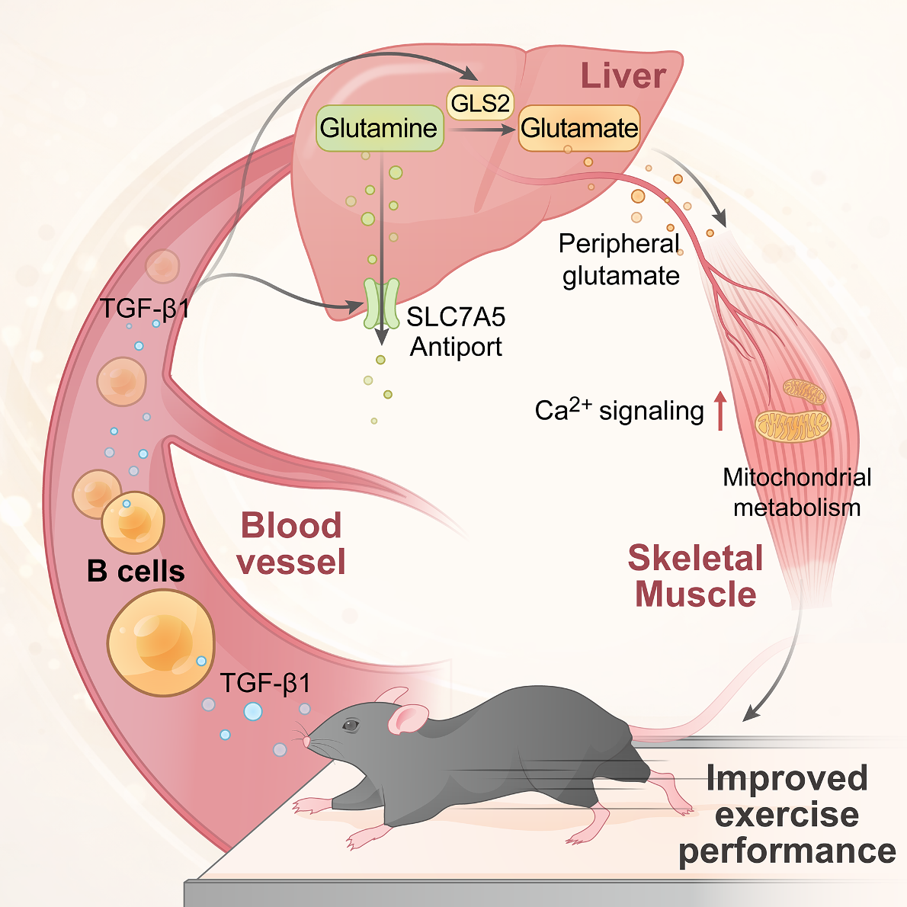
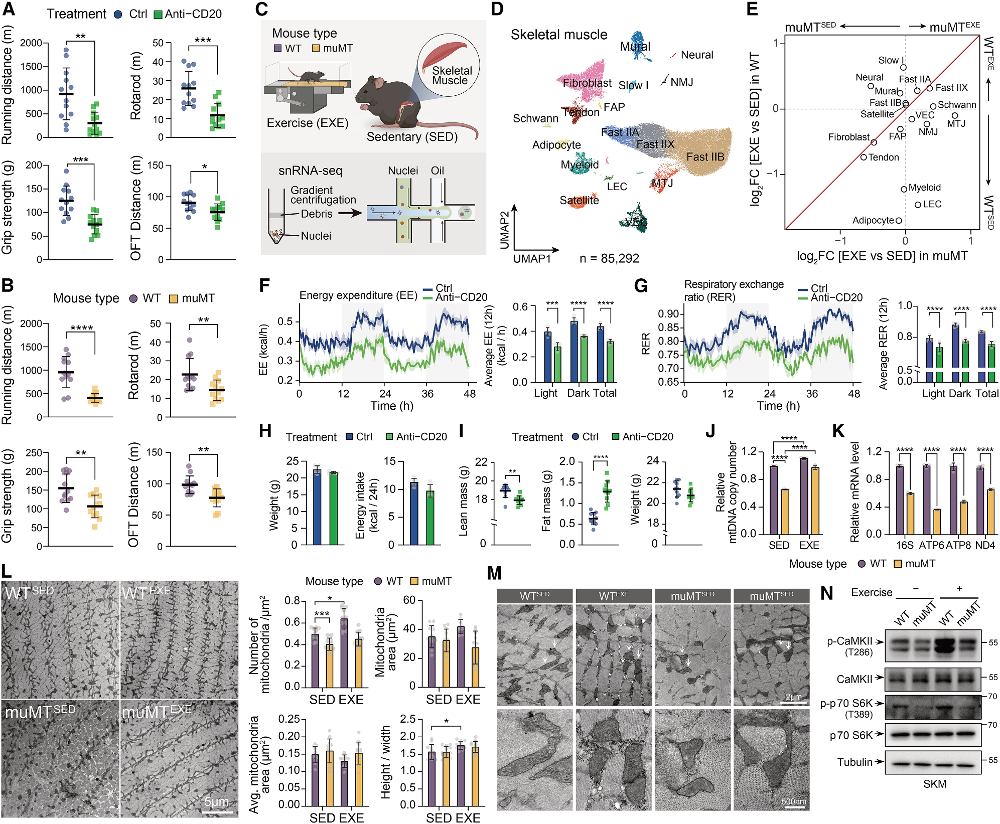
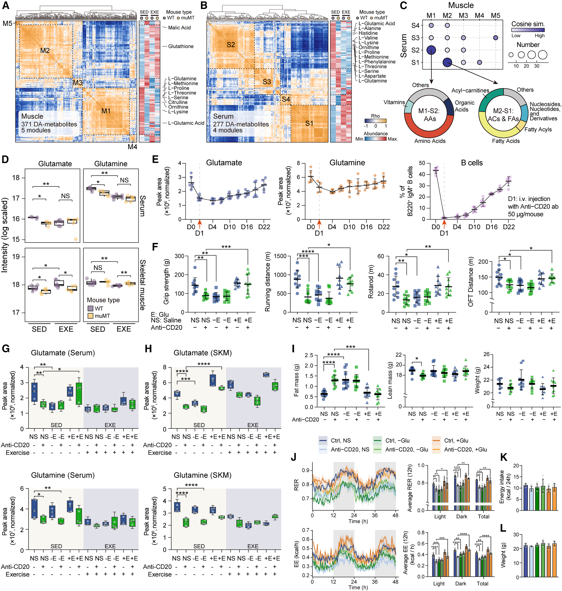
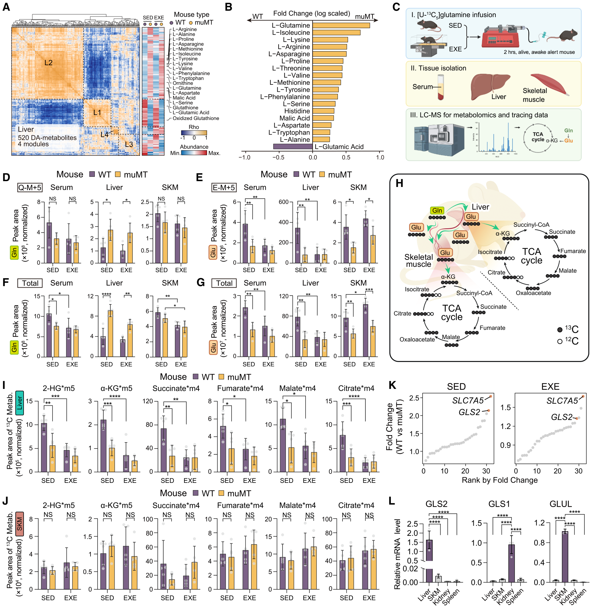
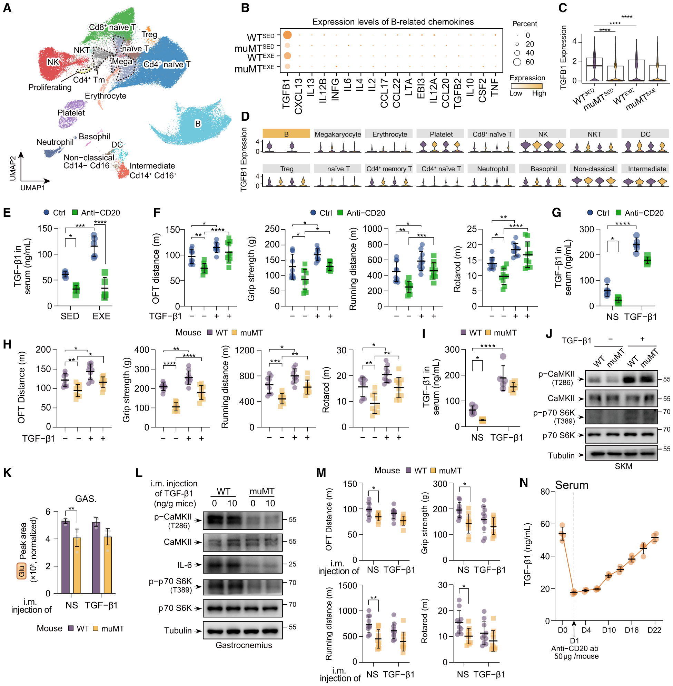
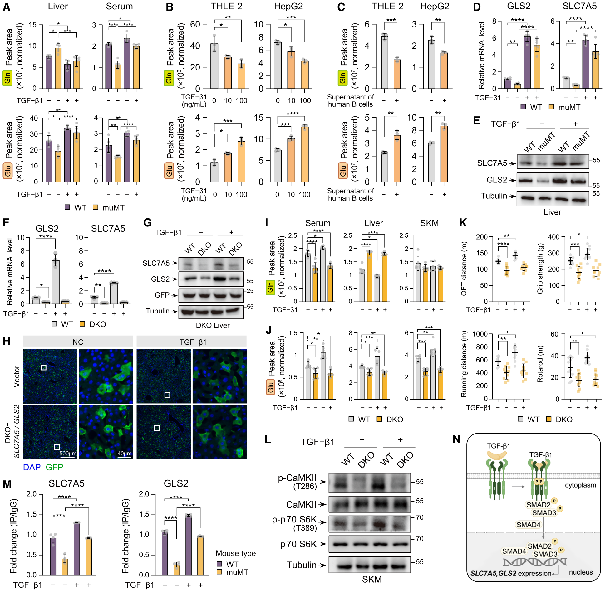
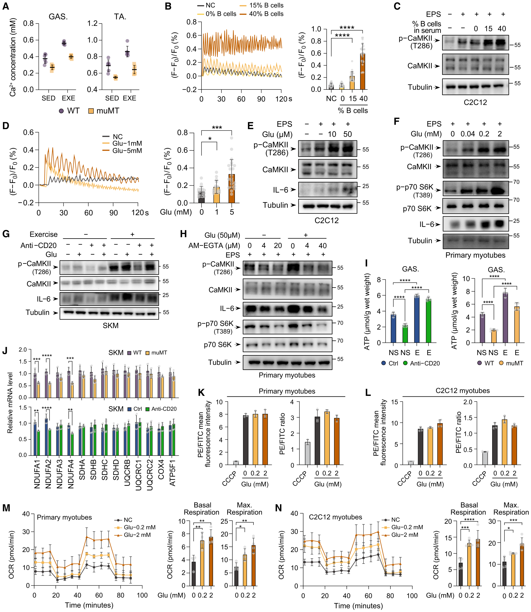
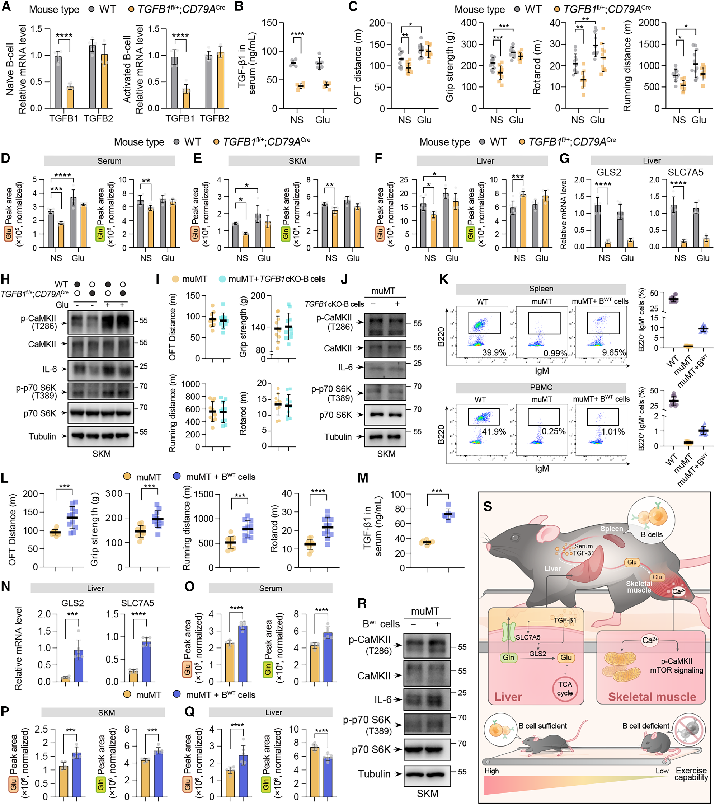

标题：B细胞缺失重塑肝脏谷氨酸代谢并限制小鼠运动能力

发表：Cell (2026)

类型：science

citekey：8660add44f

## 十行速览

1. 现实问题：去除 B 细胞可治疗某些疾病，但其对运动能力是否有非经典免疫作用及其跨器官机制尚未明确（引言，PDF 第 2 页）。
2. 此前背景包括运动后的肌肉钙信号和免疫变化，并不能直接回答 B 细胞如何改变运动表现（引言，PDF 第 2 页）。
3. 本文提出：在所测小鼠中，B 细胞经 TGF-β1 与肝脏谷氨酰胺／谷氨酸代谢，影响骨骼肌钙信号和运动表现（Fig. 1–7）。
4. 抗 CD20 耗竭和遗传性成熟 B 细胞缺失均伴随运动表现下降；这不是直接的人体临床结果（Fig. 1A–B）。
5. 血清与肌肉谷氨酸降低、补充谷氨酸后的恢复，以及谷氨酰胺示踪共同指向肝—肌代谢连接（Fig. 2–3）。
6. 血清 TGF-β1 补充与肝脏 GLS2／SLC7A5 双靶点干预把 B 细胞、肝脏代谢与运动表型连接起来（Fig. 4–5）。
7. 谷氨酸诱导肌管钙响应，钙螯合阻断相关磷酸化，肌肉 ATP 与细胞耗氧读出提供互补证据（Fig. 6）。
8. B 细胞 Tgfb1 杂合条件模型及野生型／条件模型 B 细胞回输支持该链，但未单独证明每个环节的唯一性（Fig. 7；Methods，PDF 第 21、26 页）。
9. 样本和统计需按面板辨认：细胞、图像、混样和小鼠不能互换，图注复用与正文／图注不一致均需保留（Fig. 1L、6B、7N；Methods，PDF 第 22、28 页）。
10. 本次未获可核验的已读对照；人体验证、原始数据及若干图注矛盾仍待查（Limitations，PDF 第 14 页；Data S1–S2）。

---

## PDF 与来源

- 原文：Youxiang Mao, Ziyan Xia, Xu Pan, Wenjun Xia, Peng Jiang. “B cell deficiency limits exercise capacity by remodeling liver glutamate metabolism.” *Cell* 189, 3254–3269 (2026). DOI：[10.1016/j.cell.2026.03.039](https://doi.org/10.1016/j.cell.2026.03.039)。原文于 2026-04-17 在线发表，期刊页标 2026-05-28（PDF 第 2、16 页）。
- 来源：用户提供的原始 PDF；为避免泄露本地用户路径，此展示稿不公开绝对路径。已读取 PDF 第 1–28 页的文字、资源和 Methods，以及第 29–47 页 S1–S10 的可提取文字与图例；主图裁切经独立回读；补充图的图内内容未逐张独立目视核验。原文引文只作为作者的背景线索，没有逐篇取得或核验。本次仅收到该 PDF，Data S1、Data S2 和 Table S1 未单独取得、未核验。
- 页码：PDF 第 2–16 页为主文与主图／图例，印刷页码 3254–3268；第 17 页为参考文献续页，第 18–28 页为 STAR Methods；第 29–47 页为补充图和图例。主图 Fig. 1–7 分别位于 PDF 第 4、5、7、9、11、13、15 页，部分图例续于紧接其后的页；封面 Graphical abstract 位于 PDF 第 1 页。
- **原图与版权**：以下图片取自用户提供的 PDF 的原始图像对象，或按所在页面原位裁切并栅格化；不重画、不覆盖、不增加图内标记。论文 PDF 标注“© 2026 Elsevier Inc. All rights are reserved, including those for text and data mining, AI training, and similar technologies.”（PDF 第 2 页）。本说明只标明来源和原文版权状态，**不表示作品采用 CC BY，也不表示已获得再分发或公开展示授权**；后续公开或云端再利用应由使用者核实适用许可。
- 图片路径相对于本阅读稿所在目录；插入仓库根目录 README 时需转换为以 `examples/b-cell-exercise/` 开头的路径。此处为本地阅读稿，不表示已完成云端归档。
- 原图回读状态：已进行源对象哈希／裁切范围与像素一致性自动检查；主图裁切经独立回读，图框完整、无正文／图注混入，关键标签可读；补充图的图内内容未逐张独立目视核验。

## 第 1 段：痛点

抗 CD20 等 B 细胞清除治疗有明确的免疫学背景，但不能据此推出 B 细胞缺失对运动的后果，更不能解释免疫细胞如何跨肝脏、血液与肌肉发挥作用。已有研究将肌肉钙／CaMK 信号、线粒体适应以及运动引起的免疫变化联系起来；这些是论文引言引用的**背景知识**，不是本文新做的临床治疗试验（引言及引文 8–17，PDF 第 2 页）。实际难题是同时区分 B 细胞缺失、系统代谢变化、局部肌肉效应和其他免疫／心血管解释；如果只看一个血清代谢物的相关性，就不足以定位作用器官或恢复功能。

## 第 2 段：空白与核心新发现

**在本研究的实验条件下，小鼠 B 细胞缺失伴随循环 TGF-β1 和肝脏 GLS2／SLC7A5 改变、血清及骨骼肌谷氨酸降低，并伴随较差的运动表现；补充或回输等干预支持一条 B 细胞—肝脏—肌肉作用链。**

作者将其概括为 B 细胞的“免疫非依赖”功能；这里更窄的证据表述是：若干替代性免疫表型不一致或阴性，而 TGF-β1、肝脏代谢及谷氨酸干预可改变实验小鼠表型（Fig. 1–7，S2、S5、S10）。这补充了 B 细胞作为抗体／免疫细胞之外的跨器官代谢调节角色，并不证明该过程完全不涉及其他免疫作用。遗传／抗体消除、TGF-β1 与代谢物干预、肝脏双靶点抑制、同位素示踪、回输、肌管和生化测量构成互补证据；单细胞、代谢组及血液相关性本身不证明因果。作者明确说尚缺直接人体数据（Limitations，PDF 第 14 页）。

论文自己的机制总览连接 B 细胞、肝脏、骨骼肌与运动；它是作者提出的工作模型，不是单个实验的直接读出（Graphical abstract，PDF 第 1 页）。

原文标题：Graphical abstract。

中文：作者提出 B 细胞相关 TGF-β1 改变肝脏谷氨酰胺代谢，再通过谷氨酸影响肌肉钙信号与运动。这是综合模型；其不同环节的证据强度和对象需按下文各图分别判断。

## 第 3 段：论证链

### 3.1 论证地图

P1 **存在表型**：两种 B 细胞缺失方式下小鼠运动与肌肉读出改变（Fig. 1，S1–S2）。 
P2 **代谢物可参与表型**：Glu 随缺失下降；补充可恢复多项结果（Fig. 2，S3）。 
P3 **肝脏是有证据的上游节点**：Gln 示踪、组织差异及肝脏 SLC7A5 操作支持肝代谢参与，但并未直接测定完整器官间净通量（Fig. 3，S4）。 
P4 **TGF-β1—肝靶点可干预**：外源 TGF-β1、局部／系统对照、肝双靶点 CRISPR 和 SMAD2/3 富集连接信号与转录（Fig. 4–5，S5–S6）。 
P5 **肌肉有可操作的下游响应**：Glu、Ca²⁺ 螯合、ATP 与耗氧实验支持肌肉机制；B 细胞 Tgfb1 条件等位基因和回输进一步测试来源（Fig. 6–7，S7–S10）。

### 3.2 指标和读图前提

- 跑台耐力是到预定疲劳终点的表现；转棒反映协调与耐受，握力反映抓握力，开放场距离反映一般运动活动；这些读出互补，但没有一个单独等于人的最大摄氧量或自发运动动机（Fig. 1A–B；Methods，PDF 第 24 页）。
- RER 为呼出二氧化碳与摄入氧的比值 $VCO_2/VO_2$，用于间接判断底物氧化倾向；能量消耗由间接测热估算，食物摄入和体组成提供补充，但两者不能单独定位哪一个器官消耗了能量（Fig. 1F–I；Methods，PDF 第 23 页）。
- LC–MS 的代谢物峰面积／相对丰度描述测得的代谢物量；$M+5$ 表示含五个标记碳的同位素体信号，它能报告标记进入产物，但不能单靠这一数值定量器官间净通量（Fig. 3C–J；Methods，PDF 第 23–24 页）。
- $F$ 为电刺激时荧光强度，$F_0$ 为刺激前同一区域基线；$(F-F_0)/F_0$ 是标准化钙荧光变化，不直接等于肌肉组织钙离子绝对浓度；另一个组织匀浆比色法给出组织钙读出（Fig. 6A–B、D；Methods，PDF 第 22–23 页）。
- mtDNA／核 DNA 比值、TEM 线粒体数量／形态、肌肉 ATP 以及肌管氧消耗率（OCR）分别反映拷贝数、超微结构、组织 ATP 和细胞呼吸；它们互补，但都不是单独测得的线粒体新生速率，OCR 也不能单独决定运动中的 ATP 来源（Fig. 1J–M、6I–N；Methods，PDF 第 25、27 页）。
- 此文没有算法训练目标或损失函数，损失项不适用；上式中的 $VCO_2$、$VO_2$、$F$、$F_0$ 为各次测量的标量，$M+5$ 是同位素体类别而非独立样本（Methods，PDF 第 23–24 页）。

### 3.3 P1：B 细胞缺失与运动表型是否相连？

**问题与设计。** 若结果只来自单一遗传背景或单一运动测试，不能知道它是否伴随 B 细胞损失。作者以抗 CD20 与同型抗体对照比较，并以缺乏成熟 B 细胞的 muMT 小鼠与 WT 比较；运动后测肌肉单核转录组、呼吸代谢和线粒体结构（Fig. 1；Methods，PDF 第 21–22 页）。

**按图读。** A–B 从跑台、转棒、握力和开放场展示两套模型；作者报告抗 CD20 组跑台、转棒和握力下降约 40%–50%，开放场影响较小（Results，PDF 第 3 页）。C 为训练与取样，D 为肌肉细胞核 UMAP，E 将不同细胞类型的运动响应按 WT／muMT 分轴比较；论文称共识别 85,292 个细胞核及 17 种类型，但**核不是动物重复**（Fig. 1C–E；Methods，PDF 第 22 页）。F–I 给出能量消耗、RER、摄食、体重与 MRI 脂肪／瘦体重；J–N 依次为肌肉 mtDNA、线粒体相关转录、TEM 数量／嵴以及磷酸化免疫印迹。J–M 同时提供数量与结构而非只凭一张显微图判断功能。

> Figure 1. B cell deficiency impairs exercise capacity and skeletal muscle function (A and B) Exercise performance of isotype-matched Ctrl and anti-CD20 monoclonal antibody (mAb)-treated mice (A) and WT and muMT mice (B). Treadmill endurance, rotarod, grip strength, and open field tests (OFTs) were performed 30 days post B cell depletion (2-day rest between tests; n = 12). (C) Schematic of exercise protocol, tissue sampling, scRNA-seq, and liquid chromatography-mass spectrometry (LC-MS) analysis. (D) UMAP of skeletal muscle (SKM) nuclei, colored by cell type (UMAP, uniform manifold approximation and projection). (E) Exercise-induced cell-type abundance changes in muMT vs. WT mice. Scatterplot shows log₂ fold changes (EXE vs. SED) for each SKM cell population (muMT: x axis; WT: y axis). Each point = one cell type; red diagonal = equal genotype responses. (F–H) EE (F), RER (G), weight, and energy intake (H) quantification during 12-h light/dark cycle and their averages in Ctrl/anti-CD20 mAb-treated mice (30 days post-treatment; n = 5); data are shared with Figures 2J–2L (anti-CD20 or isotype control/fed normal saline [NS], same treatments). (I) Fat/lean mass and weight in Ctrl/anti-CD20 mAb-treated mice (30 days) by magnetic resonance imaging (MRI) (n = 10, data from Figure 2I). (J) mtDNA copy number in WT/muMT SKM (n = 4). (K) Relative mRNA levels of mitochondrial function-related genes in WT/muMT SKM (n = 4). (L) Representative transmission electron microscopy (TEM) images of SKM mitochondria in WT/muMT mice (SED/EXE, left; scale bars, 5 μm). Quantification (right; 11–12 images per mitochondrial population from three mice). (M) TEM images of mitochondrial cristae changes in WT/muMT SKM (SED/EXE; three mice). Scale bars: 2 μm (low magnification), 500 nm (high magnification). (N) Western blotting of homogenized gastrocnemius (GAS) muscle (SKM) from WT/muMT mice (SED/EXE). All data: mean ± SD. Experiments repeated ≥3 times (consistent results). p values: two-tailed unpaired t test (A, B, F–I, and K) and two-way ANOVA + Tukey’s test (J and L). \*p < 0.05, \*\*p < 0.01, \*\*\*p < 0.001, \*\*\*\*p < 0.0001. See also Figures S1 and S2.

中文：先比较抗 CD20／同型对照和 muMT／WT 的运动表现，再看运动后肌肉细胞组成及线粒体读出。图中细胞核和 TEM 图像都嵌套在动物样本之内，不能当成彼此独立的小鼠。

**结果与边界。** 两种缺失模型出现较差表现，并伴肌肉 mtDNA／线粒体结构和磷酸化差异（Fig. 1A–B、J–N）。常规心脏超声、肌纤维形态和毛细血管读出未见作者所报告的明显差异，缩小了这些测量范围内的替代解释，但不能排除所有心肺、神经、疾病或动机因素（Fig. S1L–T、S2A–C）。主要实验使用雄鼠；雌鼠有关键复现但伴体重差异，不能把“未见明显性别差异”等同完整性别分层验证（Fig. S1D、S10D–O；Methods，PDF 第 21 页）。

### 3.4 P2：Glu 是伴随变化，还是能改变运动表现？

**问题与设计。** 作者从肌肉与血清代谢组的相关模块中筛选代谢物，并比较 WT／muMT、静息／训练；再比较 B 细胞清除恢复时的血液读出，以及饮食或腹腔 Glu 条件（Fig. 2；Methods，PDF 第 23–24 页）。

**按图读。** A–C 是肌肉／血清代谢模块及相似性，不是干预；D 显示组织中 Glu／Gln，E 把外周血 B 细胞比例与血清代谢物联系起来。F 对照缺失、饮食及 Glu 给药的运动表现，G–H 测血清与腓肠肌代谢物，I–L 测体组成、RER、能量消耗和摄食／体重（Fig. 2A–L）。补充图 S3 展示其他氨基酸、乳酸、糖原和部分 TCA 中间物；图例明确 Fig. S3A 的部分数据与 Fig. 2D 复用，不是独立复现。

> Figure 2. B cell-maintained peripheral Glu ensures optimal exercise performance (A and B) Metabolite modules in SKM (A) and serum (B). Each panel: right, Spearman correlation similarity matrix between metabolites; left, mean metabolite abundances of WT/muMT groups at SED/EXE (n = 5). (C) Bubble plot (cosine similarity across muscle/serum metabolite modules, dots sized by metabolite number) and donut chart (metabolite category percentages) (n = 5). (D) Boxplot: Glu/Gln intensity in muscle/serum of WT/muMT mice at SED/EXE (n = 5). (E) Correlation between serum Glu/Gln and PBMC-derived B cell percentage. B cells depleted by day 1 intravenous (i.v.) 50 μg/mice anti-CD20 antibody; orbital blood collected for LC-MS and FACS analysis (n = 5–6). (F–L) 5-week-old mice: anti-CD20 or isotype control, fed NS, Glu-deficient (-E) or NS + Glu intraperitoneal (i.p.) every other day (+E). After 30 days, exercise performance (F), serum (G)/SKM (GAS) Glu/Gln (H), fat/lean mass and weight (I), RER/EE (J), energy intake (K), and weight (L) were measured. n = 10 (F and I); n = 5 (G, H, and J–L). All data: mean ± SD. Experiments repeated ≥3 times (similar results). p values: two-way ANOVA + Tukey’s test (D and F–L). \*p < 0.05, \*\*p < 0.01, \*\*\*p < 0.001, \*\*\*\*p < 0.0001. See also Figures S2 and S3.

中文：代谢组和血中 B 细胞比例先提示谷氨酸与表型有关，随后补充谷氨酸测试能否改变运动和代谢读出。相关性不能单独区分原因与结果，补充的效应也不能证明谷氨酸是唯一介质。

**结果与替代解释。** muMT 小鼠血清及肌肉 Glu 较低；外源 Glu 使多项缺失相关表型改善（Fig. 2D、F–L）。这支持 Glu 在所用模型中具有功能作用，不证明其生理浓度变化是所有运动缺陷的唯一原因，也不排除其他代谢物随干预同时变化。Fig. 2F–L 图注将对照写作“fed NS”，语义与饲料／注射并列不够清楚；此处保留“普通／缺 Glu 饲料及腹腔补充”而不凭空细化对照（Fig. 2 图注续页，PDF 第 6 页）。

### 3.5 P3：变化是否涉及肝脏 Gln 代谢？

**问题与设计。** 单独看肌肉 Glu 降低无法判定它来自肌肉自身，还是其他组织。作者比较肝、血清和肌肉代谢物，对清醒小鼠静脉给予 [U-¹³C₅]-Gln 并用 LC–MS 追踪，再改变肝脏转运相关蛋白（Fig. 3；Fig. S4；Methods，PDF 第 24–25 页）。

**按图读。** A–B 是肝代谢组模块与氨基酸变化；C 是示踪方案；D–G 分别给出标记 Gln、标记 Glu 和总 Gln／Glu 的跨组织读出；H 是作者提出的器官交换示意，I–J 是肝和肌肉的 TCA 标记读出；K–L 检查相关酶／转运体的肝内表达及组织分布。图例将部分标记读出称“flux”，但展示的标记和丰度不应被自动理解为已定量的净器官间通量（Fig. 3C–L）。

> Figure 3. B cell deficiency alters Glu metabolism in multiple tissues (A) Liver metabolite modules. Right: the Spearman correlation similarity matrix between metabolites; left: mean metabolite abundances of WT and muMT mice at SED and EXE states (n = 5). (B) Bar plot of amino acid fold changes in the liver of WT and muMT mice (n = 5). (C) Schematic of the [U-13C]-Gln infusion system. [U-13C]-Gln was infused into the tail vein of SED and EXE mice for 2 h (mice alive, awake, alert). Serum, liver, and SKM were collected immediately post-infusion for LC-MS analysis. (D–G) Circulatory [U-13C]-Gln (Q-M+5) (D), Glu (E-M+5) (E) flux, and total Gln (F) and Glu (G) abundance in serum, liver, and SKM of WT and muMT mice (SED/EXE) after 2 h [U-13C]-Gln infusion (n = 5). (H) Schematic of inter-organ Gln/Glu carbon exchange between SKM and liver via serum (black circles: 13C-labeled carbons; open circles: 12C carbons). (I and J) TCA cycle flux in liver (I) and SKM (J) of WT and muMT mice (SED/EXE) after 2 h [U-13C]-Gln infusion (n = 5). (K) Relative mRNA levels of Glu/Gln metabolism transporters and enzymes in the liver of WT and muMT mice (SED/EXE). (L) Relative mRNA levels of GLS2, GLS1, and GLUL in mouse liver, kidney, SKM, and spleen (n = 4). All data are mean ± SD. Experiments were performed ≥3 times with similar results. p values: one-way ANOVA+ Dunnett’s test (L) and two-way ANOVA + Tukey’s multiple comparison test (D–G, I, and J). \*p < 0.05, \*\*p < 0.01, \*\*\*p < 0.001, \*\*\*\*p < 0.0001. See also Figure S3.

中文：先看肝内谷氨酰胺积累与谷氨酸减少，再看标记碳进入各组织谷氨酸及 TCA 中间物的差异。跨组织示意是模型，示踪本身不能独立测出肝到肌肉的净转运速率。

**结果与替代解释。** 在作者条件下，muMT 小鼠肝脏标记 Gln 较高，各组织的 Gln 来源标记 Glu 较低，而肌肉 TCA 标记与部分局部代谢酶读出差异有限（Fig. 3D–J，S3J–M）。肝 SLC7A5 过表达改善运动并提高肌肉 Glu，但未提高血清／肝 Glu；作者提出多余 Gln 可能供应肌肉产生 Glu（Fig. S4H–Q）。因此，“肝脏直接输出的 Glu 是肌肉 Glu 的唯一来源”并未被证明，肌肉局部代谢仍是重要替代／补充路径。

### 3.6 P4：上游 TGF-β1 如何连接 B 细胞与肝脏？

**问题与设计。** 作者测 PBMC 转录、血清蛋白和 B 细胞清除恢复相关性，比较系统性 TGF-β1 与肌肉局部注射，再分别测试肝细胞培养、肝脏双靶点 CRISPR 和 SMAD2/3 启动子富集（Fig. 4–5；Methods，PDF 第 21、25–26 页）。

**Fig. 4 按图读。** A–D 为 PBMC 细胞分群与 Tgfb1 表达，E 为血清蛋白；F–J 测系统性 TGF-β1 对抗体耗竭或 muMT 小鼠运动、血清蛋白和肌肉磷酸化的影响；K–M 改用肌肉内给药，观察局部 Glu、蛋白和运动；N 为恢复过程中的血清 TGF-β1 与 B 细胞比例相关性。相关性与系统补充分别承担提示和干预作用，不是同一证据类型（Fig. 4A–N）。

> Figure 4. B cells sustain serum TGF-β1 levels to drive exercise performance (A) UMAP of serum cells, colored by cell type. (B) Dot plot of pseudobulk B cell-related chemokine expression in serum from WT/muMT mice (SED/EXE); pseudobulk profiles = sum of transcript counts per sample. (C and D) Violin plots of TGF-B1 expression: (C) overall PBMCs TGF-B1; (D) TGF-β1 in each PBMC cell type. (E) ELISA analysis of serum TGF-β1 protein in SED/EXE mice treated with isotype control or anti-CD20 mAb (n = 5). (F and G) 5-week-old mice treated with isotype control/anti-CD20 mAb + i.p. TGF-β1 every other day for 30 days. Exercise performance (F) (2-day rest between tests) (n = 10) and serum TGF-β1 (G) (n = 5) measured. (H and I) WT/muMT mice injected i.p. with TGF-β1 every other day for 30 days. Exercise performance (H) (2-day rest between tests) (n = 9–10) and serum TGF-β1 (I) (n = 5) measured. (J) Western blot analysis of homogenized GAS (SKM) from WT/muMT mice (±i.p. 250 ng TGF-β1). (K–M) WT/muMT mice injected intramuscular (i.m.) with TGF-β1 (10 ng/g per mouse) every other day for 20 days. GAS Glu levels (K) (n = 5), western blotting of exercise-related proteins (L), and exercise performance (M) (n = 10) assessed. (N) Correlation between serum TGF-β1 and B cell percentage: B cells depleted by i.v. 50 μg/mice anti-CD20 (day 1); serum TGF-β1 detected by ELISA (as Figure 2E); B cell percentage shown in Figure 2E (n = 4). All data: mean ± SD; experiments repeated ≥3 times. p values: Mann-Whitney U test (C) and two-way ANOVA + Tukey’s test (E–I, K, and M). \*p < 0.05, \*\*p < 0.01, \*\*\*p < 0.001, \*\*\*\*p < 0.0001. See also Figure S4.

中文：比较系统补充与肌肉局部注射，理解为什么作者将 TGF-β1 的主要作用位置指向肌肉之外。局部给药在所测剂量、时间和指标下未恢复，并不证明肌肉永远不能响应 TGF-β1。

**Fig. 5 按图读。** A、D–E 将系统补充后的肝／血清代谢物与肝 GLS2、SLC7A5 表达放在一起；B–C 是人源 THLE／HepG2 细胞经 TGF-β1 或人 B 细胞条件培养基处理，结果是细胞培养证据而非人体运动研究。F–H 验证肝脏双靶点 CRISPR 干预，I–L 检验代谢物、运动与肌肉蛋白，M 用抗 SMAD2+SMAD3 与 IgG 对照做肝组织 CUT&RUN-qPCR，N 为作者机制示意。原文将该干预称 double-knockdown／DKO，不能推断每个肝细胞或每个靶点都达到完全敲除（Fig. 5A–N，S6A–B）。

> Figure 5. TGF-β1 transcriptionally upregulates hepatic Gln catabolism (A, D, and E) WT and muMT mice were treated with/without TGF-β1 every other day for 30 days. Liver (left) and serum (right) Gln/Glu levels (A), liver SLC7A5/GLS2 mRNA (D), and protein (E) levels were measured (n = 5–6). (B and C) THLE or HepG2 cells were treated with TGF-β1 for 12 h, and subsequently detected cellular Gln and Glu levels (B) (n = 3). Human B cells culture medium was collected after 48 h and added to THLE or HepG2 cells for further 12 h. Intracellular Gln and Glu levels were quantified by LC-MS (C) (n = 3). (F–J) C57BL/6J mice received hydrodynamic tail vein injection of GFP-tagged CRISPR plasmid to knockdown liver SLC7A5/GLS2 (DKO), then i.p. TGF-β1 every other day for 30 days. SLC7A5/GLS2 knockout efficiency was verified by RT-qPCR (mRNA, F) (n = 4), western blot (protein, G), and immunofluorescence (H); (H) shows DAPI/GFP staining (sgRNA expression). Scale bars: 500 μm (low magnification) and 40 μm (high magnification). For immunofluorescence: five images/mouse, three mice/group. Serum/liver/SKM Gln (I) and Glu (J) (n = 6) levels were analyzed by LC-MS. (K) Exercise performance of untreated/TGF-β1-treated WT and liver DKO mice (2-day rest between assays) (n = 10). (L) Western blot analysis of GAS (SKM) of untreated/TGF-β1-treated WT and liver DKO mice. (M) CUT&RUN-qPCR (anti-Smad2+Smad3 antibody) demonstrated TGF-β transcriptional regulation of liver SLC7A5/GLS2 in untreated/TGF-β1-treated WT and muMT mice. Data: mean 2-ΔΔCT (normalized to IgG/β-actin) (n = 4). (N) Schematic of TGF-β regulation of SLC7A5/GLS2. All data: mean ± SD. Experiments repeated ≥3 times. p values: two-way ANOVA + Tukey’s test (A, D, F, I–K, and M); one-way ANOVA + Dunnett’s test (B); two-tailed unpaired Student’s t test (C). \*p < 0.05, \*\*p < 0.01, \*\*\*p < 0.001, \*\*\*\*p < 0.0001. See also Figures S4, S5, and S6.

中文：把 TGF-β1 引起的肝靶点表达、双靶点干预后的表型和启动子 SMAD2/3 富集连读。双靶点同时改变不能分别证明 GLS2 或 SLC7A5 各自对所有终点都是必需的。

**结果与替代解释。** 系统性 TGF-β1 在模型中改善运动表型并增加肝靶点表达；肝脏双靶点干预使许多 TGF-β1 效应减弱，CUT&RUN 提供启动子占据证据（Fig. 4F–J、5D–M）。肌内 TGF-β1 与 IL-6 补充在所测条件下未重现效果（Fig. 4K–M，S5I–K）；这限制了这些具体方案的解释，不等于排除所有局部免疫因子或剂量。Fig. S6I 的人源细胞 ChIP-seq 轨迹来自外部 GEO／ENCODE 数据，是本文对既有数据的再分析，不应称作本文新做的人体试验。

### 3.7 P5：肌肉钙与线粒体读出能否连接到 B 细胞来源？

**问题与设计。** 作者先以不同来源的小鼠血清或 Glu 刺激 C2C12／原代肌管，再用钙螯合剂、ATP／OCR 等实验检验下游；最后用 B 细胞 Tgfb1 条件等位基因与 B 细胞回输考察来源（Fig. 6–7，S6–S9）。

**Fig. 6 按图读。** A 是组织匀浆钙比色；B–D 是小鼠血清或 Glu 条件下肌管电刺激钙荧光与蛋白，B、D 图注各称约 30 个细胞但未交代它们来自多少个独立培养或动物。E–H 检查肌管、鼠肌肉及 AM-EGTA 螯合后的磷酸化；I–J 测肌肉 ATP 与呼吸链相关 mRNA；K–L 以 JC-1 测膜电位并设去极化阳性对照：图内标签为 CCCP，图注写为 FCCP，药物名称待原始资料核实（Fig. 6K–L，PDF 第 13–14 页）；M–N 测原代与 C2C12 肌管基础和最大 OCR（Fig. 6A–N）。

> Figure 6. Glu fosters Ca2+ signaling and mitochondrial function in SKM (A) Intracellular calcium concentration in GAS and TA muscles of WT and muMT mice (SED or EXE) (n = 6). (B) Contribution of serum from mice with different B cell numbers to C2C12 myotube Ca2+ responses. High B cell serum increased intracellular Ca2+ sparks upon EPS (left). Normalized average calcium transient amplitude ((F-F0)/F0) vs. basal (no EPS) (right). ∼30 cells quantified. (C) C2C12 myotubes were cultured in serum from mice with different B cell numbers for 12 h prior to EPS (in vivo exercise mimic) and analyzed by western blotting. (D) Contribution of Glu to C2C12 myotube Ca2+ responses. High Glu increased intracellular Ca2+ sparks upon EPS (left). Normalized average calcium transient amplitude ((F-F0)/F0) vs. basal (no EPS) (right). ∼30 cells quantified. (E) C2C12 myotubes were pretreated with increasing Glu doses for 12 h prior to EPS (in vivo exercise mimic) and analyzed by western blotting. (F) Western blot analysis of primary myotubes pretreated with increasing Glu doses for 12 h prior to EPS (in vivo exercise mimic). (G) GAS (SKM) from isotype control (Ctrl) and anti-CD20 antibody-treated mice (i.p. Glu) was analyzed by western blotting. (H) Primary myotubes were pretreated with/without 50 μM Glu and increasing AM-EGTA doses for 12 h prior to EPS (in vivo exercise mimic) and analyzed by western blotting. (I) GAS ATP concentration in Ctrl/anti-CD20 antibody-treated mice (left) and WT/muMT mice (normal chow or + Glu i.p. every other day for 30 days, E group) (n = 4). (J) Relative mRNA expression of mitochondrial electron transport chain (ETC) components in SKM (GAS) from WT/muMT mice or Ctrl/anti-CD20-treated mice (n = 6). (K and L) Mitochondrial membrane potential JC-1 (mitochondrial membrane potential dye) staining: red = aggregates, green = monomers. Fluorescence changes in primary myotubes (K) and C2C12 myotubes (L) after L-Glu treatment were quantified by FACS; FCCP (carbonyl cyanide-4-(trifluoromethoxy) phenylhydrazone) as positive control (mitochondrial depolarization) (n = 3). (M and N) OCR in primary myotubes (M) (n = 4) and C2C12 myotubes (N) (n = 5) pretreated with L-Glu for 12 h; basal and maximal respiration quantified. All data: mean ± SD. Experiments repeated ≥3 times. p values: two-way ANOVA + Tukey’s test (A and I); one-way ANOVA+ Dunnett’s test (B, D, and K–N); two-tailed unpaired Student’s t test (J). \*p < 0.05, \*\*p < 0.01, \*\*\*p < 0.001, \*\*\*\*p < 0.0001. See also Figures S6 and S7.

中文：区分组织匀浆的钙含量、单个肌管的电刺激钙荧光和肌肉 ATP／细胞耗氧，它们分别测量不同层面。螯合剂支持钙参与谷氨酸诱导的磷酸化，但并未识别谷氨酸最初作用的受体或直接测出体内信号通量。

**Fig. 7 按图读。** A–H 比较 WT 与 Tgfb1 条件杂合模型的 B 细胞表达、血清 TGF-β1、运动、组织 Glu／Gln、肝靶点和肌肉蛋白，并检查 Glu 补充；I–J 测条件模型来源 B 细胞回输；K–R 测 WT B 细胞回输后的细胞比例、运动、血清、组织代谢和肌肉蛋白；S 是作者整体模型（Fig. 7A–S）。Methods 写明受基因位置限制只获得 Tgfb1^flox/+; Cd79a^Cre，而不是 Tgfb1 双等位基因纯合条件敲除；每只受体按方案接受活化 B 细胞回输，不能把回输的细胞数当作受体数（Methods，PDF 第 21、26 页）。

> Figure 7. B cell-specific TGF-β1 deficiency yields a phenotype resembling B cell deficiency (A) Reverse-transcription quantitative PCR (RT-qPCR)-determined TGFB1/TGFB2 expression in naive (left) and activated (right) splenic B cells from WT and TGFB1fl/+CD79Acre mice (n = 6). (B–H) WT and TGFB1fl/+CD79Acre mice maintained on a normal diet received i.p. L-Glu every other day for 30 days. Serum TGF-β1 (B) (n = 6) was measured by ELISA. Exercise performance was assessed (C) (n = 10). Serum (D), GAS (SKM, E), and liver (F) Glu/Gln levels were quantified by LC-MS. mRNA (G) (n = 6) and protein (H) levels were analyzed. (I and J) Exercise performance (I) (n = 10) and western blot analysis of GAS muscle (SKM) (J) in muMT mice with/without adoptive transfer of TGFB1 cKO splenic B cells (from TGFB1fl/+CD79Acre mice). (K) Flow cytometry of splenic (top) and PBMC-derived (bottom) B cells in WT, muMT, and muMT mice with WT splenic B cell transfer (n = 11). Representative B220+IgM+ gating and quantification are shown. (L) Exercise performance in muMT mice with/without WT B cell transfer (n = 11). (M and N) Serum TGF-β1 (M) and GAS GLS2/SLC7A5 mRNA levels (N) in muMT mice with/without B cell transfer (n = 6). (O–Q) Serum (O), GAS SKM (P), and liver (Q) Glu/Gln levels (LC-MS) in muMT mice with/without B cell transfer (n = 6). (R) Western blot analysis of exercise-related signaling in muMT mice with/without WT B cell transfer (GAS SKM). (S) Working model: B cells regulate exercise capacity via spatial and metabolic modulation of liver metabolism. All data: mean ± SD. Experiments were repeated ≥3 times with consistent results. p values: two-tailed unpaired Student’s t test (A, I, and L–Q); one-way ANOVA + Dunnett’s test (K); two-way ANOVA + Tukey’s test (B–G). \*p < 0.05, \*\*p < 0.01, \*\*\*p < 0.001, \*\*\*\*p < 0.0001. See also Figures S8 and S9.

中文：条件杂合模型和不同供体的 B 细胞回输把 TGF-β1 来源与运动表型联系起来，工作模型则汇总此前各环节。原文 Fig. 7N 的组织名称以及 7O–Q 的部分文字方向存在待核对问题，不能在未查原图和原始数据前擅自消除矛盾。

**结果与边界。** 作者报告条件杂合模型产生与 B 细胞缺失相近的表型；野生型、而非条件模型来源的 B 细胞回输改善运动（Fig. 7A–L）。Glu 补充可绕过若干上游缺失效应，Gln 也可改善肝双靶点模型部分读出，后者与可能存在肝外／肌肉局部代谢的解释相容（Fig. S8N–R、S9）。这些实验支持参与关系，不证明体内所有 TGF-β1 均来自 B 细胞，也不证明完整链条在人体成立。

### 3.8 湿实验六项：n、重复、检验、离散度、p 和多重比较

总原则：下表的“图注 n”在动物实验中按所述动物／组织样本解释；若图注明显未指定单位或是否每组相同，原样标明“表述不清”，不从点数臆造。主图图注均称实验至少重复三次且数据 mean ± SD；Methods 汇总却写“standard error of the mean ± SD”，两种术语相互矛盾，以具体图注所写 SD 为记录并保留待核；代表性条带是否来自多少独立动物、同一次实验是否计入“重复”，原文对各面板并不总是清楚（Fig. 1–7 图注；Methods，PDF 第 28 页）。

| 图／实验 | n 数的是什么与重复 | 检验、离散度、p 与多重比较 |
| --- | --- | --- |
| Fig. 1A–B 运动 | 图注 n=12；对象为接受测试的小鼠；每项测试间休息两天；实验重复 ≥3 次，但分批方式未逐项说明 | 双侧非配对 t 检验；图注 mean ± SD；星号给阈值而非精确 p；此面板未报告多重终点校正。 |
| Fig. 1D–E 单核 | 85,292 个细胞核不是 85,292 只鼠；Methods 称每组三个生物样本混合、每组两份混样重复；生物来源如何在统计模型中独立处理未逐图说明 | 图中 UMAP／组成用于描述；图例未逐面板给离散度、检验和多重比较；原文未报告。 |
| Fig. 1J–M 肌肉 | J、K 图注 n=4，单位未逐项解释；L 每组 3 只小鼠的每类线粒体 11–12 张图像，图像不能按 11–12 只鼠解读；M 为 3 只鼠代表图 | K 为双侧非配对 t；J、L 为双因素 ANOVA + Tukey；图注 mean ± SD、星号阈值；未给各比较精确 p。 |
| Fig. 2 代谢组／补充 | A–D 组别 n=5，E n=5–6；F、I n=10，G、H、J–L n=5；图注未逐项说明所有 n 的层级；≥3 次重复 | D、F–L：双因素 ANOVA + Tukey；图注 mean ± SD，但 D 标为箱线图，须查箱线定义；星号阈值而非精确 p；模块筛选多重检验校正未说明。Fig. 1F–I 与 Fig. 2I–L 部分对照复用。 |
| Fig. 3 示踪 | D–G、I–J 图注 n=5，L n=4；设计为小鼠血清／组织，具体是否每组相同需核原始数据；≥3 次重复 | D–G、I–J：双因素 ANOVA + Tukey；L：单因素 ANOVA + Dunnett；mean ± SD、星号阈值；K 的 n／检验未在图注单独说明。 |
| Fig. 4 TGF-β1 | E、G、I n=5；F n=10、H n=9–10、K n=5、M n=10、N n=4；对象按图注为小鼠或其血清／组织，独立实验如何分批表述不清 | C 用 Mann–Whitney U；E–I、K、M 用双因素 ANOVA + Tukey；mean ± SD；星号为 p 阈值。B、D、J、L、N 未给完整面板级统计。 |
| Fig. 5 肝与细胞 | A、D–E n=5–6；B–C n=3（是孔、培养还是独立供体未说明）；F n=4，I–J n=6，K n=10，M n=4；H 为每组 3 只鼠、每鼠 5 张图像；≥3 次重复 | A、D、F、I–K、M 双因素 ANOVA + Tukey；B 单因素 ANOVA + Dunnett；C 双侧非配对 t；mean ± SD；星号阈值，未给所有精确 p。 |
| Fig. 6 肌肉／细胞 | A n=6，I n=4，J n=6；B、D 约 30 个肌管细胞，培养／供体层级不清；K–L n=3，M n=4，N n=5，图注未说明细胞实验 n 为独立培养还是技术孔 | A、I 双因素 ANOVA + Tukey；B、D、K–N 单因素 ANOVA + Dunnett；J 双侧非配对 t；mean ± SD、星号阈值；单细胞嵌套未说明。 |
| Fig. 7 条件模型／回输 | A n=6，B n=6，C n=10，G n=6；I n=10，K–L n=11，M–Q n=6；图注 D–F 未逐项写 n；回输对象为受体鼠，供体池与独立次数未逐项写 | A、I、L–Q 双侧非配对 t；K 单因素 ANOVA + Dunnett；B–G 双因素 ANOVA + Tukey；mean ± SD、星号阈值；没有全图／多终点统一校正声明。 |

所有主图的星号定义均为 `*` p<0.05、`**` p<0.01、`***` p<0.001、`****` p<0.0001；星号必须对应原图实际画出的组间比较，不能把阈值当成精确 p 或在未读到标记时指定特定两组（Fig. 1–7 图注）。Tukey／Dunnett 仅表示所列面板内相应多重比较；Fig. S4M、Q 与 S6A、B 明确使用 FDR 校正，不能推广为全文所有代谢物或所有终点均已校正（Fig. S4、S6 图注）。图例未明确 t 检验的方差齐性假设、精确 p 或置信区间时，记为原文未报告；“无显著差异”不等于统计等效。

### 3.9 实验清单：阳性与阴性分开

| 实验／对照 | 目的与结果 | 支持／边界 |
| --- | --- | --- |
| 抗 CD20 vs 同型；muMT vs WT | 运动、肌肉和代谢表型下降（Fig. 1A–B） | P1；两种模型并非同一个特异扰动。 |
| Glu 缺乏／补充 | 多项缺失相关运动及代谢读出恢复（Fig. 2F–L） | P2；补充充分性不是唯一性。 |
| ¹³C-Gln 与多组织 LC–MS | 比较标记进入肝、血清、肌肉（Fig. 3C–J） | P3；未直接给器官净交换通量。 |
| 肝 SLC7A5 过表达 | 肌肉 Glu 与运动改善，血清／肝 Glu 未明显增加（Fig. S4H–Q） | P3；兼容经 Gln 供肌肉转化的路径。 |
| 系统 TGF-β1 与肝双靶点干预 | 补充可改善；双靶点干预下效应减弱（Fig. 4F–J、5F–L） | P4；不能拆分两个靶点各自的贡献。 |
| SMAD2/3 CUT&RUN 与 IgG | 肝靶点启动子富集（Fig. 5M） | P4；占据配合表达／干预，不独自测转录因果。 |
| Glu、AM-EGTA、OCR | 肌管钙响应和磷酸化／呼吸读出变化（Fig. 6B–N） | P5；体外细胞数不等于独立动物数。 |
| Tgfb1 条件杂合与供体回输 | 条件模型表型和 WT／条件 B 细胞回输比较（Fig. 7A–R） | P5；不是双等位基因完全敲除。 |

**阴性／未见显著差异单列：** 在论文给定条件下，肌肉内 TGF-β1 未改善所测运动（Fig. 4K–M）；IL-6 补充未明显改善所测运动（Fig. S5I–K）；心脏超声、部分毛细血管／肌纤维及肌肉 TCA 读出未见作者所述明显变化（Fig. S1L–T、S2A–C、3J）；CD4⁺ 或 CD8⁺ T 细胞清除未改变所测运动（Fig. S10A–C）；Glu 未改变所测肌管 JC-1 膜电位（Fig. 6K–L）。它们均只限定所选模型、剂量、时间和读出，并非所有替代解释的普遍否定。

### 3.10 收口：可以怎样引用

可以写：**“在抗 CD20 耗竭、muMT 及 B 细胞 Tgfb1 条件杂合小鼠与配套细胞实验中，作者观察并干预了 B 细胞相关 TGF-β1—肝脏 Gln/Glu 代谢—骨骼肌功能之间的联系”**（Fig. 1–7）。不可写成：已证实抗 CD20 治疗会使患者运动能力下降、人体补充 Glu 可治疗疲劳、血清 Glu 全部来自肝脏、或该通路完全免疫非依赖；这些均超出论文直接证据（Limitations，PDF 第 14 页）。

## 与已读的关系

| 论文／来源 | 关系 | 差在哪 |
| --- | --- | --- |
| 无可核验的已读相关记录 | 未作跨论文定位 | 本任务只给当前 PDF 与项目模板；未检索私人阅读库或云端，故不声称已有并行、冲突或前后继关系。 |

引言所引 Hawley 等运动整合生物学及 T 细胞研究是作者的背景线索，并非本次已读对照，也不是本文新实验（引文 9、16–17，PDF 第 16 页）。

## 待查

**补充材料／原始数据：**
1. 取得 Data S1 原始图像／定量数据，核对 Fig. 7N 的组织：Results（PDF 第 12 页）称肝脏 GLS2／SLC7A5，Fig. 7 续图注（PDF 第 16 页）却写 GAS；保留不一致，勿自动更正。
2. 对照 Fig. 7O–Q 原图及原始数据，核查 Results（PDF 第 12 页）关于 WT B 细胞回输后肝 Gln 上升、血清／肌肉 Gln 下降的文字方向，与前文缺失／恢复模型叙述的关系；目前不替作者判断方向。
3. 取得 Data S2 和 Table S1，核对 FACS 门控、引物／构建体与分组；核实单细胞混样及细胞实验的独立重复层级（Methods，PDF 第 22、26 页）。另核对 Fig. 6K–L 阳性对照的原始实验记录：图内标 CCCP、图注写 FCCP，药物名称待原始资料核实（PDF 第 13–14 页）。

**缺少但可能改变解释的量：**
1. 真实人体 B 细胞缺失／抗 CD20 治疗人群的肝—血—肌代谢、运动终点、对照和效应量；作者明确尚无直接数据（Limitations，PDF 第 14 页）。
2. 肝—血—肌 Glu 和 Gln 的器官间净交换速率及其对全身供给的贡献；现有示踪／丰度读出不足以确定唯一来源（Fig. 3，S4）。
3. 关键多组比较的精确 p、置信区间、所有培养／动物的独立 n 和预先指定多重终点校正；目前图注通常只有阈值、部分 n 和分面板检验（Fig. 1–7；Methods，PDF 第 28 页）。

## 定位素材

状态：待回顾 
原文：B cell deficiency limits exercise capacity by remodeling liver glutamate metabolism · Cell 2026 · DOI 10.1016/j.cell.2026.03.039 
图注：Fig. 1 —— 抗 CD20／muMT 小鼠运动表现、肌肉细胞组成及线粒体读出。 
图注：Fig. 2 —— 血清／肌肉谷氨酸模块、B 细胞相关性及谷氨酸干预。 
图注：Fig. 3 —— 肝脏代谢组、¹³C 谷氨酰胺示踪和多组织代谢。 
图注：Fig. 4 —— B 细胞相关 TGF-β1 与系统／肌内干预。 
图注：Fig. 5 —— TGF-β1、肝脏 GLS2/SLC7A5 双靶点和 SMAD2/3 富集。 
图注：Fig. 6 —— 肌肉钙信号、ATP、膜电位及肌管耗氧。 
图注：Fig. 7 —— Tgfb1 条件杂合 B 细胞、回输及作者工作模型。 
能力变化：作者提出 B 细胞可经肝脏代谢影响运动；数据直接支持所用小鼠和细胞实验中的相关性、干预及部分机制，不含直接人体运动结局。 
比较口径：同型抗体／抗 CD20、WT／muMT、静息／训练、外源 TGF-β1／Glu／Gln、肝双靶点 CRISPR 与不同供体 B 细胞回输；运动、LC–MS、蛋白、肌管与显微指标各有不同样本层级。 
课题组事实：通讯作者 Peng Jiang；论文署名单位包括清华大学生命科学学院与清华—北大生命科学联合中心；论文称未报告原创代码，scRNA-seq 与代谢组数据分别存于 OMIX007512、OMIX015015（PDF 第 2、14 页）。 
前作／跟进线索：引言引用运动生物学和 CaMK 文献（引文 9–12）；未独立核验这些文献，也未检索跟进。 
待横向确认：与其他 B 细胞、肝—肌代谢和运动免疫研究的对象、扰动、定量通量及人体证据是否可比。
