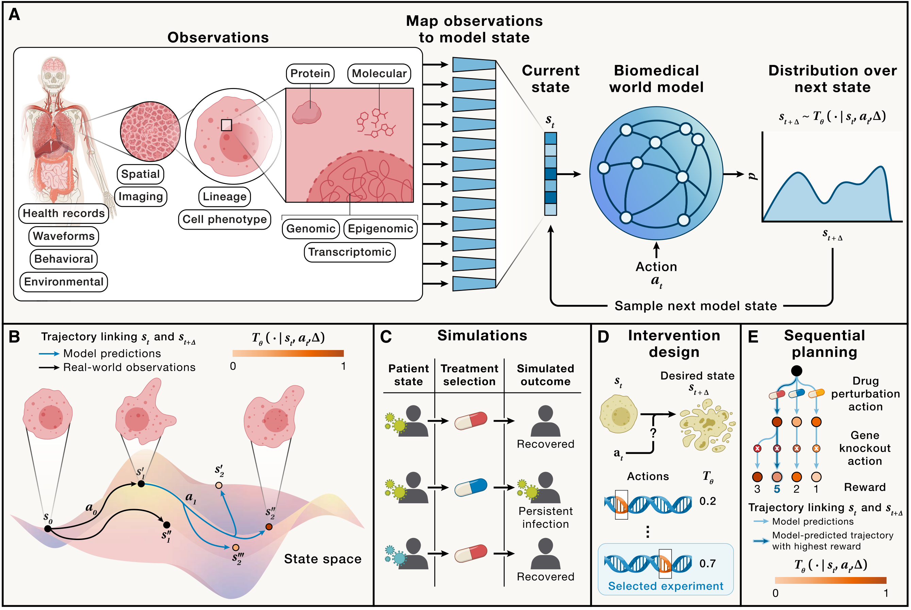
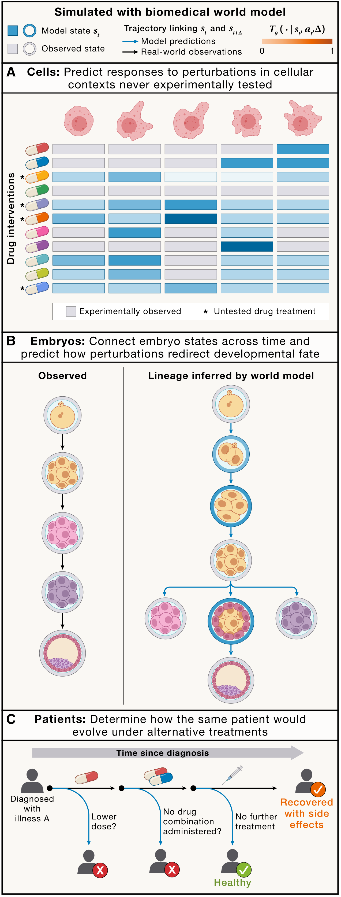
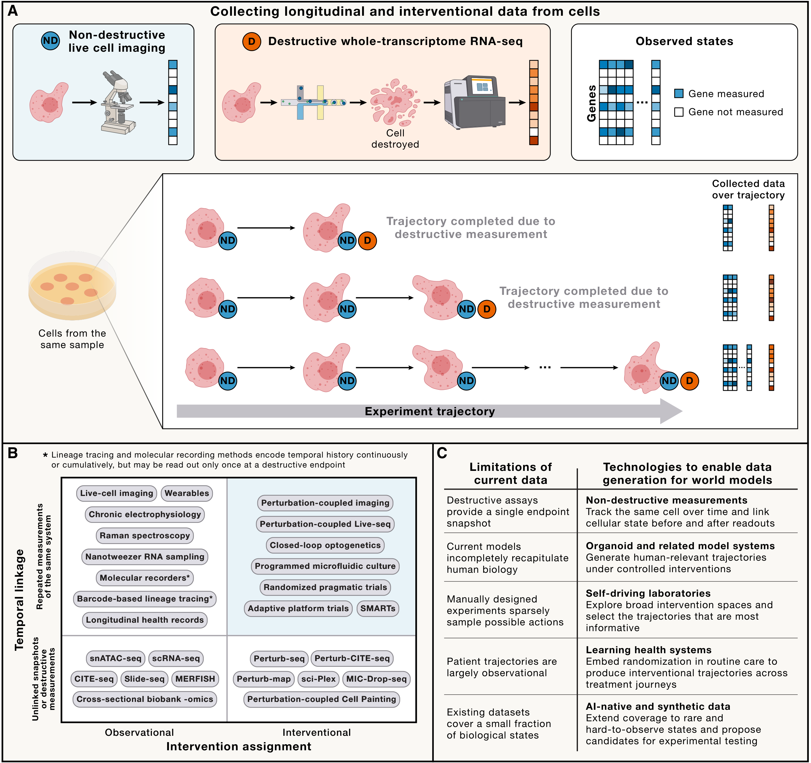
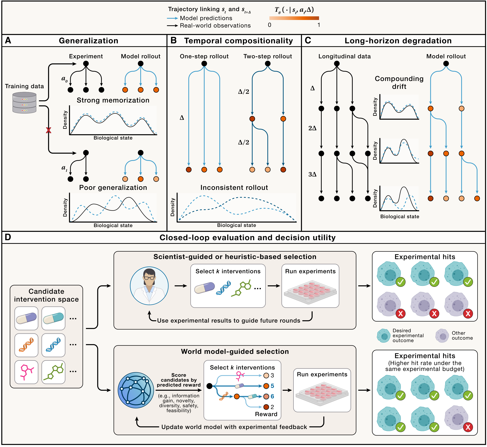

标题：生物医学世界模型的干预模拟与评估

发表：Cell (2026)

类型：review

citekey：4245851aa3

## 十行速览

1. 这篇 Perspective 综合文献并提出研究议程，讨论如何在可实验覆盖有限的干预空间中预测生物系统的响应（PDF 第 1–2、5 页）。
2. 作者将世界模型界定为能够生成动作条件下的未来状态分布并继续模拟的系统，模型动作不自动等于现实干预的因果效应（Fig. 1，PDF 第 3–4 页）。
3. 基础模型、机制模型、数字孪生和代理可与世界模型相交，但名称或生成能力不等于满足其定义（PDF 第 4–5 页）。
4. 细胞、胚胎和患者案例分别面对扰动背景稀疏、单细胞时间对应缺失和医疗记录混杂的问题（Fig. 2，PDF 第 5–7 页）。
5. 作者认为干预、观察及纵向数据互补，提出非破坏测量、类器官、自动实验室和学习型医疗系统等数据路径（Fig. 3，PDF 第 7–9 页）。
6. 预训练、多模态与结构化动作可帮助表示和泛化，但不能单凭模型架构识别因果效应或单细胞轨迹（PDF 第 10–11 页）。
7. 作者转述若干扰动预测研究称复杂模型在相关比较条件下常未超过简单基线，且长程模拟存在误差累积（PDF 第 5、12、14 页，引文 [89–93]）。
8. 作者建议以严格留出、简单基线、校准与分布指标、时间一致性和长程退化共同评价预测（Fig. 4A–C，PDF 第 12–15 页）。
9. 前瞻验证和匹配预算的闭环实验用于检验决策效用，模拟、干预设计和多步规划仍以因果有效性为条件（Fig. 4D，PDF 第 15–16 页）。
10. 已读 scDFM 笔记聚焦非配对细胞群体的扰动预测，不能据此认定多步世界模型能力；相关原研究未重新核验，基线范围与闭环收益仍待查（与已读的关系、待查）。

---

## PDF 与来源

- Ayush Noori, Nic Fishman, Ada Fang, Lukas Fesser, and Marinka Zitnik, “World models for biomedicine,” *Cell* 189, 5845–5869 (2026), https://doi.org/10.1016/j.cell.2026.08.032。
- 阅读依据：用户提供的出版版全文 PDF，共 25 页；正文、Box、声明至 PDF 第 16 页，参考文献从第 16 页延续至第 25 页。本文为 Perspective，没有独立的 Methods／实验结果主表。
- 主图：Fig. 1、2、3、4 分别位于 PDF 第 2、6、8、13 页（刊物页 5846、5850、5852、5857）。图片从对应页面直接裁出，未重画、重排或添加标记；图片路径相对于本阅读稿，嵌入仓库根 README 时需改写为仓库根路径；版权与许可见文末。
- 核验范围：逐页读过本 Perspective 的全部正文和四张图，并检查文内引用编号和部分参考文献条目；**未取得或独立核验所引原始研究**。下文文献结论除非另有说明，均是这篇 Perspective 的转述；示意图不是新实验。

## 第 1 段 研究问题与范围

**问题与目标。** 可行的基因扰动、剂量、给药时序、组合和生物背景远多于能够逐一实验的情况；作者想讨论能否利用模型在实验前比较干预结果，并为后续实验选择提供依据（PDF 第 1–2 页）。引言援引研究估计人类二元蛋白互作图谱的已知覆盖约为 2%–11%，以及最大组合扰动筛选对名义上两两蛋白编码基因空间的覆盖约为 2%；这是文章引述的不同原研究口径，不是此文测得的总体覆盖率，也不代表被引原文已核验（PDF 第 1 页，引文 [3, 5]）。

**文章实际做了什么。** 作者将文献和方法按定义与相邻概念、数据与尺度案例、训练与动态建模、评测，以及可能的应用顺序组织；细胞、胚胎和患者是有意选择的代表性案例，而非穷尽所有尺度（PDF 第 2、5、9–16 页）。本文兼有叙述性综述和作者提出的概念、评价、研究议程，不是新模型论文，也不提供该 Perspective 自己的前瞻性基准结果。原文未报告系统检索数据库、检索式、截止日期、纳排筛选、偏倚评估或 Meta 分析；因此不能声称其完整代表领域文献。

## 第 2 段 概念界定与文献组织

### 作者的定义：状态、动作和可继续的分支

作者按功能而非某种架构定义 biomedical world model：它要能对**生物系统在不同动作下如何演化给出状态分布**，并能把生成的状态作为后续模拟的起点，由此生成动作条件下可延展、可分支的轨迹（PDF 第 3–4 页，Fig. 1）。这是本文工作定义，不是这里已经核实的全领域共识。作者同时规定：**action** 是模型中可指定的输入；**intervention** 是现实中施加到生物系统的操作。把动作作为条件并不自动使预测等于真实干预的因果效应（PDF 第 3–4 页）。

Fig. 1 从上到下先看 A 再看 B–E：A 把病历、成像和组学等部分观测映射为当前模型状态，再结合给定动作采样下一状态，并将其送回模型；B 将这种更新串成分支轨迹；C 比较同一初始状态下的不同动作或不同初始状态下的同一动作；D 给定目标状态反向搜索动作；E 搜索多步动作序列。图中药物结果、概率和奖励是功能示意，不是新实验或已验证的临床决策（Fig. 1A–E，PDF 第 2 页）。

Figure 1. Biomedical world models simulate action-conditioned biological trajectories 
(A) A biomedical world model integrates observations across modalities to construct a representation of the current biological state, $s_t$. Given this state and an action $a_t$, the model predicts a distribution over possible next states, $s_{t+Δ} ∼ T_θ(·|s_t; a_t; Δ)$. (B) Repeated application of action-conditioned transitions generates trajectories through the state space of a cellular world model. (C) In simulation, alternative actions can be applied to the same initial state, and the same action can be evaluated across different initial states to compare predicted outcomes. (D) In intervention design, the model can be searched in reverse: given a current state and a desired future state, candidate actions are evaluated according to their predicted ability to induce that state. (E) In sequential planning, predicted states are used as starting points for future simulation, allowing estimation of long-horizon evolution.

中文：A 先把部分观测变成可继续使用的模型状态，再在动作条件下产生下一状态的分布。B–E 依次说明滚动、反事实比较、目标导向设计及多步规划的设想，而非新实验结果。能画出预测分支不等于分支已经通过现实干预检验。

出处：Noori et al., *Cell* 189 (2026), Fig. 1；© 2026 The Author(s)，Published by Elsevier Inc.，CC BY 4.0；由原 PDF 裁切，未改动图像内容。

**原文符号与读法。** Fig. 1A 的转移可写成 $s_{t+Δ} \sim T_θ(\cdot\mid s_t,a_t,Δ)$；这是条件分布，不是说下一状态唯一确定（PDF 第 2–4 页）。

| 符号 | 原文含义 | 类型／形状 |
| --- | --- | --- |
| $t, Δ$ | 当前时间、经过的时间 | 时间标量；单位由任务确定 |
| $x_t$ | 系统实际生物状态，通常仅部分可观测 | 生物状态；维度未规定 |
| $o_t, o_{≤t}$ | 当前观测、截至当前的观测历史 | 观测或序列；维度未规定 |
| $p(\cdot\mid x_t)$ | 给定真实状态时观测的随机机制 | 条件分布 |
| $a_t, a_{≤t}$ | 当前可指定动作、动作历史 | 动作表示或序列；维度未规定 |
| $c$ | 可用于构造状态的上下文 | 上下文；维度未规定 |
| $s_t, s_{t+Δ}$ | 模型携带的当前状态及经过时间后的状态 | 状态表示；可含历史、token、显式变量或潜变量，维度未规定 |
| $E, D$ | 可选的状态编码器和观测解码器 | 映射；作者明确说二者并非定义所必需 |
| $T_θ$ | 动作条件的状态转移 | 参数化条件分布；形状依实现而定 |
| $θ$ | 转移模型的参数 | 参数集合；维度未规定 |
| $t_k, k$ | 离散轨迹中的时间与步骤索引 | 时间标量、整数索引 |

作者要求状态具备**预测充分性**：保留已有历史中对未来动作条件结果有用的信息，而不是必须重建未观测的每个生物学细节；该要求不意味着隐藏状态已被唯一识别（PDF 第 4、10、14 页，Box 2）。这篇 Perspective 没有提出一个训练损失或消融表；具体损失项及其移除效果**原文未报告**。

### 边界：相邻模型何时才属于作者口径

| 类型 | 与本文定义的关系 | 不能自动推出什么 |
| --- | --- | --- |
| 监督／生成模型 | 预测标签或生成条件样本不必表示动作条件的状态转移；若输入、输出都是可续推的宽状态且由动作控制，才可能满足作者口径（PDF 第 4 页） | 生成逼真结果不等于可做连续干预模拟 |
| 基础模型 | 大规模预训练得到的表征可以充当状态或动作编码器；只有满足可指定动作与可继续状态转移等功能，才可按本文口径称世界模型（PDF 第 4–5 页） | 多模态、参数规模或生成能力本身不够 |
| 机制模型 | 可从指定状态受干预并向前传播的方程或仿真也可符合功能定义；本文重点讨论学习式与可结合机制的混合模型（PDF 第 5 页） | 世界模型不必全是神经网络，也不保证只凭观测数据识别因果机制 |
| 数字孪生 | 数字孪生强调特定实体的虚拟副本；世界模型可表达人群或一般动态。只镜像现状、不能预测干预后状态的孪生不满足本文口径（PDF 第 5 页） | 两类名称不等价，也不是互斥 |
| 代理及虚拟实验室 | 代理可提议行动、调用工具；实验室环境表示操作与实验状态，可与世界模型结合（PDF 第 5 页） | 会自动执行流程不等于能准确预测生物干预 |

### 三类案例如何组织

Fig. 2 从 A 的细胞背景×干预矩阵，转到 B 的胚胎发育状态及可能谱系，再到 C 的同一患者不同治疗分支。灰色表示已观察、蓝色表示模型状态或预测，星号标示图示中的未测试处理；它是一种拟议能力的示意，而非该文在这些系统中完成反事实验证（Fig. 2，PDF 第 5–7 页）。

Figure 2. World models enable action-conditioned reasoning across cells, embryos, and patients 
(A) Cellular world models can predict responses for perturbation-context combinations that have not been experimentally measured. (B) Embryonic world models can connect developmental states across time and infer how perturbations redirect lineage and fate trajectories. (C) Patient world models can simulate alternative treatment trajectories for the same patient and compare their predicted outcomes.

中文：图按细胞、胚胎、患者展示作者设想中的不同查询方式。蓝色分支及缺失矩阵格代表模型预测，不是已经观察到的个体反事实或谱系真值。

出处：Noori et al., *Cell* 189 (2026), Fig. 2；© 2026 The Author(s)，Published by Elsevier Inc.，CC BY 4.0；由原 PDF 裁切，未改动图像内容。

| 案例／文献线索 | 文章组织的可用信息 | 仍缺的识别条件 |
| --- | --- | --- |
| 细胞：GEARS [82]、CellFlow [83]、STATE [84]；Perturb-seq [72] 与 Tahoe-100M [73] | 在实验分配扰动覆盖到的背景中，细胞群体的转录反应可提供群体层面的因果信息 | 测量通常破坏细胞，缺同一细胞的前后对应；单步输出必须还能作为后续输入，才符合文中可迭代定义；新背景泛化是待检验问题（PDF 第 5–6 页） |
| 胚胎：Monocle／Palantir、RNA velocity、Waddington-OT [103–110] | 发育图谱、空间组学、谱系记录与成像各自约束自然发育过程 | 不同时间的破坏性快照不能唯一确定单细胞转移；谱系重建依赖假设，正常发育拟合不等于能预测干预（PDF 第 6–7 页，引文 [77, 111]） |
| 患者：Foresight [125]、Delphi-2M [78] 等 | 电子病历可链接同一患者的长期就诊、诊断和治疗序列 | 治疗分配非随机，缺失严重程度、就诊可及性与编码过程可能混杂；预测病历序列可能学到医疗服务行为而非干预后的真实病程（PDF 第 7 页） |

## 第 3 段 综合判断与依据

### 结论一：现有数据各有信息，不能互相冒充

作者把动作分配和时间链接作为互补维度。Fig. 3A 对比重复非破坏测量与终点破坏性测量；B 将代表性技术按**观察／干预**和**无链接快照／同一系统重复测量**排列，并注明谱系追踪、分子记录可以连续积累历史但只在破坏性终点读出；C 从现有数据限制指向非破坏测量、类器官、自动实验室、学习型医疗系统和 AI-native／合成数据等可能路径（Fig. 3，PDF 第 8–9 页）。技术在示意坐标中的位置不等于量化排名，也不证明它们目前已同时满足全部要求。

Figure 3. Data for biomedical world models 
(A) Repeated non-destructive measurements can track biological systems over time, whereas destructive assays provide richer endpoint measurements but terminate trajectories. (B) Representative biomedical data sources and measurement technologies vary in intervention assignment and temporal linkage. (C) Emerging technologies and experimental systems could address limitations in longitudinal measurement, human relevance, intervention coverage, causal patient trajectories, and biological state coverage.

中文：A 对照破坏性深度终点与同一系统的连续观测，B 把数据按干预分配和时间链接摆到同一坐标，C 再把缺口对应到可能的数据生成路径。图不是技术实测排行榜，图中的位置也不能替代具体实验条件。

出处：Noori et al., *Cell* 189 (2026), Fig. 3；© 2026 The Author(s)，Published by Elsevier Inc.，CC BY 4.0；由原 PDF 裁切，未改动图像内容。

- **文章转述的实验／观测材料：** 扰动筛选能在所覆盖状态和动作内提供实验分配信息，但覆盖有限；发育快照可描绘自然变化，却常缺跨时间对应与干预；患者病历可链接长期过程，但治疗选择与观测过程受混杂影响（PDF 第 5–7 页，引文 [72, 73, 75–80]）。
- **作者综合：** 宽覆盖观察数据、受控干预和纵向链接提供不同信息，应结合而非将其中一种视为全部。观察动态能否迁移到干预动态本身仍难验证；未被数据识别的干预效应仍是外推（PDF 第 7、11 页）。
- **作者提出的数据议程：** 原文讨论 Live-seq、分子记录、类器官、自动化闭环与嵌入常规医疗的随机试验等；非破坏技术目前仍需面对吞吐量与分子深度限制，类器官不等同于人体，目标试验模拟也可能受到未测混杂和 positivity 违背影响。合成轨迹继承生成器的假设和偏差，不能当作独立实验证据（PDF 第 7–9 页）。

### 结论二：表示能力、因果可识别性和多步可靠性是不同问题

- **表示与动作。** 作者转述 scGPT [54] 和 Chreode [197] 等先从更广观察数据预训练表征、再用于扰动或转移任务的路线；多模态共同观测、桥接或生物知识可帮助连接表征，但无任何链接信息时，跨模态对应不能凭生成模型自动确定。动作应尽可能编码靶点、结构、剂量、时长与顺序；结构有助于信息共享，不独自识别未测动作的因果效应（PDF 第 10–11 页）。
- **识别与轨迹单位。** 观察性临床数据可能有未测混杂；破坏性细胞快照可能兼容多种单细胞路径。可测量或用谱系／动力学假设约束对应；如果个体对应未识别，也可以把群体分布作为状态，但不能将群体转移改写成已知的单细胞轨迹（PDF 第 11 页）。
- **长时程和跨尺度。** 作者比较序列模型与显式潜状态转移、概率预测与点预测，并讨论相互作用的细胞、增殖死亡以及空间组织。单步误差会在自回归 rollout 中累积；直接多时距预测和连续时间模型是候选路线，不是已解决证明。细胞与组织之间的聚合／反馈和多个时间尺度的协调仍是开放问题（PDF 第 11–12 页，Box 2）。

### 结论三：预测有用不等于因果正确或决策有用

作者转述细胞扰动预测中的比较研究称，一些深度模型在相关测试条件下未超过简单线性、平均或对照基线（PDF 第 5、14 页，引文 [89–93]）。这是来自多项被引研究的综合表述，不是对所有世界模型、所有任务的统一实测排序。另一条转述指出，平均表达差可能由不同扰动共有的系统偏差解释，故看似准确的均值预测未必识别了特定扰动效应（PDF 第 13–14 页，引文 [92]）。这些原研究的数据划分、基线预算、实现与反例均**未独立核验**。

## 第 4 段 评价规约与研究议程

作者提出的评估层次是建议，而非该文已经运行过的统一基准。Fig. 4A 比较已见条件的记忆与留出状态／动作泛化；B 比较直接一次跨越与较短转移的组合；C 将自由滚动随时长增长的分布漂移与纵向观测对照；D 在相同目标和实验预算下比较科学家／启发式与世界模型选实验的闭环。D 的命中数量和评分只是示意，不能引为世界模型已获得更高命中率的证据（Fig. 4，PDF 第 13–15 页）。

Figure 4. Evaluation of biomedical world models 
(A) Generalization. Performance on observed states and actions can reflect memorization; evaluation should test held-out states, actions, and state-action combinations. (B) Temporal compositionality. Predictions over an interval "Δ" should agree with predictions obtained by composing transitions over shorter intervals. (C) Long-horizon degradation. Errors can compound when predicted states are reused for subsequent simulation, causing increasing distributional drift from longitudinal observations. (D) Closed-loop evaluation and decision utility. World-model-guided experiment selection can be compared with scientist-guided or heuristic selection under the same objective and experimental budget.

中文：A 测未见状态与动作，B 测不同时间粒度下的转移组合是否一致，C 测反复使用预测状态后的退化，D 比较同预算闭环中的决策结果。这些是评价设计示意，不能证明模型已经通过各项评价。

出处：Noori et al., *Cell* 189 (2026), Fig. 4；© 2026 The Author(s)，Published by Elsevier Inc.，CC BY 4.0；由原 PDF 裁切，未改动图像内容。

### 评价对象与对照

1. **泛化和泄漏：** 分别留出新状态、新动作、见过状态与动作的新组合、时间跨度或干预序列；按供者、谱系、患者、机构、地域或时间等关联结构划分，避免把同一轨迹的近邻同时放入训练与测试。基因家族／通路或化合物骨架划分能提出更严格的问题，但具体划分仍需与使用场景一致（PDF 第 12–13 页，引文 [93, 249–251]）。
2. **基线与组件：** 对照原状态保持、忽略干预的自然动态、忽略初始状态的平均反应、加性／线性、近邻或插值；分别消融动作和初始状态，检验模型到底利用什么。原文对 stability 和 natural dynamics 的文字表述存在重叠，未给出可直接复现的统一实现（PDF 第 14 页）。
3. **生物知识和表示：** 用已知敲除、救援、谱系不可能事件、亚群治疗反应等进行挑战测试；这些测试本身不证明完整反事实轨迹。冻结状态编码器，对比仅给 $s_t$ 与同时给 $s_t$ 和观测历史 $o_{≤t}$ 的匹配预测器；若加入历史后留出预测改善，状态遗漏了可用的预测信息（PDF 第 14 页）。
4. **长时程与一致性：** 自由滚动时比较端点误差、分布漂移、多样性损失和约束违背；也比较直接预测和分段预测的状态分布，例如作者举出的直接 48 小时预测与两段 24 小时组合，这是测试设计示例而非实测结果（PDF 第 14–15 页）。跨模态／跨尺度的状态分布或聚合结果也应一致，同时允许信息少的输入具有更大不确定性（PDF 第 15 页）。
5. **前瞻与决策：** 在实验前预先指定状态、干预、预测分布与评价；文章建议将模型冻结后与正在进行的随机临床试验并行比较，并依据入组时可得信息产生各处理的预测。评价规划时，与单步、贪心、贝叶斯优化、专家启发式等在同目标及实验预算下比较，并记录收益和安全／可行性违背（PDF 第 15 页）。

### 指标说明：互补而非单一排名

下表是对原文所列评价方向的计算口径解释；论文未为本 Perspective 规定统一数据集、核函数、距离、阈值或实施公式，实际复现须先明确这些选择（PDF 第 13–15 页）。

| 指标／检验 | 衡量和一般计算 | 会遮蔽什么；由什么补充 |
| --- | --- | --- |
| 基因逐项均值、扰动前后均值差、倍数变化、方差／协方差 | 在预测与实测群体上分别求相应统计量并比较 | 均值可被共同的平均扰动效应解释、忽略多峰及异质性；以分布距离和扰动身份排序补充 |
| 最大均值差异（MMD） | 在选定核的特征空间比较预测与实测样本的均值嵌入 | 依赖核与样本；总体分布接近不保证单细胞对应或干预因果有效；配合谱系／干预实验 |
| Wasserstein 距离 | 在选定状态间代价下比较两组分布的最小运输代价 | 依赖状态距离和抽样，分布匹配也不能单独验证单元对应或规划收益；配合真实轨迹与闭环决策 |
| 扰动身份排序 | 将预测反应与候选扰动反应比较，检查其自身扰动的排序 | 排名依赖候选集合与相似度，只测相对区分不保证绝对幅度和概率校准；配合幅度与不确定性 |
| 校准与区间覆盖 | 将预测概率与经验频率对照，或统计预测区间包含实测值的比例 | 总体覆盖不保证各亚群或各干预均校准，宽区间也可能获得覆盖；按背景分层并同时报告准确度与区间宽度 |
| 决策效用 | 在相同目标和预算下评估命中率、富集、信息增益、遗憾以及安全或可行性违规 | 某项命中率不揭示代价、长时程风险或校准；配合约束、预算与多轮实验结果 |

作者指出，上述转录组指标不能直接覆盖胚胎空间组织、谱系、形态和临床事件时间；这些对象需要各自适配的评价（PDF 第 14 页）。论文没有为本 Perspective 自身报告新湿实验的样本量、独立重复、检验、离散度、p 值或多重比较；不能把被引研究的这些信息猜填到本文。

## 第 5 段 覆盖边界与使用

- **可带走的框架：** 用“当前状态是否足以续推—动作是否可指定—下一状态是否为分布—能否滚动—数据是否支持干预识别—是否有前瞻与决策评价”逐项定位模型能力。细胞／胚胎／患者的比较是组织工具，不是完整的尺度清单（PDF 第 3–7、12–15 页）。
- **作者的应用设想：** 在因果有效性被建立的条件下，可模拟未施加的干预、根据目标设计动作、规划多步序列；但优化可能利用模型误差，长程模拟可能漂移，作者建议结合不确定性、安全约束和观测后重新规划（PDF 第 15–16 页）。这些是条件化议程，不是已证实通用能力。
- **来源限制：** 没有系统检索流程、定量综合、统一实测基准或对所有现有模型的穷尽评估；这里不能推断整个领域缺乏某类研究。本文作者提出的功能定义与建议，不等于已获领域共识，也不能据单篇判定开创性。
- **版面勘误线索：** PDF 第 7 页正文提到 Fig. 3D，但实际 Fig. 3 与图注只有 A–C；PDF 第 15 页的前瞻验证引用 Fig. 4A、决策效用引用 Fig. 4B，与图注中 A=泛化、B=时间组合、D=闭环／决策的分图说明不一致。本文按实际图形及其图注解释，不替原文改号。

## 与已读的关系

`e1e2b1aea2`（scDFM）｜可对照的细胞扰动预测｜已读笔记 `notes/e1e2b1aea2.md` 描述基于非配对数据预测和对齐扰动后细胞群体分布；本文 Perspective 讨论动作条件状态的续推与多步评价，不能据该笔记认定 scDFM 具备多步世界模型能力。本次只核对这一条已读笔记，scDFM 原论文未重新核验，亦未检索云端或全网。

## 待查

**追溯原始材料：**

1. 对照 [89] Ahlmann-Eltze et al., “Deep-learning-based gene perturbation effect prediction does not yet outperform simple linear baselines,” *Nature Methods* (2025), https://doi.org/10.1038/s41592-025-02772-6，检查任务划分、数据覆盖及各基线实现，确认线性基线结论的适用范围。
2. 对照 [92] Viñas Torné et al., “Systema: a framework for evaluating genetic perturbation response prediction beyond systematic variation,” *Nature Biotechnology* (2026), https://doi.org/10.1038/s41587-025-02777-8，核对共同扰动效应与扰动特异性指标的具体计算、对照和数据范围。
3. 对照 [77] Weinreb et al., “Fundamental limits on dynamic inference from single-cell snapshots,” *PNAS* (2018), https://doi.org/10.1073/pnas.1714723115 及 [109] Schiebinger et al., “Optimal-Transport Analysis of Single-Cell Gene Expression Identifies Developmental Trajectories in Reprogramming,” *Cell* (2019), https://doi.org/10.1016/j.cell.2019.01.006，区分可识别性结论与最优传输耦合所需假设。

**缺失且会改变结论的量：**

1. 原文未汇总各案例在严格留出新背景、动作及其组合下的可比效应量、置信区间与统一基线预算；因此不能据本文量化当前方法的跨场景优劣。
2. 原文未给出对同一模型在多步预测、前瞻实验与匹配预算闭环中的联合实测成绩或安全失败率；因此不能据本文量化多步规划的真实收益或风险。

## 定位素材

状态：待回顾 
原文：World models for biomedicine · Cell 2026 · DOI 10.1016/j.cell.2026.08.032 
图注：Fig. 1 —— 多模态观测、可指定动作与状态分布共同构成可滚动的干预模拟框架。 
图注：Fig. 2 —— 细胞、胚胎和患者案例分别展示未测反应、发育分支及替代治疗轨迹的拟议查询。 
图注：Fig. 3 —— 用干预分配与时间链接比较数据来源，并列出现有缺口及可能的数据生成方法。 
图注：Fig. 4 —— 从留出泛化、时间组合、长期退化和同预算闭环四方面检验世界模型。 
能力变化：作者设想从单点预测走向可干预、可迭代模拟与规划；本文提供定义、文献综合及评价建议，未提供验证整套能力的新实验。 
比较口径：跨状态、动作、组合和时程留出；配对简单基线、概率／分布指标、前瞻实验及同目标同预算决策比较（PDF 第 12–15 页）。 
课题组事实：通讯作者 Marinka Zitnik，隶属 Harvard Medical School Department of Biomedical Informatics 等机构；论文正文未给出本 Perspective 的专属模型代码仓库（PDF 第 1 页）。 
前作／跟进线索：作者引用 Ha 与 Schmidhuber [10]、LeCun [37]、GEARS [82]、CellFlow [83]、扰动预测对照 [89–93]；均未在本次独立核验。 
待横向确认：定义及评测建议与其他综述或原研究的重合、分歧、实际采用情况和可泛化范围。

## 图片署名与许可

图像来自 Ayush Noori, Nic Fishman, Ada Fang, Lukas Fesser, and Marinka Zitnik, “World models for biomedicine,” *Cell* 189, 5845–5869 (2026), https://doi.org/10.1016/j.cell.2026.08.032，Fig. 1–4。论文 PDF 首页明确写明 “© 2026 The Author(s). Published by Elsevier Inc.” 及 “This is an open access article under the CC BY license (http://creativecommons.org/licenses/by/4.0/).” 许可链接：[Creative Commons Attribution 4.0 International](https://creativecommons.org/licenses/by/4.0/)。本稿仅从原 PDF 裁切图框并渲染为 PNG，未重画、改变内容或叠加标记；每张图旁保留作者、原文、图号、许可及裁切说明。此核验依据所给 PDF 的声明，不替其他可能受单独权利限制的材料作额外授权保证。
